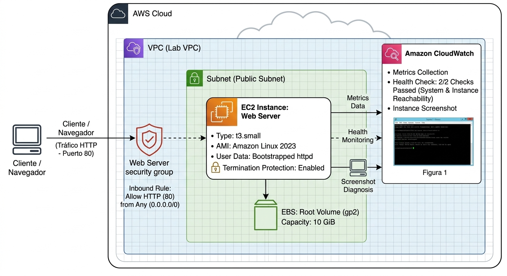
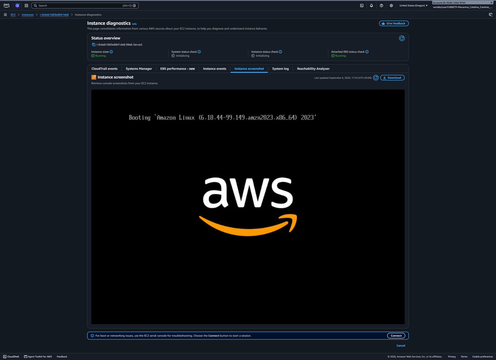
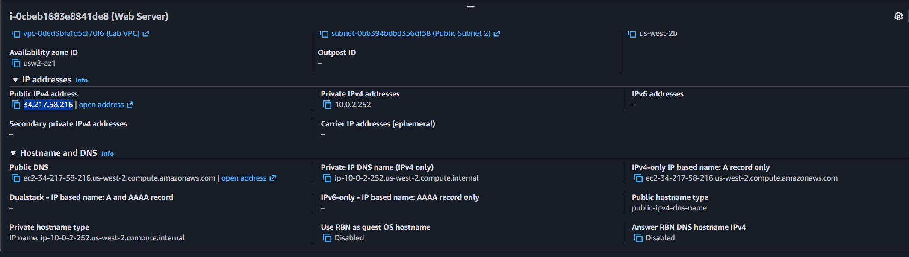
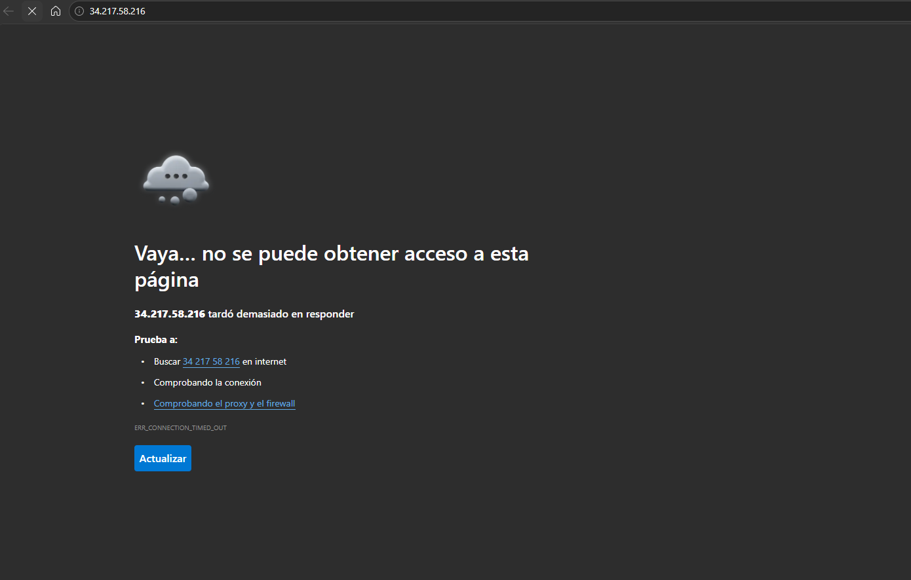
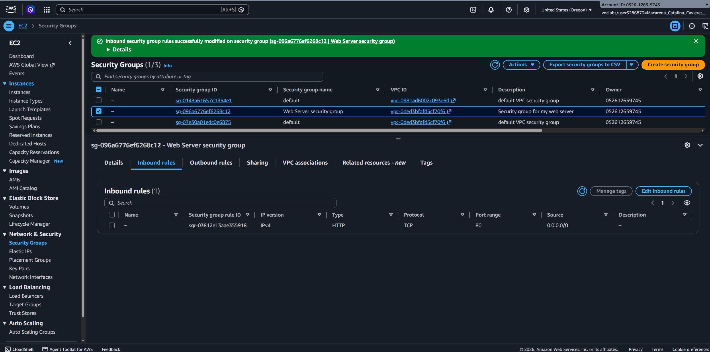
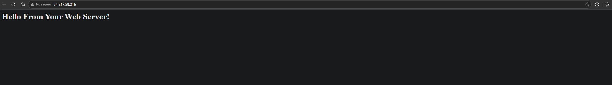
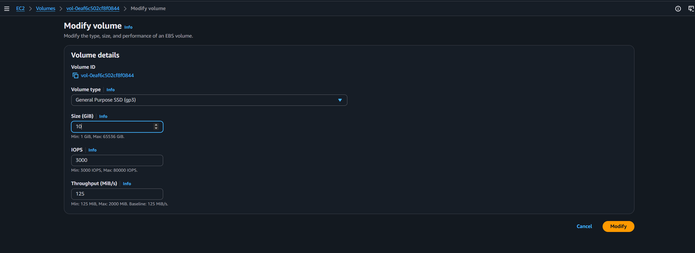
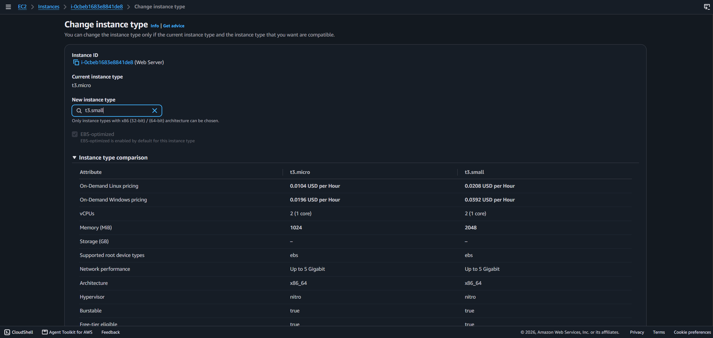
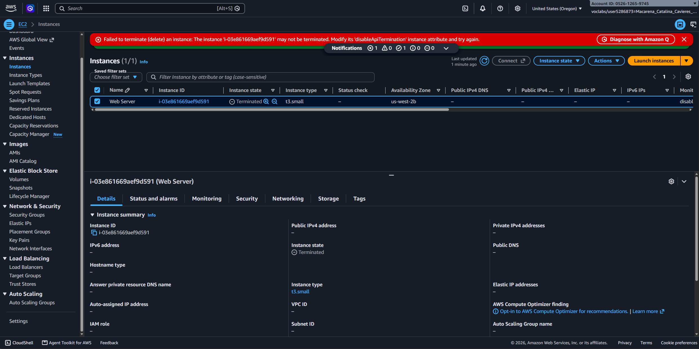

# Lab 11 Lanzamiento, Modificación y Supervisión de una Instancia Amazon EC2


## Descripción General

En este laboratorio implementamos y gestionamos un servidor web Apache en **Amazon EC2** mediante la Consola de Administración de AWS, configuramos la protección de terminación, personalizamos las reglas de red mediante Grupos de Seguridad (Security Groups) y analizamos la supervisión del sistema con Amazon CloudWatch.

## Objetivos del Laboratorio

- Automatizar el aprovisionamiento de un servidor web Apache (`httpd`) utilizando scripts de inicialización en `User Data`.
- Configurar la seguridad perimetral de la red mediante la creación y modificación de reglas de entrada en los Grupos de Seguridad (Security Groups).
- Realizar operaciones de escalado vertical modificando el tipo de instancia EC2 y expandiendo la capacidad de almacenamiento en volúmenes EBS.
- Aplicar mecanismos de protección contra eliminación accidental activando la opción de _Termination Protection_.
- Diagnosticar el estado de la instancia mediante las métricas de CloudWatch y la herramienta visual _Get Instance Screenshot_.

## Arquitectura y Flujo de Trabajo

La siguiente arquitectura representa la solución implementada para el servidor web en Amazon EC2, incorporando los cambios de escalado, seguridad perimetral y supervisión:

<p style="margin-bottom: 0px;">
  
</p>

_Figura: Topología de la infraestructura con instancia EC2 escalada (`t3.small`), volumen EBS redimensionado, grupo de seguridad configurado y monitoreo activo con CloudWatch[cite: 4]._

### Explicación de la Arquitectura y Componentes:

- **AWS Cloud / VPC (`Lab VPC`):** Entorno de red aislado que contiene todos los recursos desplegados para el funcionamiento del servidor[cite: 4].
- **Security Group (`Web Server security group`):** Firewall virtual a nivel de instancia que protege el servidor, configurado con una regla de entrada (Inbound Rule) explícita para permitir el tráfico **HTTP (Puerto 80)** desde cualquier origen (`0.0.0.0/0`)[cite: 4].
- **Amazon EC2 Instance (`Web Server`):** Servidor virtual configurado con el sistema operativo **Amazon Linux 2023** y el servicio web Apache (`httpd`) automatizado mediante scripts de _User Data_[cite: 4]. En este laboratorio se escaló de `t3.micro` a `t3.small`[cite: 4].
- **Amazon EBS (Root Volume):** Almacenamiento persistente en bloque vinculado al servidor, cuyo tamaño raíz fue expandido de 8 GiB a **10 GiB**[cite: 4].
- **Amazon CloudWatch & Diagnóstico:** Servicio de supervisión integrado que recopila métricas de rendimiento, valida el estado operativo (_Health Check 2/2 Checks Passed_) y permite realizar diagnósticos visuales mediante capturas de consola (_Instance Screenshot_)[cite: 4].

## Tarea 1: Lanzamiento de la Instancia EC2 con User Data

Se configuró una instancia t3.micro con el sistema operativo Amazon Linux 2023, habilitando la Protección de Terminación en los detalles avanzados y eliminando la regla SSH para minimizar la superficie de ataque.

Se incluyó el siguiente script en User Data para automatizar el despliegue del servidor web:

```bash
#!/bin/bash
yum -y install httpd
systemctl enable httpd
systemctl start httpd
echo '<html><h1>Hello From Your Web Server!</h1></html>' > /var/www/html/index.html

```

## Tarea 2: Monitoreo y Captura de Pantalla

- **Health Checks:** Se verificó el paso exitoso de las comprobaciones 2/2 checks passed (System & Instance Reachability).

- **CloudWatch:** Se inspeccionaron las métricas de rendimiento en tiempo real.

- **Get Instance Screenshot:** Se utilizó la herramienta de diagnóstico de consola de AWS para visualizar la pantalla física virtual del servidor sin necesidad de conectarse por SSH/RDP.

<p style="margin-bottom: 0px;">
  
</p>

_Figura 1: Verificación de estado de la consola virtual mediante Instance Screenshot._

## Tarea 3: Configuración de Security Groups y Acceso Web

Al intentar acceder a la IP pública en el navegador, la conexión falló. Esto ocurrió debido a que la instancia carecía de reglas entrantes para el tráfico web.

<p style="margin-bottom: 0px;">
  
</p>

_Figura 2: Obtener la IP pública de la instancia._

<p style="margin-bottom: 0px;">
  
</p>

_Figura 3: Acceso web fallido._

**Solución:** Se editó el Web Server security group agregando una regla entrante (Inbound Rule):

- Tipo: HTTP
- Puerto: 80
- Origen: `Anywhere-IPv4 (0.0.0.0/0)`

<p style="margin-bottom: 0px;">
  
</p>

_Figura 4: Modificación del Security Group._

<p style="margin-bottom: 0px;">
  
</p>

_Figura 5: Carga exitosa del mensaje "Hello From Your Web Server!"._

## Tarea 4: Escalado Vertical (Tipo de Instancia y EBS Volume)

- **Detención:** Se detuvo la instancia (Stopped) para realizar cambios de hardware.

- **Cambio de Tipo:** Se modificó la capacidad de la instancia escalando de `t3.micro` a `t3.small` (duplicando la memoria RAM).

<p style="margin-bottom: 0px;">
  
</p>

_Figura 6: Cambio del tipo de instancia a t3.small._

- **Redimensionamiento EBS:** En la sección de Elastic Block Store, se modificó el volumen raíz aumentando su capacidad de 8 GiB a 10 GiB.

<p style="margin-bottom: 0px;">
  
</p>

_Figura 7: Cambio del volumen de la instancia._

- **Reinicio:** Se volvió a iniciar la instancia con los nuevos recursos asignados.

## Tarea 5: Validación de Protección de Terminación y Limpieza

- **Prueba de Fallo:** Se intentó terminar la instancia directamente desde el menú, generando un error intencional debido a la marca de Protección de Terminación activada en la Tarea 1.

- **Desactivación y Eliminación:** Se deshabilitó manualmente la regla `Change Termination Protection` y se procedió a terminar (Terminate) la instancia exitosamente.

<p style="margin-bottom: 0px;">
  
</p>

_Figura 8: Error al tratar de terminar la instancia._

## Resumen de Recursos y Componentes

| Servicio / Recurso      | Nombre del Componente                  | Descripción y Función Técnica                                                                    |
| :---------------------- | :------------------------------------- | :----------------------------------------------------------------------------------------------- |
| **Amazon EC2**          | `Web Server` (`t3.micro` / `t3.small`) | Instancia de cómputo responsable de alojar y servir el contenido web de prueba.                  |
| **Amazon EBS**          | Volumen raíz (8 GiB a 10 GiB)          | Almacenamiento persistente en bloque vinculado a la instancia de Amazon EC2.                     |
| **AWS Security Groups** | `Web Server security group`            | Firewall virtual a nivel de instancia para controlar el tráfico entrante y saliente (puerto 80). |
| **Amazon CloudWatch**   | Métricas del sistema                   | Herramienta de supervisión para evaluar el estado y rendimiento operativo de los recursos.       |

---

## Conclusiones del Laboratorio

- **Diagnóstico sin SSH:** `Get Instance Screenshot` permite visualizar fallos de arranque o Kernel Panic sin depender de accesos remotos.
- **Comportamiento Stateful:** Los Security Groups actúan como firewalls a nivel de instancia; sin reglas de entrada explícitas para el Puerto 80, el tráfico HTTP es denegado por defecto.
- **Escalabilidad Vertical en AWS:** Los cambios de tipo de instancia requieren detener la máquina, mientras que la expansión de volúmenes EBS se puede gestionar desde el panel del almacenamiento.
- **Prevención de Errores Humanos:** La protección de terminación es un mecanismo indispensable para instancias de producción críticas.
