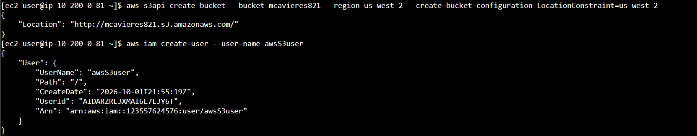
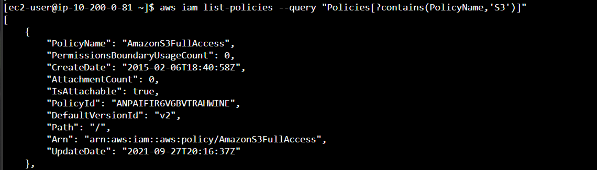
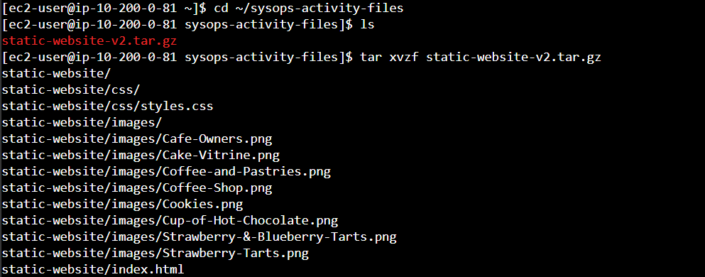
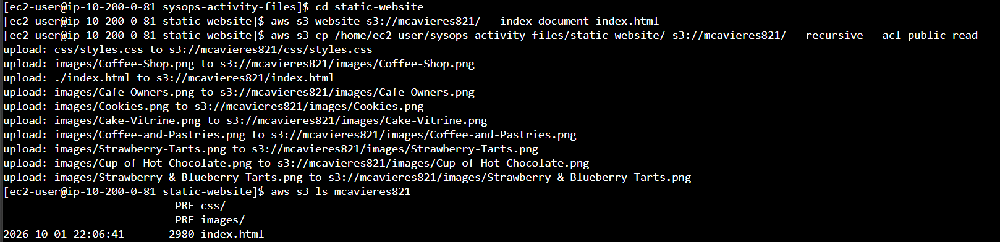
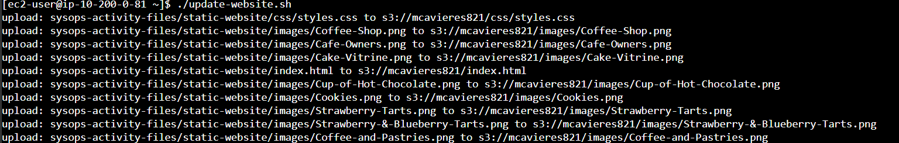
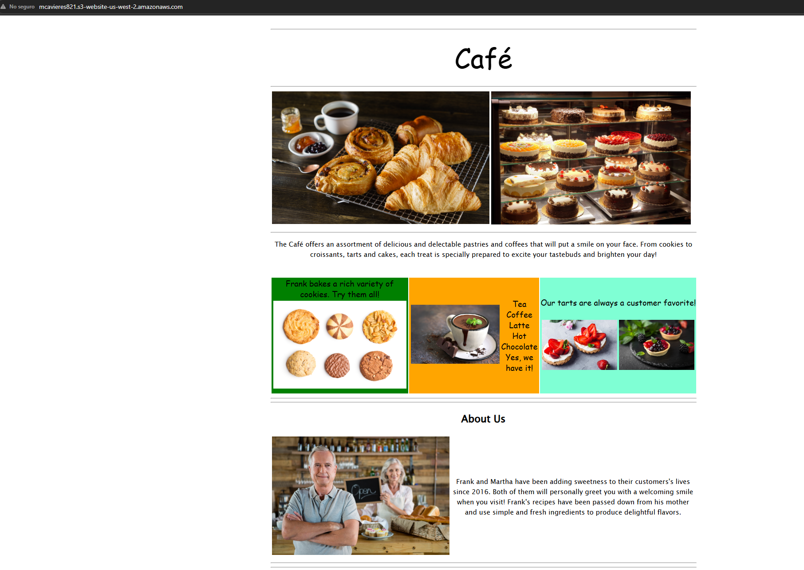
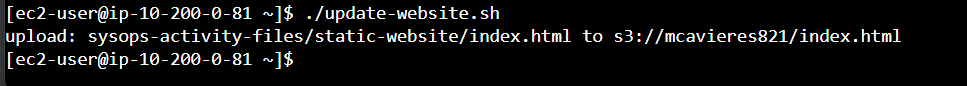

<!-- faltan las imagenes -->

# Lab 170 Creación y Alojamiento de un Sitio Web Estático en Amazon S3 mediante AWS CLI


## Descripción General

En este laboratorio práctico se automatizó el aprovisionamiento y despliegue de un sitio web estático para una cafetería utilizando la **AWS CLI v2** desde una instancia cliente **Amazon EC2**. Durante la actividad se creó un bucket en **Amazon Simple Storage Service (Amazon S3)**, se configuraron permisos de acceso e identidades en **AWS IAM**, se habilitó el alojamiento web público ajustando **ACLs** y bloques de acceso público, y se desarrolló un script en **Bash** para sincronizar cambios locales de forma eficiente mediante la operación `aws s3 sync`.

## Arquitectura del Laboratorio

```text
[Navegador del Usuario] ──(HTTP)──► [Amazon S3 Website Endpoint]
                                              ▲
                                              │ (aws s3 cp / sync)
┌─────────────────────────────────────────────┼───────────────────┐
│ AWS Cloud (LabVPC)                          │                   │
│  ┌──────────────────────────────────────────┴────────────────┐  │
│  │ Amazon EC2 (Linux Host)                                   │  │
│  │  ├── AWS CLI v2                                           │  │
│  │  └── update-website.sh (Bash Script)                      │  │
│  └───────────────────────────────────────────────────────────┘  │
└─────────────────────────────────────────────────────────────────┘
```

## Objetivos del Laboratorio

- Establecer conexión a una instancia Amazon EC2 mediante AWS Systems Manager Session Manager.
- Configurar credenciales y parámetros regionales de la AWS CLI.
- Aprovisionar un bucket en Amazon S3 en una región específica usando `aws s3api`.
- Crear un nuevo usuario en AWS IAM y asignarle la política administrada `AmazonS3FullAccess`.
- Configurar el Bloqueo de Acceso Público y habilitar las ACLs en el bucket de S3.
- Cargar archivos web estáticos (`index.html`, imágenes, CSS) y habilitar Static Website Hosting.
- Desarrollar un script automatizado en Bash comparando los comandos `aws s3 cp` y `aws s3 sync`.

## Tarea 1: Conectarse a la Instancia EC2 mediante SSM

1. Desde la consola del laboratorio, obtener la dirección InstanceSessionUrl.
2. Abrir la sesión en el navegador y cambiar al usuario ec2-user:

```bash
sudo su -l ec2-user
pwd
```

## Tarea 2: Configurar la AWS CLI

1. Ejecutar el comando de configuración interactiva:

```bash
aws configure
```

2. Ingresar las credenciales proporcionadas por el entorno:
   - AWS Access Key ID: `<SU_ACCESS_KEY_ID>`
   - AWS Secret Access Key: `<SU_SECRET_ACCESS_KEY>`
   - Default region name: `us-west-2`
   - Default output format: `json`

## Tarea 3: Crear un Bucket de S3 mediante la AWS CLI

1. Ejecutar el comando de creación definiendo la restricción de localización para `us-west-2`:

```bash
aws s3api create-bucket --bucket mi-bucket-cafeteria-2026 --region us-west-2 --create-bucket-configuration LocationConstraint=us-west-2
```


_Figura 1: Creación del bucket_

## Tarea 4: Crear un Usuario de IAM y Asignar Políticas

1. Crear el nuevo usuario de IAM `awsS3user`:

```bash
aws iam create-user --user-name awsS3user
```

2. Crear un perfil de inicio de sesión con contraseña para la consola gráfica:

```bash
aws iam create-login-profile --user-name awsS3user --password Training123!
```

3. Buscar la política administrada de AWS para acceso completo a S3:

```bash
aws iam list-policies --query "Policies[?contains(PolicyName,'S3')]"
```


_Figura 2: Lista de las políticas de S3_

4. Adjuntar la política `AmazonS3FullAccess` al usuario creado:

```bash
aws iam attach-user-policy --policy-arn arn:aws:iam::aws:policy/AmazonS3FullAccess --user-name awsS3user
```

## Tarea 5: Ajustar Permisos y Accesibilidad en el Bucket de S3

1. En la consola de Amazon S3, seleccionar el bucket creado.

2. En la pestaña Permissions > Block public access (bucket settings), desmarcar la casilla Block all public access y guardar los cambios.

3. En Object Ownership, seleccionar ACLs enabled, aceptar los términos y guardar.

## Tarea 6 y 7: Extracción y Carga de Archivos al Sitio Web

1. Extraer los recursos del sitio web en la instancia EC2:

```bash
cd ~/sysops-activity-files
tar xvzf static-website-v2.tar.gz
cd static-website
```


_Figura 3: Comandos tarea 6 y 7 paso 1_

2. Habilitar la función de sitio web estático en el bucket especificando el documento de índice:

```bash
aws s3 website s3://mi-bucket-cafeteria-2026/ --index-document index.html
```

3. Cargar el directorio con permisos de lectura pública (Public Read):

```bash
aws s3 cp /home/ec2-user/sysops-activity-files/static-website/ s3://mi-bucket-cafeteria-2026/ --recursive --acl public-read
```


_Figura 4: Pasos 2 y 3 de la tarea 6 y 7_

4. Verificar la disponibilidad ingresando al Endpoint generado:`http://mi-bucket-cafeteria-2026.s3-website-us-west-2.amazonaws.com`

## Tarea 8: Crear un Archivo por Lotes para la Actualización del Sitio Web

1. Consultar el historial de comandos para obtener la instrucción exacta de carga realizada previamente:

```bash
history
```

2. Crear un archivo de script vacío llamado update-website.sh en el directorio principal:

```bash
cd ~
touch update-website.sh
```

3. Editar el archivo con la herramienta vi para incluir la cabecera #!/bin/bash y la orden de copia masiva:

```bash
vi update-website.sh
```

4. Presionar `i` para ingresar al modo de inserción y agregar las siguientes líneas (asegurándose de presionar `Enter` después del shebang `#!/bin/bash`):

```bash
#!/bin/bash
aws s3 cp /home/ec2-user/sysops-activity-files/static-website/ s3://mi-bucket-cafeteria-2026/ --recursive --acl public-read
```

5. Opcionalmente, asignar permisos de ejecución al archivo por lotes:

```bash
chmod +x update-website.sh
```

6. Abrir el archivo `index.html` local para realizar modificaciones de prueba en la interfaz:

```bash
vi sysops-activity-files/static-website/index.html
```

7. Presionar `i` para ingresar al modo de edición y realizar los siguientes cambios en los atributos `bgcolor`:
   - Cambiar la primera ocurrencia de `bgcolor="aquamarine"` a `bgcolor="gainsboro"`.

   - Cambiar `bgcolor="orange"` a `bgcolor="cornsilk"`.

   - Cambiar la segunda ocurrencia de `bgcolor="aquamarine"` a `bgcolor="gainsboro"`.

8. Ejecutar el script por lotes para subir la versión actualizada hacia el bucket de Amazon S3:

```bash
./update-website.sh
```


_Figura 5: Ejecución del comando `./update-website.sh`_

9. Refrescar la página en el navegador para verificar la actualización del sitio web de la cafetería.


_Figura 7: Vista el sitio web_

## Desafío Opcional: Sincronización Eficiente mediante aws s3 sync

El comando utilizado en la Tarea 8 (`aws s3 cp --recursive`) vuelve a transferir todos los archivos al bucket de S3 independientemente de si sufrieron modificaciones. Para optimizar la transferencia de archivos, se actualizó el script utilizando `aws s3 sync`.

1. Abrir nuevamente el archivo `index.html` y realizar una modificación evidente en el código HTML (por ejemplo, cambiar otro color de fondo o texto):

```bash
vi sysops-activity-files/static-website/index.html
```

2. Modificar el script `update-website.sh` reemplazando el comando `aws s3 cp` por `aws s3 sync`:

```bash
vi update-website.sh
```

```bash
#!/bin/bash
aws s3 sync /home/ec2-user/sysops-activity-files/static-website/ s3://mi-bucket-cafeteria-2026/ --acl public-read
```

3. Ejecutar el script por lotes actualizado para enviar los cambios:

```bash
./update-website.sh
```


_Figura 6: Ejecución del comando `./update-website.sh` despues de agregar el comnado `sync`_

4. Análisis de Eficiencia (`cp` vs `sync`):
   - El comando `aws s3 sync` compara marcas de tiempo y checksums (MD5) entre los archivos locales y los objetos en S3.

   - A diferencia de `aws s3 cp`, que transfiere todo el contenido del directorio en cada ejecución, `aws s3 sync` únicamente subió el archivo `index.html` modificado, omitiendo la carga redundante de imágenes y hojas de estilo intactas.

## Resumen de Recursos y Componentes

| Servicio / Recurso | Nombre del Componente      | Descripción y Función Técnica                                                                            |
| :----------------- | :------------------------- | :------------------------------------------------------------------------------------------------------- |
| **Amazon S3**      | `mi-bucket-cafeteria-2026` | Bucket configurado para alojamiento web estático público con ACLs habilitadas.                           |
| **AWS IAM User**   | `awsS3user`                | Usuario de IAM creado mediante CLI para la gestión de recursos de almacenamiento.                        |
| **IAM Policy**     | `AmazonS3FullAccess`       | Política administrada adjuntada para otorgar permisos globales sobre Amazon S3.                          |
| **AWS SSM**        | `Session Manager`          | Mecanismo de conexión remota interactiva basado en navegador hacia la instancia EC2.                     |
| **Script Bash**    | `update-website.sh`        | Automatización local que utiliza `aws s3 sync` para transferir únicamente archivos modificados hacia S3. |

## Conclusiones del Laboratorio

- **Alojamiento Servidor / Serverless:** Amazon S3 proporciona una solución altamente disponible y rentable para alojar sitios web estáticos sin necesidad de administrar servidores web tradicionales como Apache o Nginx.
- **Eficiencia en la Transferencia (`cp` vs `sync`):** Mientras que `aws s3 cp --recursive` vuelve a cargar la totalidad de los archivos sin verificar su estado, `aws s3 sync` compara marcas de tiempo y hashes MD5, transfiriendo únicamente los archivos nuevos o modificados, lo que reduce drásticamente el consumo de ancho de banda y la latencia.
- **Gestión de Seguridad Granular:** El despliegue requiere una alineación precisa entre las políticas de **AWS IAM**, el desmantelamiento controlado del **Block Public Access** y la aplicación de **ACLs** (`public-read`) para la entrega exitosa de contenido a clientes en Internet.
