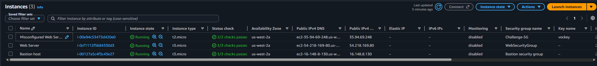
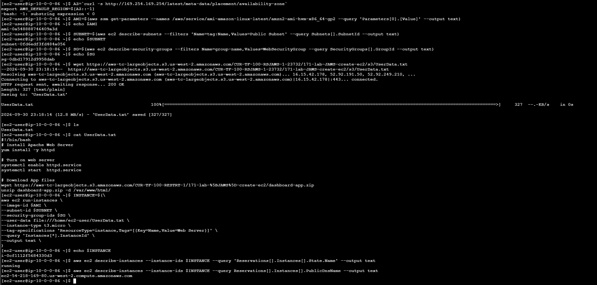
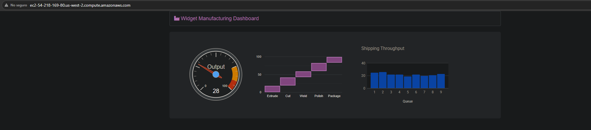
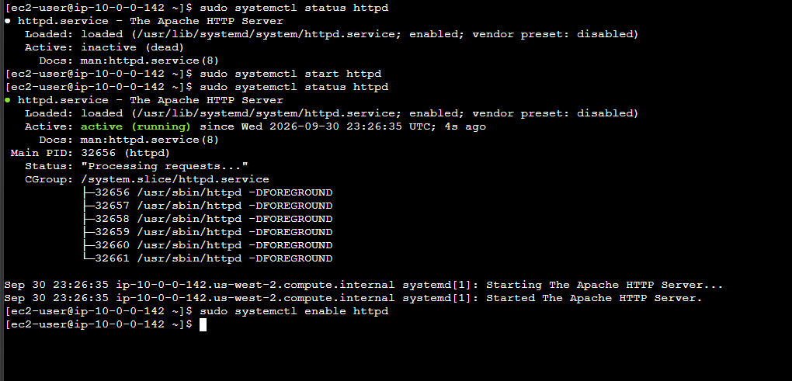
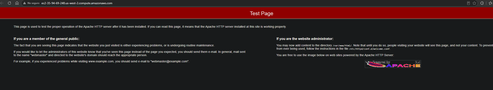

# Lab 171 Aprovisionamiento y Despliegue de Instancias Amazon EC2 mediante Consola de AWS y AWS CLI


## Descripción General

En este laboratorio práctico se construyó e implementó una infraestructura en **Amazon Elastic Compute Cloud (Amazon EC2)** combinando métodos visuales y automatizados. Inicialmente, se desplegó un **Bastion Host** a través de la **Consola de Administración de AWS** dentro de una VPC pública y con permisos asignados por un **Rol de IAM**. Posteriormente, utilizando **EC2 Instance Connect** para acceder a la terminal del Bastion, se ejecutaron comandos de la **AWS CLI v2** y scripts de datos de usuario (**User Data**) para consultar la AMI más reciente desde **AWS Systems Manager Parameter Store** y lanzar automáticamente un servidor web **Apache** completamente operacional.

## Arquitectura del Laboratorio

```text
[Usuario / Cliente Web] ──(HTTP)──► [Web Server EC2 (Apache)]
                                            ▲
                                            │ (aws ec2 run-instances)
┌───────────────────────────────────────────┼─────────────────────────┐
│ AWS Cloud (Lab VPC / Public Subnet)       │                         │
│  ┌───────────────────────────┐   ┌────────┴──────────────────────┐  │
│  │ Bastion Host (EC2)        │   │ Web Server (EC2)              │  │
│  │  ├── Amazon Linux 2       ├──►│  ├── Amazon Linux 2           │  │
│  │  ├── Bastion-Role (IAM)   │   │  └── Apache / Application     │  │
│  │  └── AWS CLI v2           │   └───────────────────────────────┘  │
│  └─────────────▲─────────────┘                                      │
└────────────────┼────────────────────────────────────────────────────┘
                 │ (EC2 Instance Connect)
      [Navegador del Administrador]
```

## Objetivos del Laboratorio

- Lanzar una instancia de **Amazon EC2** (Bastion Host) mediante la Consola de Administración de AWS.
- Establecer una conexión interactiva a la instancia usando **EC2 Instance Connect**.
- Consultar metadatos e ID de recursos (AMI, Subredes y Grupos de Seguridad) programáticamente vía **AWS CLI**.
- Descargar y aplicar un script de datos de usuario (**User Data**) para instalar y configurar **Apache HTTP Server**.
- Desplegar una segunda instancia de EC2 (Web Server) en forma automatizada con el comando `aws ec2 run-instances`.
- Diagnosticar y resolver problemas de configuración de red y grupos de seguridad en entornos EC2.

## Tarea 1: Lanzar una Instancia de EC2 mediante la Consola de AWS

1. En la consola de Amazon EC2, seleccionar **Lanzar una instancia**.
2. **Nombre y Etiquetas:** `Bastion host`.
3. **Imagen de máquina (AMI):** Seleccionar **Amazon Linux 2 AMI (HVM)**.
4. **Tipo de instancia:** `t3.micro`.
5. **Par de claves:** Seleccionar _Continuar sin un par de claves_.
6. **Configuración de red:**
   - **VPC:** `Lab VPC`.
   - **Subred:** `Subred pública` (Auto-assign Public IP: _Enable_).
   - **Grupo de Seguridad:** Crear nuevo grupo `Bastion security group` con descripción `Permit SSH connections` y regla de entrada para SSH (`Puerto 22`).
7. **Detalles avanzados:**
   - **Perfil de instancia de IAM:** Asignar el rol `Bastion-Role`.
8. Confirmar los datos y hacer clic en **Lanzar instancia**.


_Figura 1: Instancias EC2 desde la consola_

## Tarea 2: Iniciar Sesión en el Host Bastión

1. Seleccionar la instancia `Bastion host` en la lista de instancias.
2. Hacer clic en **Conectar**.
3. En la pestaña **EC2 Instance Connect**, confirmar la conexión para abrir el terminal web interactivo.

## Tarea 3: Lanzar una Instancia de EC2 mediante la AWS CLI

### Paso 1: Obtener la AMI a Utilizar

Obtener la Zona de Disponibilidad local vía metadatos (IMDS) y consultar la versión de AMI de Amazon Linux 2 más reciente registrada en Parameter Store:

```bash
AZ=`curl -s http://169.254.169.254/latest/meta-data/placement/availability-zone`
export AWS_DEFAULT_REGION=${AZ::-1}

AMI=$(aws ssm get-parameters --names /aws/service/ami-amazon-linux-latest/amzn2-ami-hvm-x86_64-gp2 --query 'Parameters[0].[Value]' --output text)
echo $AMI
```

### Paso 2: Obtener el ID de la Subred Pública

```bash
SUBNET=$(aws ec2 describe-subnets --filters 'Name=tag:Name,Values=Public Subnet' --query Subnets[].SubnetId --output text)
echo $SUBNET
```

### Paso 3: Obtener el ID del Grupo de Seguridad Web

```bash
SG=$(aws ec2 describe-security-groups --filters Name=group-name,Values=WebSecurityGroup --query SecurityGroups[].GroupId --output text)
echo $SG
```

### Paso 4: Descargar e Inspeccionar el Script de User Data

```bash
wget https://aws-tc-largeobjects.s3.us-west-2.amazonaws.com/CUR-TF-100-RSJAWS-1-23732/171-lab-JAWS-create-ec2/s3/UserData.txt
cat UserData.txt
```

### Paso 5: Iniciar la Instancia de Servidor Web

```bash
INSTANCE=$(\
aws ec2 run-instances \
--image-id $AMI \
--subnet-id $SUBNET \
--security-group-ids $SG \
--user-data file:///home/ec2-user/UserData.txt \
--instance-type t3.micro \
--tag-specifications 'ResourceType=instance,Tags=[{Key=Name,Value=Web Server}]' \
--query 'Instances[*].InstanceId' \
--output text \
)
echo $INSTANCE
```

### Paso 6: Monitorear el Estado del Servidor Web

Verificar que la instancia haya completado la fase de arranque y pase al estado `running`:

```bash
aws ec2 describe-instances --instance-ids $INSTANCE --query 'Reservations[].Instances[].State.Name' --output text
```

### Paso 7: Obtener el DNS Público y Probar la Aplicación

- Obtener el nombre de dominio público asignado a la instancia:

  ```bash
  aws ec2 describe-instances --instance-ids $INSTANCE --query Reservations[].Instances[].PublicDnsName --output text
  ```

  
  _Figura 2: Comandos de los pasos 2, 3, 4, 5, 6 y 7_

- Copiar el valor generado (ejemplo: `ec2-35-11-22-33.us-west-2.compute.amazonaws.com`) y pegarlo en una nueva pestaña del navegador para validar la carga de la página web.

  
  _Figura 3: Vista de la página web_

## Desafíos Opcionales: Solución de Problemas de Configuración

### Desafío 1: Reparar Conexión SSH en "Misconfigured Web Server"

- **Diagnóstico del problema:** Al intentar conectar vía EC2 Instance Connect, la sesión expiraba debido a que el Grupo de Seguridad asignado a la instancia no tenía habilitado el puerto de entrada `22` (SSH) o filtraba el bloque CIDR de AWS.
- **Solución:** Editar el Grupo de Seguridad de la instancia e ingresar una regla de entrada (_Inbound Rule_) permitiendo el protocolo **SSH (Puerto 22)** desde cualquier origen (`0.0.0.0/0`) o el rango IP del servicio EC2 Instance Connect.

### Desafío 2: Reparar Acceso Web HTTP en "Misconfigured Web Server"

- **Diagnóstico del problema:** La URL o dirección DNS pública del servidor no cargaba la aplicación web en el navegador. Se determinaron dos causas posibles:
  1. El servicio web Apache (`httpd`) no fue iniciado automáticamente durante el arranque.
  2. Falta de permisos en el firewall virtual (_Security Group_) para tráfico entrante web.
- **Solución:**
  1. Habilitar la regla de entrada para tráfico **HTTP (Puerto 80)** en el Grupo de Seguridad de la instancia.
  2. Conectarse a la instancia vía consola e iniciar/habilitar el demonio del servidor web: `sudo systemctl enable --now httpd`.


_Figura 4: Comandos del desafío 2_


_Figura 5: Vista del navegador donde carga el servidor de Apache_

## Resumen de Recursos y Componentes

| Servicio / Recurso      | Nombre del Componente                         | Descripción y Función Técnica                                                                                 |
| :---------------------- | :-------------------------------------------- | :------------------------------------------------------------------------------------------------------------ |
| **Amazon EC2**          | `Bastion host`                                | Instancia `t3.micro` en subred pública configurada para el acceso de gestión e interconexión mediante CLI.    |
| **Amazon EC2**          | `Web Server`                                  | Instancia `t3.micro` aprovisionada por CLI y configurada con Apache HTTP Server mediante script de UserData.  |
| **AWS IAM Role**        | `Bastion-Role`                                | Perfil de IAM asignado al Bastion Host para otorgarle permisos de consulta y creación sobre la API de EC2.    |
| **SSM Parameter Store** | `/aws/service/ami-amazon-linux-latest/...`    | Ruta pública de Parameter Store consultada para extraer de forma dinámica el ID de la AMI más reciente.       |
| **Security Groups**     | `Bastion security group` / `WebSecurityGroup` | Firewalls virtuales que regulan el acceso SSH (puerto 22) e interacción web HTTP (puerto 80) respectivamente. |

## Conclusiones del Laboratorio

- **Consola vs. CLI para Despliegues:** La consola gráfica es adecuada para lanzamientos únicos o de prueba, mientras que el uso de **AWS CLI** e **Infraestructura como Código (IaC)** garantiza procesos repetibles, minimizando errores humanos en entornos de producción.
- **Automatización mediante UserData:** La utilización de scripts de bootstrap (**User Data**) permite que las instancias se auto-configuren al arrancar, instalando paquetes y aplicaciones sin intervención manual posterior.
- **Gestión de Acceso Seguro:** **EC2 Instance Connect** elimina la necesidad de distribuir y gestionar archivos de claves privadas (`.pem`), permitiendo un control de acceso centralizado mediante políticas de IAM.
