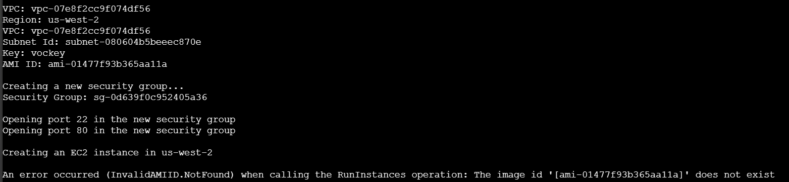
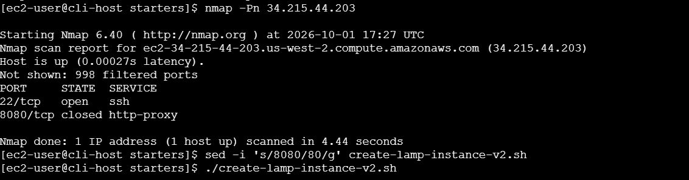
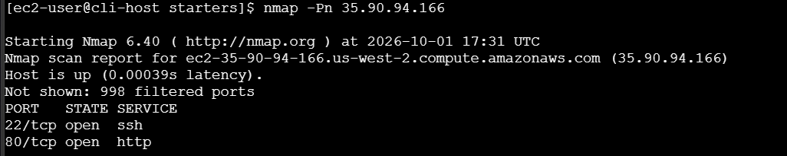
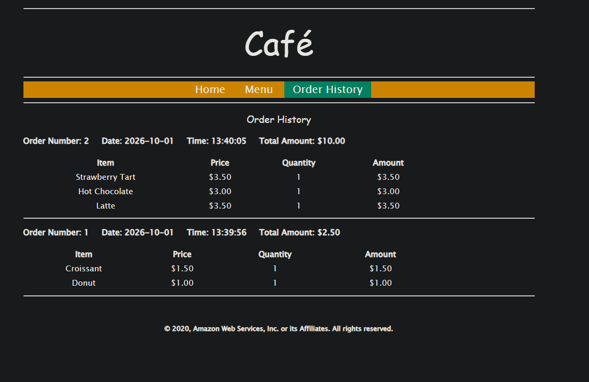

# Lab 173 Solución de Problemas y Despliegue de una Pila LAMP en Amazon EC2 mediante AWS CLI


## Descripción General

En este laboratorio práctico de depuración se utilizó la **AWS CLI v2** desde una instancia host dedicada para automatizar el aprovisionamiento de un servidor **LAMP** (**L**inux, **A**pache, **M**ariaDB, **P**HP) destinado a ejecutar la aplicación web de una cafetería. El script proporcionado contenía fallas de configuración intencionales. Mediante técnicas de solución de problemas, análisis de registros con `cloud-init`, el uso de la herramienta de escaneo de puertos `nmap` y la corrección de reglas de grupos de seguridad e identificadores AMI, se logró desplegar y validar exitosamente la base de datos relacional y la interfaz web del sistema.

## Arquitectura del Laboratorio

```text
[Navegador del Cliente] ──(HTTP / /cafe)──► [Amazon EC2 (LAMP Server)]
                                                    │
┌───────────────────────────────────────────────────┼───────────────┐
│ Cafe VPC (Lab Environment)                        │               │
│  ┌────────────────────────────────────────────────┴────────────┐  │
│  │ Public Subnet                                               │  │
│  │  ┌───────────────────────────────────────────────────────┐  │  │
│  │  │ Cafe Security Group (Inbound: HTTP:80, SSH:22)        │  │  │
│  │  │  ┌─────────────────────────────────────────────────┐  │  │  │
│  │  │  │ Amazon EC2 (t3.small / Amazon Linux)            │  │  │  │
│  │  │  │  ├── Apache HTTP Server (httpd)                 │  │  │  │
│  │  │  │  ├── MariaDB Database Engine                    │  │  │  │
│  │  │  │  └── PHP Application Runtime & Scripts          │  │  │  │
│  │  │  └─────────────────────────────────────────────────┘  │  │  │
│  │  └───────────────────────────────────────────────────────┘  │  │
│  └─────────────────────────────────────────────────────────────┘  │
└───────────────────────────────────────────────────────────────────┘
```

## Objetivos del Laboratorio

- Lanzar y automatizar una instancia Amazon EC2 mediante scripts de la AWS CLI.
- Solucionar problemas de configuración en la infraestructura utilizando técnicas de diagnóstico y la utilidad de análisis de red `nmap`.
- Configurar y verificar la ejecución correcta de una pila LAMP mediante los registros de inicialización de `cloud-init`.
- Validar la integración de base de datos ejecutando pedidos y consultando el historial de órdenes de la aplicación web.

## Tarea 1 y 2: Conexión al Host CLI y Configuración de la AWS CLI

1. Desde la consola de Amazon EC2, seleccionar la instancia CLI Host y hacer clic en Conectar mediante EC2 Instance Connect.

2. Configurar las credenciales programáticas y la región predeterminada ejecutando el comando interactivo:

```bash
aws configure
```

- AWS Access Key ID: Copiar el valor `AccessKey` de los detalles del laboratorio.
- AWS Secret Access Key: Copiar el valor `SecretKey` de los detalles del laboratorio.
- Default region name: Copiar el valor de `LabRegion`.
- Default output format: `json`

## Tarea 3: Creación de Instancia EC2 mediante Script y Depuración

### Paso 3.1: Análisis del Script y Creación de Respaldo

1. Cambiar al directorio de trabajo y generar una copia de respaldo del script antes de editarlo:

```bash
cd ~/sysops-activity-files/starters
cp create-lamp-instance-v2.sh create-lamp-instance.backup
```

2. Inspeccionar el código mediante el editor de texto vi o visualizador de solo lectura view `create-lamp-instance-v2.sh`.

### Paso 3.2 y 3.3: Ejecución y Resolución de Problemas

### Solución al Problema #1: Error `InvalidAMIID.NotFound`

- Diagnóstico: El script intentaba invocar la operación run-instances utilizando un ID de AMI obsoleto o desalineado con la región activa del laboratorio.


_Figura 1: Captura de pantalla del error al ejecutar `create-lamp-instance-v2.sh`_

- Corrección: Localizar la variable de AMI dentro del script `create-lamp-instance-v2.sh`, reemplazarla por una AMI válida correspondiente a la región en ejecución (o asegurar que consulte dinámicamente el Parameter Store de SSM), guardar los cambios y volver a ejecutar el script:

```bash
./create-lamp-instance-v2.sh
```

### Solución al Problema #2: Falla de Conectividad HTTP en el Navegador

- Diagnóstico: A pesar de que la instancia se lanzó correctamente y obtuvo una IP pública, el sitio web no respondía en el puerto 80.

- Pasos de Diagnóstico con Nmap:
  1. Instalar la herramienta de análisis de puertos en la instancia host:

  ```bash
  sudo yum install -y nmap
  ```

  2. Ejecutar el escaneo para verificar los puertos accesibles en la dirección IP pública de la instancia LAMP:

  ```Bash
  nmap -Pn <public-ip>
  ```


_Figura 2: Ejecución del comando `nmap -Pn <public-ip>`_

3. Causa raíz identificada: El grupo de seguridad presentaba una regla de entrada para el puerto 8080. Se aseguró la corrección del puerto 80.


_Figura 3: Ejecución del comando `nmap -Pn <public-ip>` luego de corregir el script_

## Tarea 4: Verificación de la Funcionalidad del Sitio Web

1. Acceso a la Aplicación: Abrir un navegador web e ingresar a la URL de la cafetería con el sufijo `http://<public-ip>/cafe`


_Figura 4: Vista del sitio web de la cafetería_

2. Prueba Transaccional de Base de Datos:
   - Seleccionar el enlace Menu, elegir algunos postres y enviar el pedido.
   - Comprobar que se muestra la página de confirmación con el detalle de la compra.
   - Navegar a Order History para confirmar que los datos se registraron correctamente y se recuperan desde la base de datos MariaDB ejecutándose en la instancia LAMP.


_Figura 5: Vista del sitio web. Apartado Order History con las órdenes activas_

## Resumen de Recursos y Componentes

| Servicio / Recurso     | Nombre del Componente | Descripción y Función Técnica                                                                              |
| :--------------------- | :-------------------- | :--------------------------------------------------------------------------------------------------------- |
| **Amazon EC2**         | `CLI Host`            | Instancia de gestión utilizada para ejecutar scripts de automatización con la AWS CLI.                     |
| **Amazon EC2**         | `cafeserver` (LAMP)   | Instancia `t3.small` aprovisionada por CLI que aloja la aplicación web de la cafetería y su base de datos. |
| **Pila de Software**   | `LAMP Stack`          | Conjunto integrado por Linux, Apache (`httpd`), MariaDB y PHP para la entrega de contenido dinámico.       |
| **Seguridad de Red**   | `cafeSG`              | Grupo de seguridad configurado para permitir el acceso remoto por SSH (22) y el tráfico web (80).          |
| **Herramienta de Red** | `nmap`                | Utilidad de código abierto empleada para realizar diagnósticos de puertos y conectividad de red.           |

## Conclusiones del Laboratorio

- **Automatización Programática:** El uso de la **AWS CLI** permite replicar despliegues complejos de infraestructura de forma consistente, reduciendo la intervención manual y minimizando errores de configuración.
- **Depuración Sistemática:** La combinación de mensajes de error de la API, herramientas de diagnóstico de puertos como `nmap` y la inspección de registros mediante `cloud-init` facilita la resolución rápida de fallas en arquitecturas basadas en la nube.
- **Integración de Backend Relacional:** El despliegue automatizado de una pila **LAMP** demuestra cómo un único script de datos de usuario puede orquestar simultáneamente la instalación de servidores web, motores de bases de datos y la implementación de código de aplicación.
