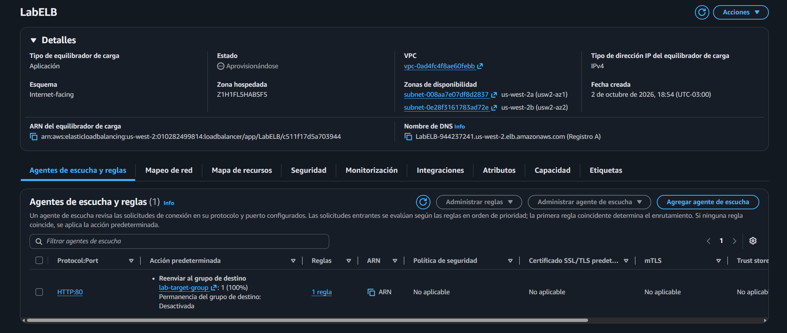
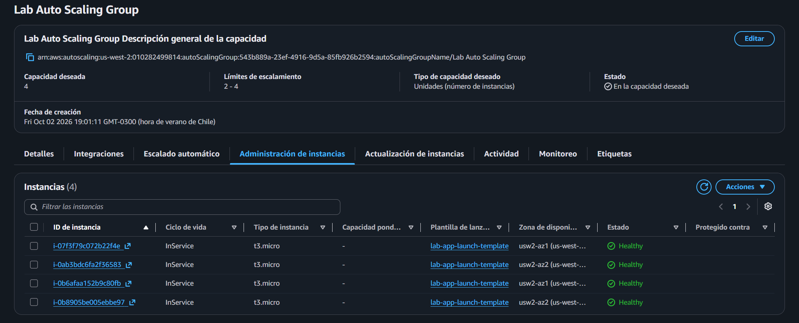
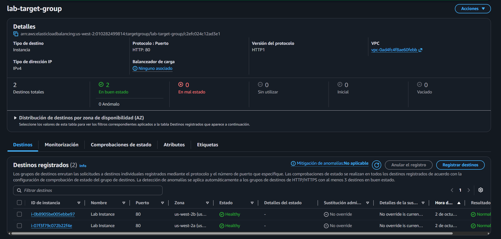
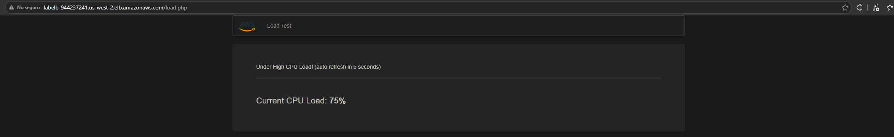
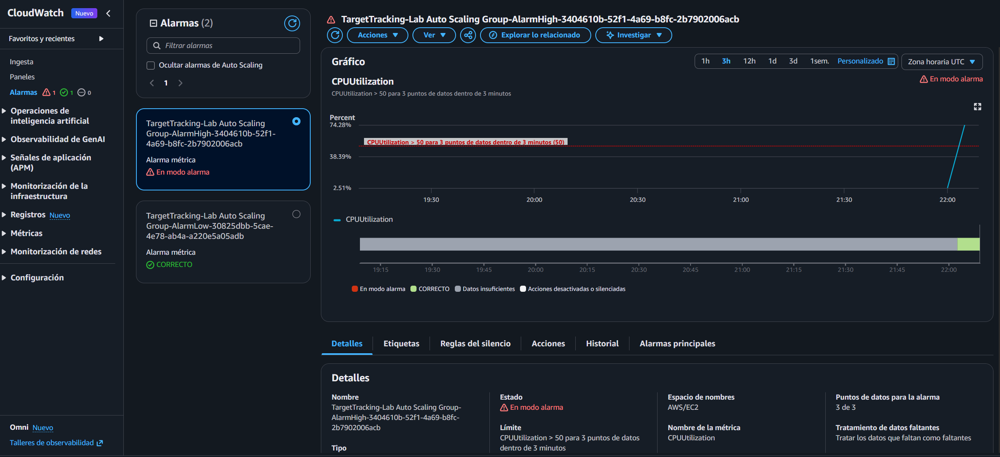
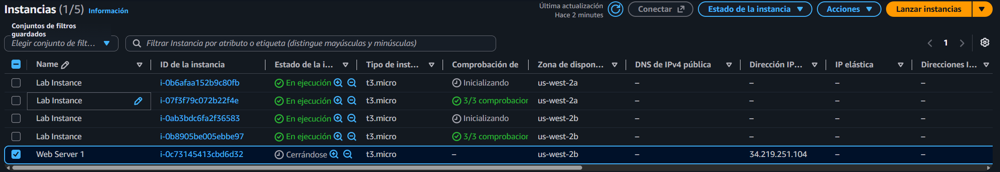

# Lab 174 Escalado y Balanceo de Carga de Infraestructura en AWS (ELB & Auto Scaling)


## Descripción General

En este laboratorio práctico se implementó una arquitectura de alta disponibilidad y tolerancia a fallos utilizando **Elastic Load Balancing (ELB)** y **Amazon EC2 Auto Scaling**. Se generó una **AMI** a partir de un servidor web existente para encapsular su configuración, se aprovisionó un **Application Load Balancer (ALB)** para distribuir el tráfico entrante en múltiples zonas de disponibilidad, y se construyó una **Plantilla de Lanzamiento (Launch Template)** conectada a un **Grupo de Auto Scaling (ASG)** operando en subredes privadas. Asimismo, se integraron alarmas de **Amazon CloudWatch** para escalar horizontalmente la capacidad del sistema ante incrementos de carga de CPU.

## Arquitectura del Laboratorio

```text
[Cliente / Navegador] ──(HTTP)──► [Application Load Balancer (LabELB)]
                                             │
      ┌──────────────────────────────────────┴──────────────────────────────────────┐
      │ AWS Cloud (Lab VPC)                                                         │
      │                                                                             │
      │  ┌───────────────────────────────────┐   ┌───────────────────────────────┐  │
      │  │ Subred Privada 1 (AZ 1)           │   │ Subred Privada 2 (AZ 2)       │  │
      │  │  ┌─────────────────────────────┐  │   │  ┌─────────────────────────┐  │  │
      │  │  │ Lab Instance (ASG Member)   │  │   │  │Lab Instance (ASG Member)│  │  │
      │  │  └─────────────────────────────┘  │   │  └─────────────────────────┘  │  │
      │  └───────────────────────────────────┘   └───────────────────────────────┘  │
      └─────────────────────────────────────────────────────────────────────────────┘
```

## Objetivos del Laboratorio

- Crear una **AMI** (Amazon Machine Image) a partir de una instancia de EC2 en ejecución.
- Configurar un **Application Load Balancer (ALB)** asociado a un Grupo de Destino (_Target Group_).
- Diseñar una **Plantilla de Lanzamiento** (_Launch Template_) basada en la AMI personalizada.
- Aprovisionar un **Grupo de Auto Scaling** para escalar dinámicamente instancias dentro de **subredes privadas**.
- Monitorear y probar el rendimiento mediante **alarmas de CloudWatch** y pruebas de carga web.

## Estructura y Paso a Paso del Laboratorio

### Tarea 1: Crear una AMI para Auto Scaling

1. En la consola de **Amazon EC2**, ir al panel de **Instancias**.
2. Seleccionar la instancia `Web Server 1`.
3. Desplegar el menú **Acciones** > **Imagen y plantillas** > **Crear imagen**:
   - **Nombre de la imagen:** `Web Server AMI`
   - **Descripción:** `Lab AMI for Web Server`
4. Hacer clic en **Crear imagen** para registrar la plantilla del disco raíz.

### Tarea 2: Crear un Balanceador de Carga (Application Load Balancer)

1. En el panel izquierdo de EC2, ir a **Balanceo de carga** > **Balanceadores de carga**.
2. Seleccionar **Crear balanceador de carga** y elegir **Application Load Balancer**.
3. Configurar los parámetros básicos:
   - **Nombre:** `LabELB`
   - **VPC:** `Lab VPC`
   - **Mapeo de red:** Seleccionar ambas zonas de disponibilidad asignando **Subred pública 1** y **Subred pública 2**.
   - **Grupos de seguridad:** Seleccionar `Web Security Group`.
4. Crear el **Grupo de Destino** (_Target Group_):
   - Elegir tipo de destino: **Instancias**.
   - **Nombre:** `lab-target-group`.
   - Completar el asistente dejando los valores por defecto y seleccionando **Crear un grupo de destino**.
5. Regresar a la pestaña del balanceador de carga, actualizar los agentes de escucha (_Listeners_) y asociar la acción predeterminada para reenviar el tráfico a `lab-target-group`.
6. Finalizar haciendo clic en **Crear balanceador de carga** y copiar el **Nombre DNS** generado para pruebas futuras.


_Figura 1: Detalles del `LabELB`_

### Tarea 3: Crear una Plantilla de Lanzamiento

1. En el panel de navegación de EC2, seleccionar **Plantillas de lanzamiento** > **Crear plantilla de lanzamiento**.
2. Configurar la plantilla:
   - **Nombre:** `lab-app-launch-template`
   - **Orientación sobre Auto Scaling:** Marcar la casilla de habilitación.
   - **AMI:** En la pestaña _Mis AMI_, seleccionar `Web Server AMI`.
   - **Tipo de instancia:** `t3.micro`.
   - **Par de claves:** _No incluir en la plantilla de lanzamiento_.
   - **Grupos de seguridad:** Seleccionar `Web Security Group`.
3. Hacer clic en **Crear plantilla de lanzamiento**.

### Tarea 4: Crear un Grupo de Auto Scaling (ASG)

1. Seleccionar la plantilla recién creada `lab-app-launch-template`, ir al menú **Acciones** y elegir **Crear grupo de Auto Scaling**.
2. Asignar el nombre del grupo: `Lab Auto Scaling Group`.
3. En las opciones de red:
   - **VPC:** `Lab VPC`.
   - **Subredes:** Seleccionar **Subred privada 1** y **Subred privada 2**.

   
   _Figura 2: Detalles del `Lab auto scaling group`_

4. En opciones avanzadas de balanceo de carga:
   - Seleccionar **Asociar a un balanceador de carga existente** > _Elegir entre los grupos de destino_.
   - **Grupo de destino:** `lab-target-group`.
   - **Tipo de comprobación de estado:** `ELB`.
5. Configurar el tamaño del grupo y las políticas de escalado:
   - **Capacidad deseada:** `2`
   - **Capacidad mínima:** `2`
   - **Capacidad máxima:** `4`
   - **Política de escalado:** Seleccionar _Seguimiento de destino_ (_Target Tracking_).
   - **Tipo de métrica:** _Utilización de CPU promedio_.
   - **Valor de destino:** `50` (mantiene el uso promedio de CPU cerca del 50%).
6. Añadir etiquetas opcionales (`Key: Name`, `Value: Lab Instance`) y finalizar seleccionando **Crear grupo de Auto Scaling**.

   
   _Figura 3: Detalles del `lab-target-group`_

### Tarea 5: Comprobar el Funcionamiento del Balanceo de Carga

1. Verificar en la sección de **Instancias** que el ASG haya aprovisionado automáticamente dos instancias llamadas `Lab Instance`.
2. Comprobar el estado de salud de los destinos en **Grupos de destino** (`lab-target-group`) hasta que cambien a estado **En buen estado** (_Healthy_).
3. Pegar el **Nombre DNS** del balanceador de carga en una nueva pestaña del navegador para validar que responde la aplicación de prueba de carga.

### Tarea 6: Realizar Pruebas de Auto Scaling

1. Abrir **CloudWatch** en la consola de AWS y verificar la creación automática de las alarmas de escala (`AlarmHigh` y `AlarmLow`).

2. Abrir la aplicación web de prueba de carga en el navegador y hacer clic en el botón **Load Test** para incrementar el uso de CPU.

   
   _Figura 4: Vista de la aplicación web al cargar el test_

3. Observar en CloudWatch cómo la alarma `AlarmHigh` cambia a estado _En modo alarma_ al superar el umbral del 50% de CPU durante más de 3 minutos.

   
   _Figura 5: Alarma de Cloudwatch_

4. Validar en la consola de EC2 cómo Auto Scaling despliega dinámicamente nuevas instancias para absorber la carga.

   
   _Figura 6: Instancias EC2_

### Desafío Opcional: Creación de una AMI mediante la AWS CLI

Para completar este desafío de manera programática:

1. **Conectarse a una Instancia:**
   Utilizar **EC2 Instance Connect** desde la consola para acceder a cualquiera de las instancias en ejecución.

2. **Configurar Credenciales de AWS:**
   Consultar los detalles de AWS en la parte superior del entorno de laboratorio (`AWS Details` > `Show`) y configurar las credenciales editando directamente el archivo de configuración en la terminal:

   ```bash
   vi ~/.aws/credentials
   ```

   _(Ingresar el `AccessKey`, `SecretKey` y la región correspondiente según los datos provistos)._

3. **Identificar la Instancia Objetivo**:
   Si necesita consultar el ID exacto y estado de las instancias disponibles en la región, ejecute el siguiente comando de la CLI:

   ```bash
   aws ec2 describe-instances \
       --region us-west-2 \
       --query "Reservations[*].Instances[*].{ID: InstanceId, Name: Tags[?Key=='Name'].Value | [0], State: State.Name}" \
       --output table
   ```

4. **Crear la AMI**:
   Utilice el comando `create-image` especificando el ID de la instancia objetivo (por ejemplo, `i-060fc2898afb5f533`), un nombre único y la opción `--no-reboot` para evitar reiniciar la máquina durante el proceso:

   ```bash
   aws ec2 create-image \
   --instance-id i-060fc2898afb5f533 \
   --name "AMI-WebServer-v1" \
   --description "AMI del servidor web Apache" \
   --no-reboot
   ```

## Resumen de Recursos y Componentes

| Servicio / Recurso     | Nombre del Componente     | Descripción y Función Técnica                                                                 |
| :--------------------- | :------------------------ | :-------------------------------------------------------------------------------------------- |
| **Amazon EC2 (AMI)**   | `Web Server AMI`          | Imagen personalizada generada a partir del disco raíz del servidor web base.                  |
| **ELB (ALB)**          | `LabELB`                  | Balanceador de carga de aplicaciones que distribuye solicitudes HTTP hacia subredes privadas. |
| **Target Group**       | `lab-target-group`        | Grupo de destino encargado de monitorear la salud (_Health Checks_) de las instancias EC2.    |
| **Launch Template**    | `lab-app-launch-template` | Plantilla estándar utilizada por el ASG para definir tipo de instancia, AMI y seguridad.      |
| **Auto Scaling Group** | `Lab Auto Scaling Group`  | Grupo elástico configurado para mantener entre 2 y 4 instancias en subredes privadas.         |

## Conclusiones del Laboratorio

- **Alta Disponibilidad mediante ELB:** La utilización de un Application Load Balancer desacopla el tráfico de los clientes de las instancias individuales, asegurando que las fallas de nodos específicos no interrumpan el servicio.
- **Escalamiento Horizontal Automatizado:** Configurar políticas de seguimiento de destino con CloudWatch permite ajustar de forma proactiva la capacidad computacional ante fluctuaciones de demanda, optimizando costos y rendimiento.
- **Seguridad en Arquitecturas Multi-Capa:** Mantener las instancias del clúster de servidores web alojadas exclusivamente dentro de **subredes privadas** a la vez que reciben tráfico balanceado mitiga la exposición directa a Internet.
- **Automatización Avanzada vía CLI**: El desafío demostró cómo interactuar directamente con la API de EC2 mediante comandos de la terminal (`aws ec2 create-image`) para replicar tareas de administración de infraestructura sin depender exclusivamente de la interfaz gráfica.
