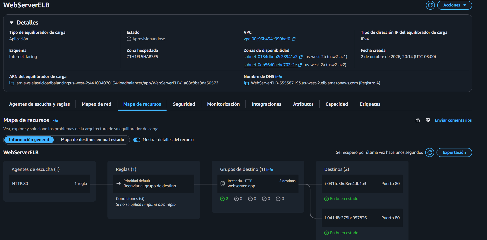
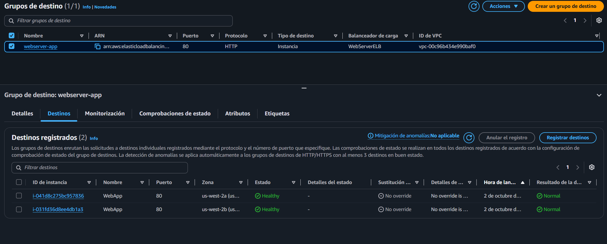
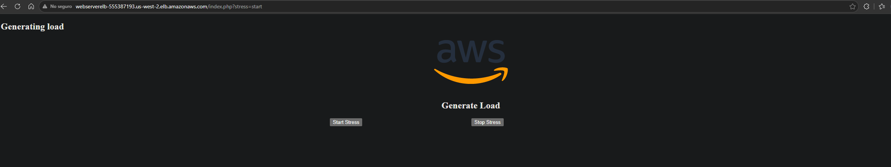
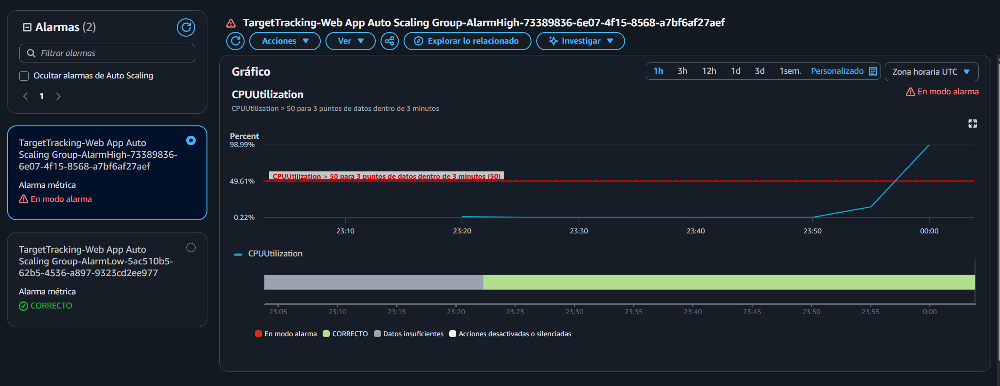
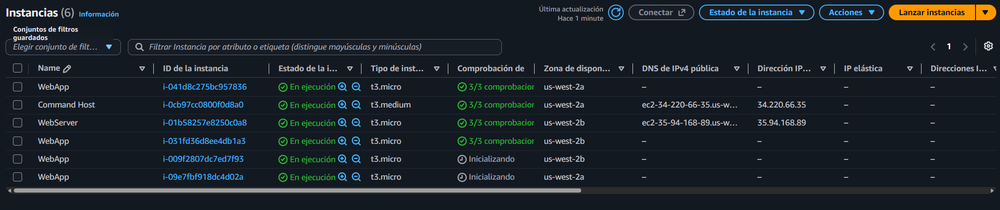

# Lab 175 Uso de Escalado Automático y Balanceo de Carga en AWS mediante AWS CLI


## Descripción General

En este laboratorio práctico se implementó una arquitectura altamente elástica combinando herramientas de automatización de la línea de comandos (**AWS CLI**) y la consola de administración. Inicialmente, se aprovisionó una instancia de servidor web y se generó una **AMI personalizada** de forma programática. Posteriormente, se construyó un **Application Load Balancer (ELB)** para distribuir el tráfico, una **Plantilla de Lanzamiento** y un **Grupo de Auto Scaling** operando dentro de **subredes privadas**, configurado con políticas dinámicas de seguimiento de CPU para responder a cargas de trabajo variables.

## Arquitectura del Laboratorio

```text
[Cliente / Navegador] ──(HTTP)──► [Application Load Balancer (WebServerELB)]
                                             │
      ┌──────────────────────────────────────┴──────────────────────────────────────┐
      │ AWS Cloud (Lab VPC)                                                         │
      │                                                                             │
      │  ┌───────────────────────────────────┐   ┌───────────────────────────────┐  │
      │  │ Subred Privada 1                  │   │ Subred Privada 2              │  │
      │  │  ┌─────────────────────────────┐  │   │  ┌─────────────────────────┐  │  │
      │  │  │ WebApp (ASG Member)         │  │   │  │ WebApp (ASG Member)     │  │  │
      │  │  └─────────────────────────────┘  │   │  └─────────────────────────┘  │  │
      │  └───────────────────────────────────┘   └───────────────────────────────┘  │
      └─────────────────────────────────────────────────────────────────────────────┘
```

## Objetivos del Laboratorio

- Crear y configurar instancias de **Amazon EC2** y disparar scripts de automatización mediante la **AWS CLI**.
- Generar una **AMI personalizada** de forma programática mediante comandos de la terminal.
- Diseñar una **Plantilla de Lanzamiento** (Launch Template) y configurar un **Grupo de Auto Scaling**.
- Integrar un **Application Load Balancer (ELB)** para distribuir solicitudes HTTP hacia servidores ubicados en subredes privadas.

- Implementar y verificar políticas de escalado horizontal basadas en el consumo de CPU.

## Tarea 1: Creación de AMI y Despliegue Base vía AWS CLI

1. **Conexión a la Instancia Command Host**:
   Desde la consola de Amazon EC2, seleccionar la instancia `Command Host` y conectarse mediante EC2 Instance Connect.

2. **Configuración de la AWS CLI**:
   Confirmar la región activa e inicializar las credenciales de entorno:

```bash
curl http://169.254.169.254/latest/dynamic/instance-identity/document | grep region
aws configure
cd /home/ec2-user/
```

3. **Lanzamiento de una Instancia EC2 con UserData**:
   Inspeccionar el script de inicialización `UserData.txt` y ejecutar el comando de la CLI reemplazando los parámetros correspondientes (`KEYNAME`, `AMIID`, `HTTPACCESS`, `SUBNETID`):

```bash
aws ec2 run-instances --key-name KEYNAME --instance-type t3.micro --image-id AMIID --user-data file:///home/ec2-user/UserData.txt --security-group-ids HTTPACCESS --subnet-id SUBNETID --associate-public-ip-address --tag-specifications 'ResourceType=instance,Tags=[{Key=Name,Value=WebServer}]' --output text --query 'Instances[*].InstanceId'
```

Monitorear el estado de arranque y extraer el DNS público para verificar la correcta visualización del servidor web:

```bash
aws ec2 wait instance-running --instance-ids NEW-INSTANCE-ID
aws ec2 describe-instances --instance-id NEW-INSTANCE-ID --query 'Reservations[0].Instances[0].NetworkInterfaces[0].Association.PublicDnsName'
```

4. **Creación de la AMI Personalizada**:
   Generar una imagen a partir de la instancia en ejecución (el comando reiniciará la máquina para garantizar la integridad del sistema de archivos):

```bash
aws ec2 create-image --name WebServerAMI --instance-id NEW-INSTANCE-ID
```

## Tarea 2: Creación del Entorno de Auto Scaling y Balanceo de Carga

### Tarea 2.1: Crear el Application Load Balancer

1. En la consola de EC2, ir a **Balanceadores de carga** > **Crear balanceador de carga** (_Application Load Balancer_).
   - **Nombre:** `WebServerELB`
   - **VPC:** `Lab VPC`
   - **Mapeo de red:** Seleccionar **Subred pública 1** y **Subred pública 2**.
   - **Grupos de seguridad:** Seleccionar `HTTPAccess`.
2. Crear un **Grupo de Destino** (_Target Group_):
   - **Tipo de destino:** Instancias.
   - **Nombre:** `webserver-app`.
   - **Ruta de comprobación de salud:** `/index.php`.
3. Asociar el grupo de destino al agente de escucha del balanceador y finalizar su creación. Copiar el **Nombre DNS** generado.


_Figura 1: Detalles del `WebServerELB`_

### Tarea 2.2: Crear una Plantilla de Lanzamiento

1. En **Plantillas de lanzamiento**, crear una nueva llamada `web-app-launch-template` seleccionando la casilla de orientación para Auto Scaling.
2. Configurar los parámetros:
   - **AMI:** Seleccionar la imagen creada previamente (`WebServerAMI`) en la pestaña _Mis AMI_.
   - **Tipo de instancia:** `t3.micro`.
   - **Par de claves:** No incluir en la plantilla de lanzamiento.
   - **Grupo de seguridad:** `HTTPAccess`.

### Tarea 2.3: Crear el Grupo de Auto Scaling (ASG)

1. Seleccionar la plantilla de lanzamiento, hacer clic en **Acciones** > **Crear grupo de Auto Scaling**.
   - **Nombre del grupo:** `Web App Auto Scaling Group`.
   - **Red:** Seleccionar `Lab VPC` y las subredes privadas: **Subred privada 1** y **Subred privada 2**.
   - **Balanceo de carga:** Asociar al grupo de destino existente `webserver-app | HTTP` y activar las comprobaciones de salud de ELB.
   - **Capacidad:** Deseada: `2`, Mínima: `2`, Máxima: `4`.
   - **Políticas de escalado:** Seleccionar _Seguimiento de destino_, métrica _Utilización de CPU promedio_, valor de destino `50`.
   - **Etiquetas:** `Key: Name`, `Value: WebApp`.

## Tarea 3 y 4: Verificación y Pruebas de Escalado

1. **Comprobación de Salud:**
   - Verificar en la sección de **Instancias** y en el grupo de destino (`webserver-app`) que las dos instancias `WebApp` se encuentren en estado **En buen estado** (_Healthy_).

     
     _Figura 2: Vista de las dos instancias con estado `Healthy`_

2. **Prueba de Estrés Web:**
   - Abrir el **Nombre DNS** del balanceador de carga en el navegador.
   - Seleccionar la opción **Start Stress** para forzar un consumo de CPU del 100%.

   
   _Figura 3: Vista del navegador con la prueba ejecutándose_

- Monitorear en la consola de Auto Scaling (pestaña _Actividad_) cómo CloudWatch detecta el incremento por encima del umbral del 50% y despliega de forma automática una instancia adicional para absorber la carga.


_Figura 4: Alarma de Cloudwatch activada luego del test de stress_


_Figura 5: Instancias del scaling group inicializándose_

## Resumen de Recursos y Componentes

| Servicio / Recurso     | Nombre del Componente        | Descripción y Función Técnica                                                                         |
| :--------------------- | :--------------------------- | :---------------------------------------------------------------------------------------------------- |
| **Amazon EC2 (AMI)**   | `WebServerAMI`               | Imagen personalizada generada mediante la AWS CLI a partir del servidor web base.                     |
| **ELB (ALB)**          | `WebServerELB`               | Balanceador de carga de aplicaciones que distribuye tráfico HTTP hacia subredes privadas.             |
| **Target Group**       | `webserver-app`              | Grupo de destino configurado con validación de salud en `/index.php`.                                 |
| **Launch Template**    | `web-app-launch-template`    | Plantilla estándar utilizada para definir la configuración base de las instancias del ASG.            |
| **Auto Scaling Group** | `Web App Auto Scaling Group` | Clúster elástico configurado para mantener entre 2 y 4 nodos en subredes privadas con escala por CPU. |

## Conclusiones del Laboratorio

- **Automatización Integral:** El uso combinado de scripts de inicialización (`UserData`) y comandos de la **AWS CLI** permite aprovisionar y parametrizar infraestructura de forma rápida y repetible.
- **Resiliencia Mediante Multi-AZ y Subredes Privadas:** Distribuir las instancias administradas por Auto Scaling en zonas de disponibilidad y subredes aisladas de Internet protege la aplicación ante fallos de infraestructura.
- **Elasticidad Proactiva:** Las políticas de seguimiento de destino con CloudWatch aseguran que la capacidad computacional escale o se reduzca de manera fluida ante fluctuaciones reales de la demanda del sistema.
