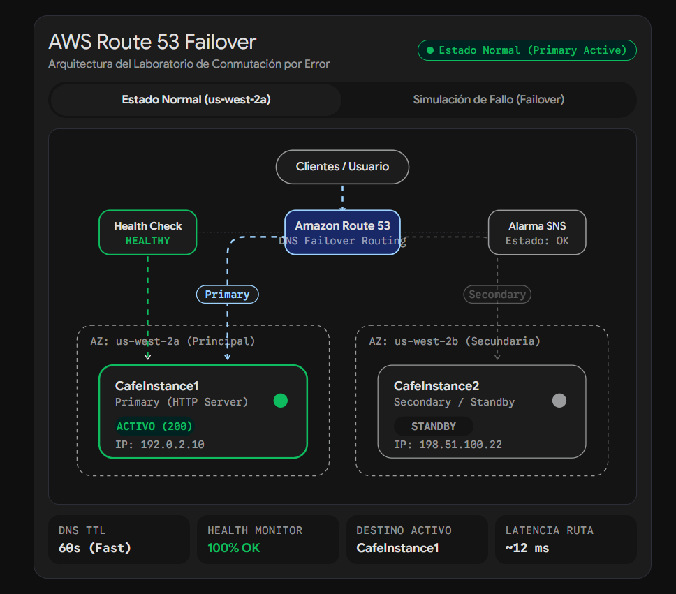
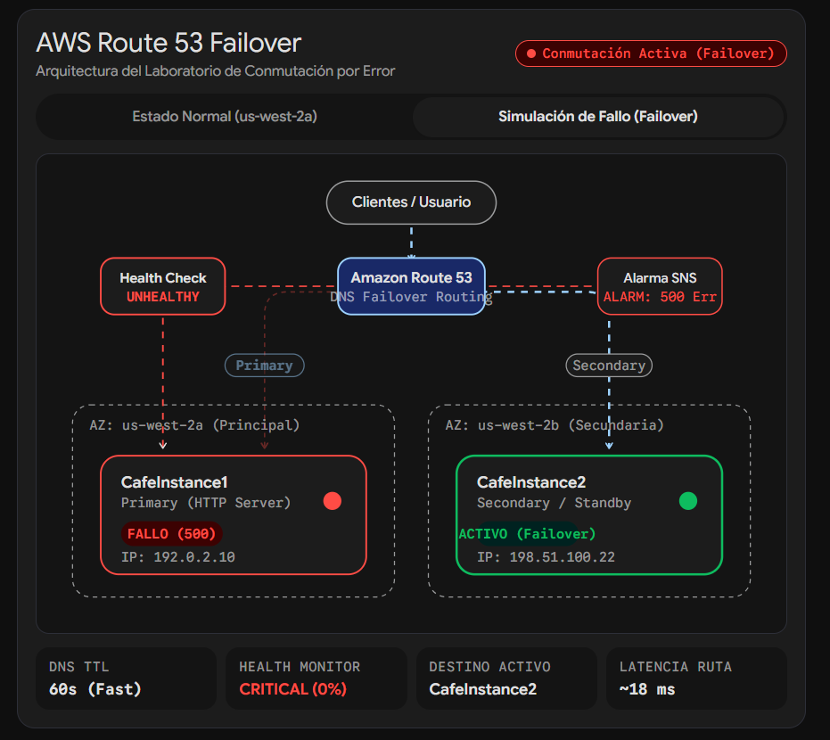
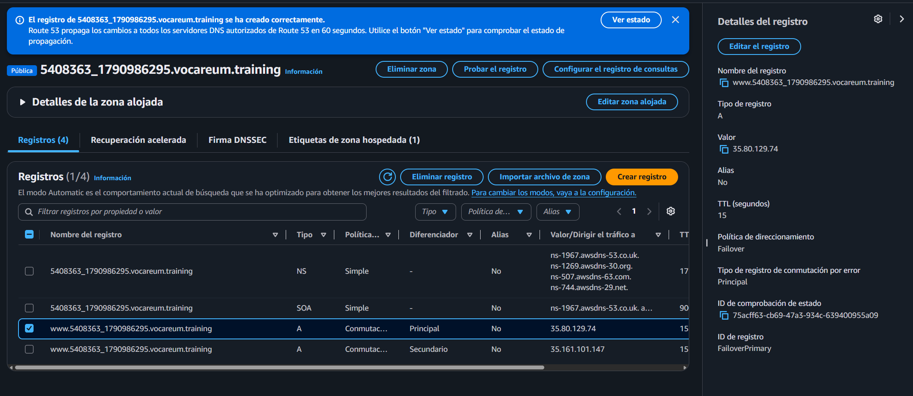
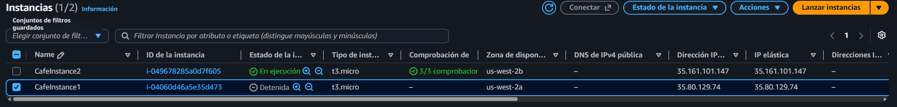
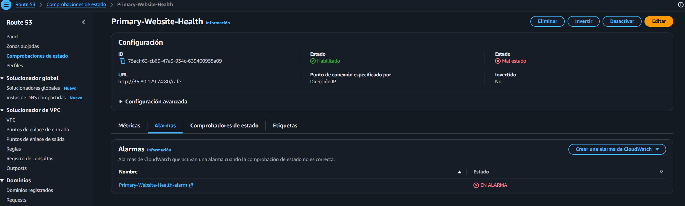
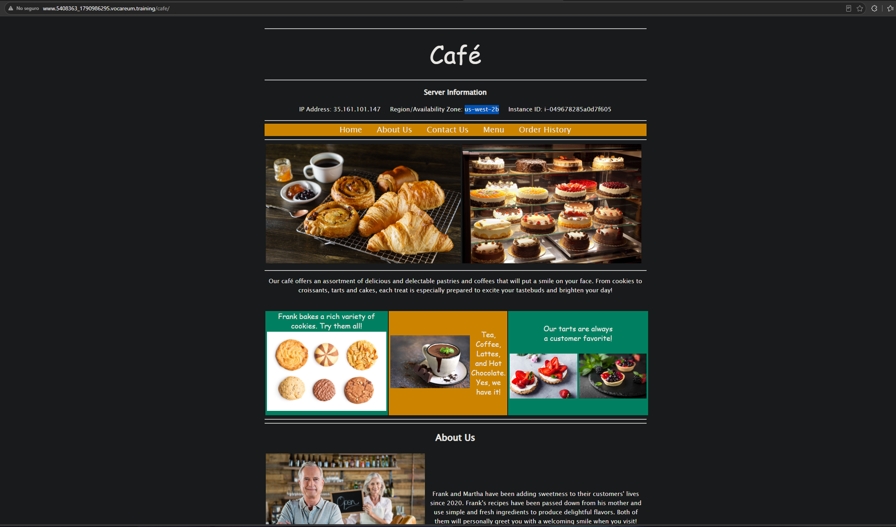

# Lab 176 Enrutamiento de Conmutación por Error (Failover) de Amazon Route 53

## Descripción General

En este laboratorio se implementó una estrategia de conmutación por error (_DNS Failover_) para una aplicación web alojada en dos instancias de **Amazon EC2** distribuidas en diferentes zonas de disponibilidad (`us-west-2a` y `us-west-2b`). Se configuró un **Health Check** en **Amazon Route 53** para supervisar continuamente el estado de la instancia primaria, vinculado a una alarma de **Amazon SNS** para notificar por correo electrónico cualquier anomalía. Asimismo, se establecieron registros de tipo A con políticas de enrutamiento de conmutación por error para redirigir automáticamente el tráfico hacia la instancia secundaria en caso de que el nodo principal deje de responder.

## Arquitectura del Laboratorio

### 1. Estado Normal (Primary Active)

En condiciones normales de operación, Amazon Route 53 enruta el tráfico de los clientes hacia la instancia principal (`CafeInstance1`) ubicada en la Zona de Disponibilidad `us-west-2a`, la cual se encuentra validada por un monitoreo de salud (_Health Check_) en estado **HEALTHY**.

_Figura 1: Arquitectura antes de la conmutación por error_

### 2. Simulación de Fallo y Conmutación (Failover)

Cuando se simula una interrupción o la instancia principal presenta un fallo de respuesta (código HTTP 500), el _Health Check_ cambia a estado **UNHEALTHY** y Route 53 ejecuta automáticamente el enrutamiento de conmutación por error (_Failover_) hacia la instancia secundaria de respaldo (`CafeInstance2`) en `us-west-2b`.

_Figura 2: Arquitectura después de la conmutación por error_

## Objetivos del Laboratorio

- Configurar una **comprobación de estado (_Health Check_) de Route 53** con monitoreo rápido y alertas por correo electrónico mediante **Amazon SNS**.
- Implementar **enrutamiento de conmutación por error (_Failover Routing_)** en Amazon Route 53 utilizando registros de tipo A principales y secundarios.
- Validar la resolución de nombres DNS y verificar la conmutación automática de tráfico ante la simulación de caída de la instancia primaria.

## Estructura y Paso a Paso del Laboratorio

### Tarea 1: Confirmar los Sitios Web de la Cafetería

1. Obtener los parámetros de credenciales y direcciones IP desde los detalles del laboratorio:
   - `CafeInstance1IPAddress`, `PrimaryWebSiteURL`, `SecondaryWebsiteURL`, `CafeInstance2IPAddress`.
2. Verificar el funcionamiento de ambas instancias abriendo las URLs respectivas en el navegador web para confirmar que la aplicación de la cafetería opera en las dos zonas de disponibilidad.
3. Realizar una prueba transaccional enviando un pedido desde el menú en uno de los sitios web.

### Tarea 2: Configurar una Comprobación de Estado de Route 53

1. Abrir la consola de **Amazon Route 53** y seleccionar **Comprobaciones de estado** en el panel de navegación.
2. Crear una nueva comprobación de estado (`Create health check`):
   - **Nombre:** `Primary-Website-Health`
   - **Qué se debe monitorizar:** Punto de enlace.
   - **Especificar el punto de enlace por:** Dirección IP.
   - **Dirección IP:** Ingresar la IP pública de `CafeInstance1` (`CafeInstance1IPAddress`).
   - **Ruta:** `cafe`
3. En la **Configuración avanzada**:
   - **Intervalo de solicitud:** Rápido (10 segundos).
   - **Umbral de error:** `2`.
4. En las opciones de notificación:
   - **Crear alarma:** Sí.
   - **Enviar notificación a:** Nuevo tema de SNS.
   - **Nombre del tema:** `Primary-Website-Health`.
   - **Direcciones de correo electrónico del destinatario:** Ingresar una dirección válida.
5. Finalizar creando la comprobación de estado y confirmar la suscripción mediante el correo electrónico de notificación recibido de AWS.

### Tarea 3: Configurar Registros de Route 53

#### Tarea 3.1: Crear el Registro A Principal

1. En la consola de Route 53, seleccionar **Zonas alojadas** y abrir el dominio asignado (`XXXXXX_XXXXXXXXXX.vocareum.training`).
2. Hacer clic en **Crear registro** (`Create record`) con los siguientes parámetros:
   - **Nombre del registro:** `www`
   - **Tipo de registro:** A (Enruta el tráfico a una dirección IPv4 y recursos de AWS).
   - **Valor:** Dirección IP de `CafeInstance1IPAddress`.
   - **TTL (segundos):** `15`
   - **Política de direccionamiento:** Conmutación por error (_Failover_).
   - **Tipo de registro de conmutación por error:** Principal (_Primary_).
   - **ID de comprobación de estado:** `Primary-Website-Health`.
   - **ID de registro:** `FailoverPrimary`.
3. Guardar el registro.

#### Tarea 3.2: Crear el Registro A Secundario

1. Hacer clic nuevamente en **Crear registro**:
   - **Nombre del registro:** `www`
   - **Tipo de registro:** A.
   - **Valor:** Dirección IP de `CafeInstance2IPAddress`.
   - **TTL (segundos):** `15`
   - **Política de direccionamiento:** Conmutación por error (_Failover_).
   - **Tipo de registro de conmutación por error:** Secundario (_Secondary_).
   - **ID de comprobación de estado:** Dejar en blanco.
   - **ID de registro:** `FailoverSecondary`.
2. Guardar el registro.

_Figura 3: Registros de Route 53_

## Tarea 4: Verificar la Resolución de DNS

1. Copiar el nombre completo del registro A desde la consola de Route 53.
2. Abrir una nueva pestaña en el navegador web agregando `/cafe` al final (por ejemplo, `http://www.XXXXXX_XXXXXXXXXX.vocareum.training/cafe`) para verificar que el sitio web principal responde correctamente desde la zona de disponibilidad primaria.

## Tarea 5: Verificar la Funcionalidad de Conmutación por Error (Failover)

1. Simular un fallo deteniendo manualmente la instancia primaria (`CafeInstance1`) desde la consola de **Amazon EC2** (_Estado de la instancia_ > _Detener instancia_).

_Figura 4: Instancia detenida manualmente_

2. Monitorear el cambio de estado en Route 53 (**Comprobaciones de estado** > `Primary-Website-Health` > pestaña _Monitorización_) hasta que el estado cambie a **En mal estado** (_Unhealthy_).

_Figura 5: `Primary-Website-Health` en estado `Unhealthy`_

3. Actualizar la página web en el navegador (`http://www.XXXXXX_XXXXXXXXXX.vocareum.training/cafe`) para comprobar que el tráfico se ha conmutado automáticamente hacia la instancia secundaria (`CafeInstance2` en `us-west-2b`).

_Figura 6: Sitio web de la cafetería mostrando la AZ `us-west-2b`_

4. Revisar la bandeja de entrada del correo electrónico para verificar la llegada de la notificación de alarma enviada por Amazon SNS (`ALARM: Primary-Website-Health...`).

## Resumen de Recursos y Componentes

| Servicio / Recurso        | Nombre del Componente                 | Descripción y Función Técnica                                                                              |
| :------------------------ | :------------------------------------ | :--------------------------------------------------------------------------------------------------------- |
| **Amazon EC2**            | `CafeInstance1`                       | Servidor web LAMP primario ubicado en la zona de disponibilidad `us-west-2a`.                              |
| **Amazon EC2**            | `CafeInstance2`                       | Servidor web LAMP secundario (en espera) ubicado en la zona de disponibilidad `us-west-2b`.                |
| **Route 53 Health Check** | `Primary-Website-Health`              | Monitor de estado que verifica solicitudes HTTP rápidas (intervalo de 10s) sobre el endpoint `/cafe`.      |
| **Amazon SNS**            | `Primary-Website-Health`              | Servicio de notificaciones que envía correos electrónicos de alerta al cambiar el estado del Health Check. |
| **Route 53 Hosted Zone**  | `XXXXXX_XXXXXXXXXX.vocareum.training` | Zona DNS alojada que gestiona los registros de conmutación por error Principal y Secundario (`www`).       |

## Conclusiones del Laboratorio

- **Alta Disponibilidad Basada en DNS:** La implementación de políticas de conmutación por error en Route 53 permite desviar el tráfico de manera transparente hacia servidores de respaldo ante caídas de infraestructura.
- **Monitoreo Proactivo y Alertas:** Las comprobaciones de estado combinadas con notificaciones SNS aseguran una visibilidad inmediata del estado de salud de las aplicaciones web críticas.
- **Resiliencia Multi-AZ:** Distribuir cargas de trabajo críticas en diferentes zonas de disponibilidad mitiga el impacto de fallos zonales y garantiza la continuidad operativa.
