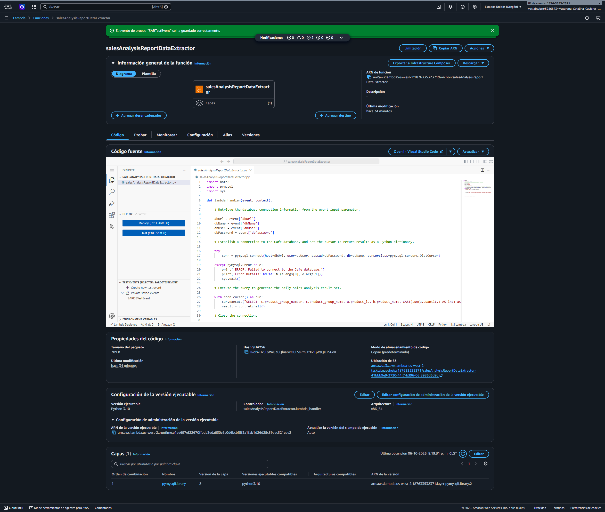
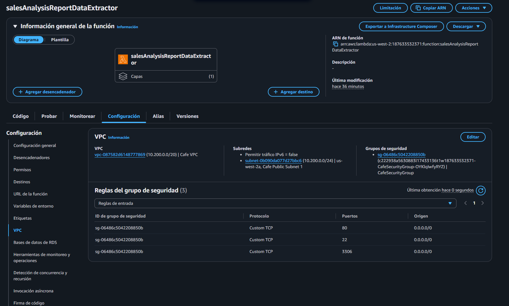
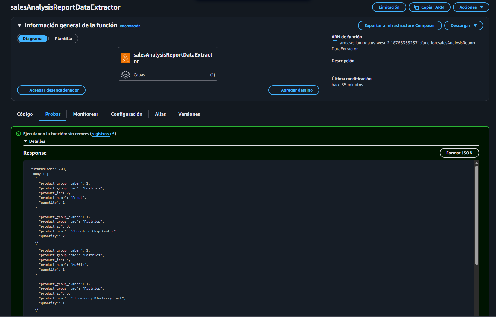
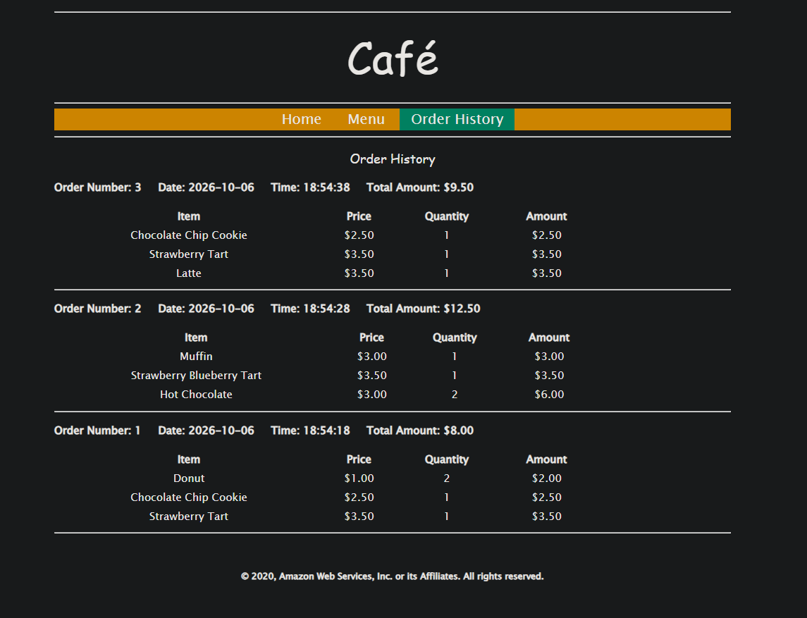
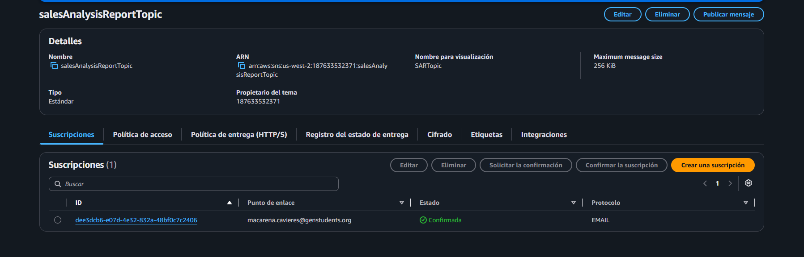
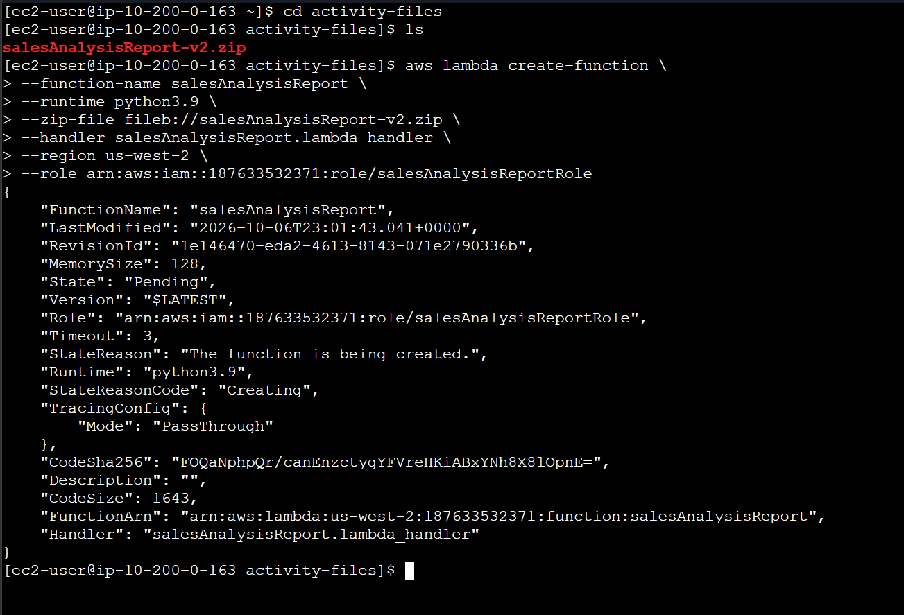
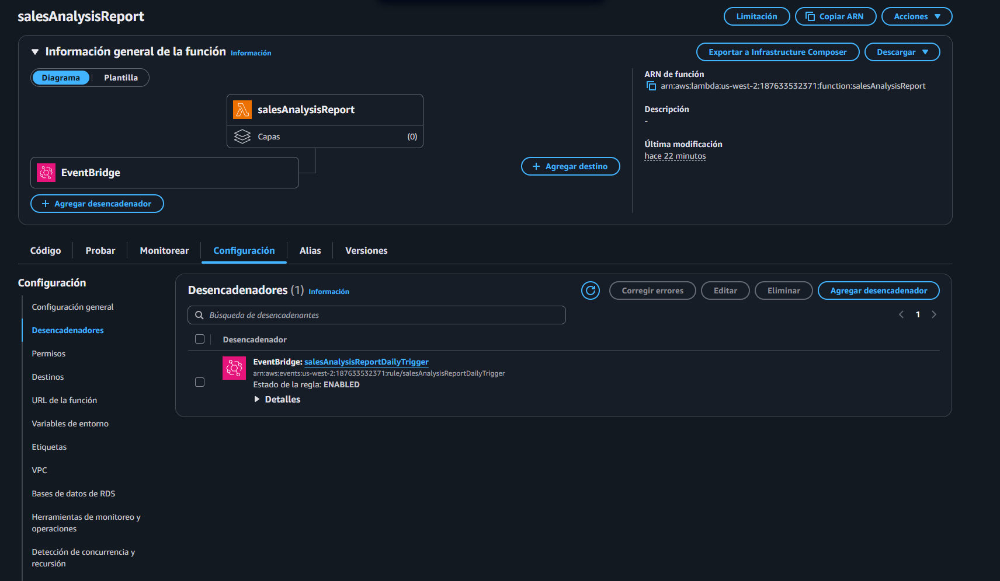
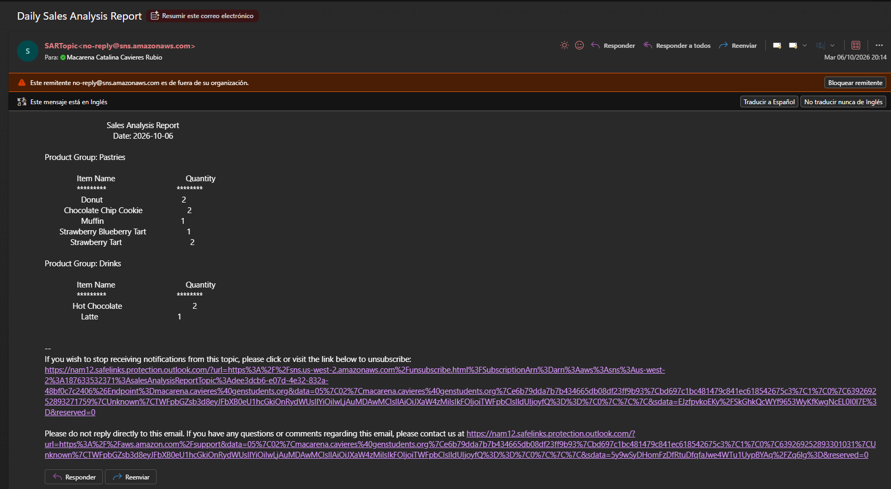

# Lab 178 Trabajo con AWS Lambda y Soluciones Serverless de Análisis de Ventas


## Descripción General

En este laboratorio se implementó y configuró una solución informática sin servidor (_serverless_) basada en **AWS Lambda** para generar y distribuir un informe diario de análisis de ventas. La arquitectura integra múltiples servicios de AWS: **AWS Systems Manager** para la gestión segura de credenciales de bases de datos, **Amazon EC2** alojando una base de datos MySQL (pila LAMP), una **Capa de Lambda** con dependencias personalizadas en Python (`PyMySQL`), **Amazon SNS** para la distribución de alertas por correo electrónico, y **Amazon EventBridge (CloudWatch Events)** como desencadenador programado mediante expresiones Cron.

## Flujo de Ejecución de la Solución:

- Paso 1: Un evento de Amazon CloudWatch llama a la función de Lambda `salesAnalysisReport` todos los días, de lunes a sábado a las 20:00 h.
- Paso 2: La función de Lambda `salesAnalysisReport` invoca otra función de Lambda, `salesAnalysisReportDataExtractor`, para recuperar los datos del informe.
- Paso 3: La función `salesAnalysisReportDataExtractor` ejecuta una consulta analítica en la base de datos de la cafetería (cafe_db).
- Paso 4: El resultado de la consulta se devuelve a la función `salesAnalysisReport`.
- Paso 5: La función `salesAnalysisReport` da formato de mensaje al informe y lo publica en el tema salesAnalysisReportTopic de Amazon SNS.
- Paso 6: El tema de SNS envía el mensaje a través de un correo electrónico al administrador.

## Objetivos del Laboratorio

- Reconocer los permisos de políticas de **IAM** necesarios para facilitar la integración de funciones Lambda con otros recursos de AWS.
- Crear una **Capa de Lambda** (_Lambda Layer_) para resolver dependencias de bibliotecas externas en Python.
- Desarrollar y configurar funciones de Lambda orientadas a la extracción de datos desde bases de datos relacionales y formateo de informes.
- Implementar conectividad de red segura entre funciones Lambda y recursos desplegados dentro de una VPC.
- Configurar desencadenadores automatizados basados en expresiones de programación y utilizar Registros de CloudWatch para la depuración de errores.

## Estructura y Paso a Paso del Laboratorio

### Tarea 1: Observar las Configuraciones del Rol de IAM

1. Revisar en la consola de IAM los roles creados previamente para las funciones:
   - `salesAnalysisReportRole`: Configurado con políticas de acceso a SNS (`AmazonSNSFullAccess`), Systems Manager (`AmazonSSMReadOnlyAccess`), CloudWatch Logs (`AWSLambdaBasicRunRole`) y permisos de invocación de Lambda (`AWSLambdaRole`).
   - `salesAnalysisReportDERole`: Configurado con acceso básico de ejecución y conectividad de red con VPC (`AWSLambdaVPCAccessRunRole`).

### Tarea 2: Crear una Capa de Lambda y una Función de Extracción de Datos

1. **Creación de la Capa de Lambda:**
   - Descargar el archivo `pymysql-v3.zip`.
   - En la consola de Lambda, ir a **Capas** > **Crear una capa**:
     - **Nombre:** `pymysqlLibrary`
     - **Descripción:** `PyMySQL library modules`
     - **Archivo:** Cargar `pymysql-v3.zip`
     - **Tiempos de ejecución compatibles:** Python 3.9
2. **Creación de la Función de Extracción:**
   - Crear una función desde cero llamada `salesAnalysisReportDataExtractor` con entorno **Python 3.9** y rol de ejecución existente `salesAnalysisReportDERole`.
   - Adjuntar la capa `pymysqlLibrary` (versión 1) a la función.
   - Configurar el controlador (_Handler_) como `salesAnalysisReportDataExtractor.lambda_handler` y cargar el código fuente mediante el archivo `.zip` correspondiente (`salesAnalysisReportDataExtractor-v3.zip`).
3. **Establecer la Configuración de Red (VPC):**
   - Configurar la conectividad de la función para que tenga acceso a la base de datos de la cafetería:
     - **VPC:** `Cafe VPC`
     - **Subredes:** `Cafe Public Subnet 1`
     - **Grupos de seguridad:** `CafeSecurityGroup`


_Figura 1: Función lambda `salesAnalysisReportDataExtractor`_

### Tarea 3: Probar y Solucionar Problemas del Extractor de Datos

1. **Configuración del Evento de Prueba:**
   - Obtener los parámetros de conexión desde el **Almacén de parámetros** de Systems Manager (`/cafe/dbUrl`, `/cafe/dbName`, `/cafe/dbUser`, `/cafe/dbPassword`).
   - Configurar un evento de prueba JSON en la consola de Lambda con dichos parámetros.
2. **Resolución del Error de Timeout:**
   - Al ejecutar la prueba inicial, se genera un error de tiempo de espera (_Task timed out after 3.00 seconds_) debido a restricciones de red.
     
     _Figura 2: Instancias del scaling group inicializándose_
   - **Solución:** Agregar una regla de entrada en el grupo de seguridad de la base de datos MySQL para permitir el tráfico en el puerto estándar **3306**.
3. **Propagación de Datos y Prueba Funcional:**
   - Acceder al sitio web de la cafetería mediante la dirección IP pública de la instancia EC2 (`http://<publicIP>/cafe`) y realizar un pedido de prueba para poblar la base de datos MySQL.
   - Volver a ejecutar la prueba en la función Lambda para verificar la correcta extracción de los registros de ventas en formato JSON.

   
   _Figura 3: Resultado de probar la funcion Lambda_

   
   _Figura 4: Órdenes de compra del sitio web_

### Tarea 4: Configurar las Notificaciones de Amazon SNS

1. **Creación del Tema de SNS:**
   - En la consola de Amazon SNS, crear un tema estándar llamado `salesAnalysisReportTopic` (Nombre para visualización: `SARTopic`). Copiar el ARN resultante.
2. **Suscripción de Correo Electrónico:**
   - Crear una suscripción seleccionando el protocolo **Correo electrónico** e ingresando una dirección válida.
   - Revisar la bandeja de entrada y confirmar la suscripción mediante el enlace enviado por AWS Notifications.

   
   _Figura 5: Detalles del Tópico de SNS_

### Tarea 5: Crear y Configurar la Función Principal de Lambda

1. **Creación mediante AWS CLI:**
   - Conectarse a la instancia `CLI Host` mediante **EC2 Instance Connect**.
   - Configurar las credenciales de la CLI ejecutando `aws configure`.
   - Crear la función principal ejecutando el comando de la CLI:
     ```bash
     aws lambda create-function \
     --function-name salesAnalysisReport \
     --runtime python3.9 \
     --zip-file fileb://salesAnalysisReport-v2.zip \
     --handler salesAnalysisReport.lambda_handler \
     --region us-west-2 \
     --role <salesAnalysisReportRoleARN>
     ```

   
   _Figura 6: Comandos ejecutados en la CLI para el paso 1_

2. **Configuración de Variables de Entorno:**
   - En la consola de Lambda, acceder a `salesAnalysisReport` > **Configuración** > **Variables de entorno**.
   - Agregar la clave `topicARN` asignando como valor el ARN del tema de SNS creado anteriormente.
3. **Prueba de Unidades:**
   - Ejecutar una prueba unitaria desde la consola de Lambda para verificar el envío exitoso del correo electrónico con el informe diario de ventas.
4. **Agregar un Desencadenador Programado (EventBridge):**
   - En la sección de configuración de la función, hacer clic en **Agregar desencadenador** seleccionando **EventBridge (CloudWatch Events)**.
   - Crear una nueva regla (`salesAnalysisReportDailyTrigger`) utilizando una expresión de programación Cron (por ejemplo, para ejecución de lunes a sábado).

   
   _Figura 7: Vista del desencadenador `EventBridge`_

   
   _Figura 8: Email con el reporte_

## Resumen de Recursos y Componentes

| Servicio / Recurso     | Nombre del Componente              | Descripción y Función Técnica                                                                     |
| :--------------------- | :--------------------------------- | :------------------------------------------------------------------------------------------------ |
| **AWS Lambda**         | `salesAnalysisReportDataExtractor` | Función basada en Python 3.9 encargada de consultar la base de datos MySQL mediante PyMySQL.      |
| **AWS Lambda**         | `salesAnalysisReport`              | Función principal que coordina la extracción de datos, procesa el formato y publica los informes. |
| **Lambda Layer**       | `pymysqlLibrary`                   | Capa reutilizable que almacena los módulos de la biblioteca cliente PyMySQL.                      |
| **Systems Manager**    | Almacén de Parámetros              | Repositorio seguro de credenciales y parámetros de conexión (`/cafe/...`).                        |
| **Amazon SNS**         | `salesAnalysisReportTopic`         | Tema estándar encargado de enrutar y entregar las notificaciones por correo electrónico.          |
| **Amazon EventBridge** | `salesAnalysisReportDailyTrigger`  | Desencadenador basado en expresiones Cron para la ejecución automatizada del informe.             |

---

## Conclusiones del Laboratorio

- **Arquitectura Sin Servidor Eficiente:** El uso de AWS Lambda permite ejecutar lógica de negocio bajo demanda sin necesidad de administrar servidores dedicados, optimizando costos operativos.
- **Desacoplamiento Mediante Capas y SNS:** Las capas de Lambda facilitan la modularización y reutilización de código (como controladores de bases de datos), mientras que Amazon SNS desacopla el procesamiento de datos de la entrega de notificaciones a los administradores.
- **Automatización Programada:** La combinación de funciones Lambda con eventos de EventBridge (CloudWatch Events) posibilita la creación de rutinas administrativas autónomas y confiables basadas en horarios específicos.
