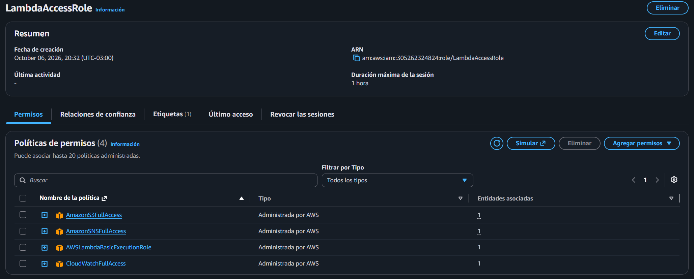
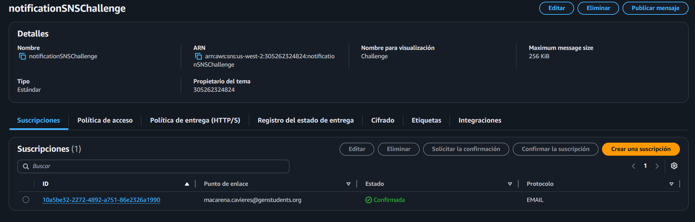
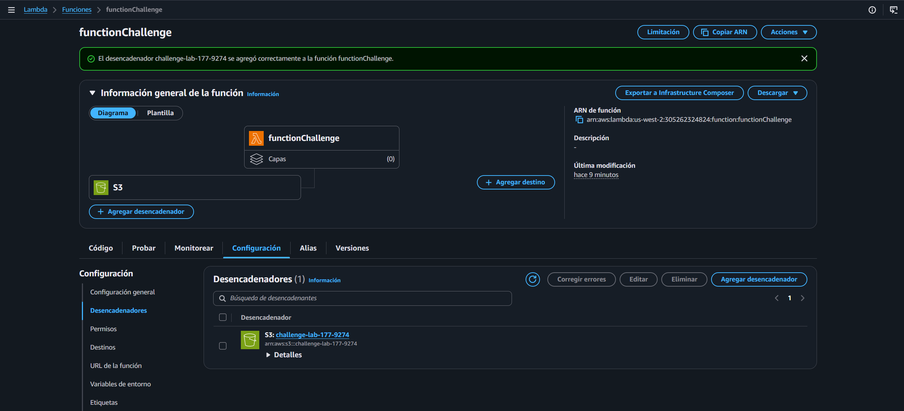
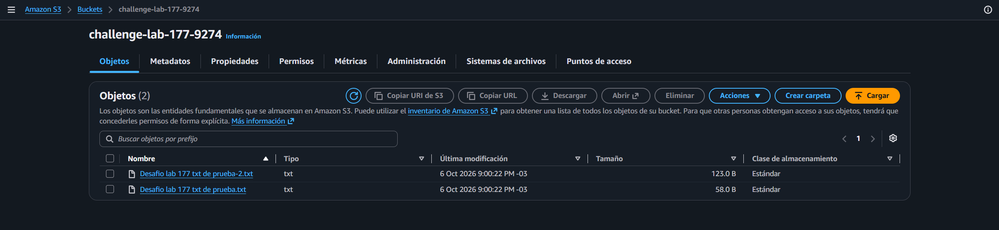
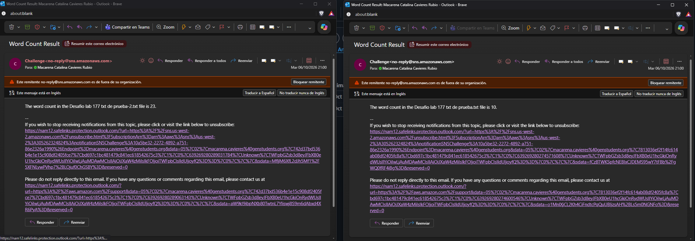

# Lab 117 Ejercicio de AWS Lambda (Desafío - Conteo de Palabras con S3 y SNS)


## Descripción General

En este laboratorio de desafío se diseñó e implementó una solución basada en **AWS Lambda** para procesar automáticamente archivos de texto cargados en un bucket de **Amazon S3**. La arquitectura permite que, al subir un archivo `.txt`, S3 invoque de forma nativa a la función Lambda para calcular el número exacto de palabras de su contenido utilizando la librería `boto3`. Posteriormente, el resultado se formatea bajo una estructura específica y se distribuye de manera automatizada al administrador mediante una alerta por correo electrónico utilizando un tema de **Amazon SNS**.

## Objetivos del Laboratorio

- Crear una función de **AWS Lambda** en Python orientada a la lectura de objetos y procesamiento algorítmico de texto.
- Configurar un bucket de **Amazon S3** para que actúe como desencadenador (_trigger_) ante la carga de nuevos archivos.
- Crear y configurar un tema de **Amazon SNS** y una suscripción de correo electrónico para informar el recuento de palabras.
- Utilizar el rol de IAM preestablecido (`LambdaAccessRole`) para otorgar los permisos necesarios de ejecución y acceso a servicios.

### Tarea 1: Configuración de Recursos y Permisos IAM

1. Asegurar la selección de una región de AWS coherente para todos los recursos del desafío (por ejemplo, `us-west-2`).
2. Utilizar el rol de IAM preexistente `LambdaAccessRole` provisto por el entorno de laboratorio, el cual integra políticas administradas para:
   - **CloudWatch Logs:** Escritura de registros de ejecución (`AWSLambdaBasicExecutionRole`).
   - **Amazon SNS:** Acceso completo para la gestión y publicación de temas (`AmazonSNSFullAccess`).
   - **Amazon S3:** Acceso total de lectura y administración sobre los buckets (`AmazonS3FullAccess`).
   - **Amazon CloudWatch:** Acceso completo de monitoreo (`CloudWatchFullAccess`).

   
   _Figura 1: Políticas del rol `LambdaAccessRole`_

### Tarea 2: Crear el Tema de Amazon SNS y la Suscripción

1. Ir al servicio **Amazon SNS** en la consola de AWS.
2. Crear un tema de tipo **Standard** (Estándar) y copiar su ARN.
3. Dentro del tema, crear una suscripción:
   - **Protocolo:** Email.
   - **Endpoint:** Tu dirección de correo electrónico.
4. **Importante:** Revisar la bandeja de entrada del correo y hacer clic en **Confirm subscription**. Si no se confirma, SNS no enviará ninguna notificación.

   
   _Figura 2: Detalles del tema de SNS_

### Tarea 3: Crear o Identificar el Bucket de Amazon S3

1. Ir al servicio **Amazon S3**.
2. Identificar el nombre del bucket aprovisionado por el laboratorio o crear uno nuevo en la misma región de AWS.

### Tarea 4: Crear y Configurar la Función de AWS Lambda

1. Ir a **AWS Lambda** y seleccionar **Create function** (Crear función).
2. Configuración general:
   - **Nombre:** Nombre descriptivo de la función.
   - **Runtime:** Python 3.11 o Python 3.12.
   - **Execution role:** Seleccionar _Use an existing role_ y elegir `LambdaAccessRole`.
3. Pegar el siguiente código de Python en el editor de `lambda_function.py`, reemplazando la variable `SNS_TOPIC_ARN` con el ARN copiado en el Paso 1:

```python
import json
import urllib.parse
import boto3

# Inicializamos los clientes de AWS fuera del handler para reutilizar conexiones
s3_client = boto3.client('s3')
sns_client = boto3.client('sns')

# Reemplaza este valor con el ARN real de tu tema SNS creado en la consola
SNS_TOPIC_ARN = "arn:aws:sns:REGION:ACCOUNT_ID:TU_TEMA_SNS"

def lambda_handler(event, context):
    bucket_name = "Desconocido"
    file_key = "Desconocido"

    try:
        # 1. Obtener el nombre del bucket y la clave (nombre) del archivo desde el evento de S3
        record = event['Records'][0]
        bucket_name = record['s3']['bucket']['name']

        # S3 codifica los nombres de archivos con caracteres especiales (ej: espacios como '+')
        file_key = urllib.parse.unquote_plus(record['s3']['object']['key'])

        # 2. Leer el contenido del archivo subido a S3
        response = s3_client.get_object(Bucket=bucket_name, Key=file_key)
        file_content = response['Body'].read().decode('utf-8')

        # 3. Contar el número de palabras
        # split() sin argumentos separa por cualquier espacio en blanco (espacios, saltos de línea, tabs)
        words = file_content.split()
        word_count = len(words)

        # 4. Construir el mensaje con el formato exacto requerido por el lab
        message_body = f"The word count in the {file_key} file is {word_count}."
        email_subject = "Word Count Result"

        # 5. Publicar el resultado en el tema de Amazon SNS
        sns_client.publish(
            TopicArn=SNS_TOPIC_ARN,
            Subject=email_subject,
            Message=message_body
        )

        return {
            'statusCode': 200,
            'body': json.dumps(f"Procesado exitosamente. Recuento: {word_count}")
        }

    except Exception as e:
        print(f"Error procesando el archivo {file_key} del bucket {bucket_name}: {str(e)}")
        raise e
```

4. Hacer clic en **Deploy** para guardar los cambios.

### Tarea 5: Configurar el Desencadenador (Trigger) en S3

1. En la consola de Lambda, dentro de la vista general de la función, hacer clic en **Add trigger** (Agregar desencadenador).
2. Seleccionar **S3**.
3. Seleccionar el bucket de S3 correspondiente.
4. En _Event type_, seleccionar **All object create events** (`s3:ObjectCreated:*`).
5. Guardar los cambios.


_Figura 3: Desencadenador S3_

### Tarea 6: Probar la Solución

1. Ir al bucket en **Amazon S3** y subir un archivo `.txt` de prueba.
2. Revisar la bandeja de entrada del correo electrónico para verificar la llegada del resultado con el recuento de palabras bajo el formato requerido (`The word count in the <textFileName> file is nnn.`).
3. En caso de errores o fallos, revisar los registros de ejecución en **Amazon CloudWatch** (Log Groups asociados a la función Lambda).


_Figura 4: Carga de los archivos `.txt` al bucket S3_


_Figura 5: Correos del conteo de las palabras de los archivos cargados a S3_

## Resumen de Recursos y Componentes

| Servicio / Recurso | Nombre del Componente         | Descripción y Función Técnica                                                                    |
| :----------------- | :---------------------------- | :----------------------------------------------------------------------------------------------- |
| **AWS Lambda**     | Función de Conteo de Palabras | Componente _serverless_ en Python encargado de procesar objetos de texto y calcular métricas.    |
| **Amazon S3**      | Bucket de Almacenamiento      | Repositorio de archivos configurado para activar notificaciones ante la creación de objetos.     |
| **Amazon SNS**     | Tema de Notificaciones        | Servicio de mensajería encargado de distribuir los resultados del conteo vía correo electrónico. |
| **IAM Role**       | `LambdaAccessRole`            | Rol de seguridad con políticas integradas para S3, SNS, CloudWatch Logs y ejecución de Lambda.   |

## Conclusiones del Laboratorio

- **Automatización Basada en Eventos:** La integración nativa entre Amazon S3 y AWS Lambda permite desencadenar flujos de procesamiento de datos de manera instantánea ante la llegada de nuevos archivos.
- **Desacoplamiento y Notificación Ágil:** El uso de Amazon SNS facilita la entrega inmediata de resultados analíticos a administradores mediante suscripciones de correo validadas.
- **Eficiencia Operativa:** Resolver desafíos de procesamiento de archivos mediante arquitecturas _serverless_ elimina la necesidad de aprovisionar infraestructura dedicada, reduciendo costos y complejidad de mantenimiento.
