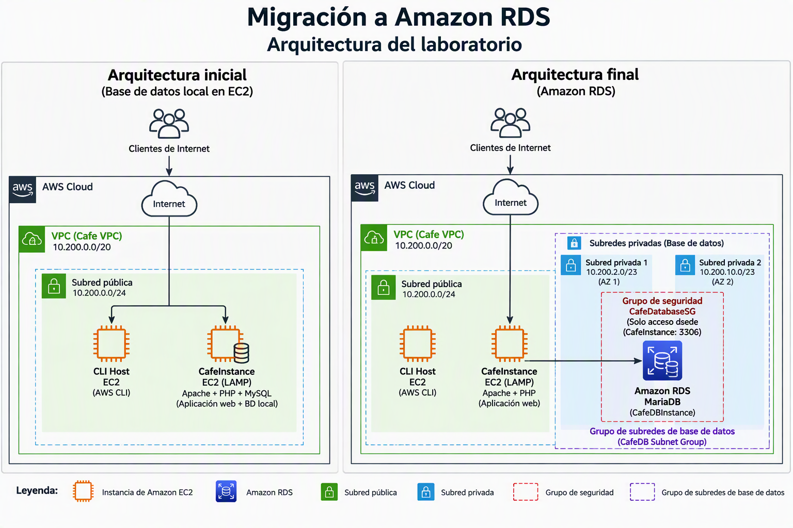
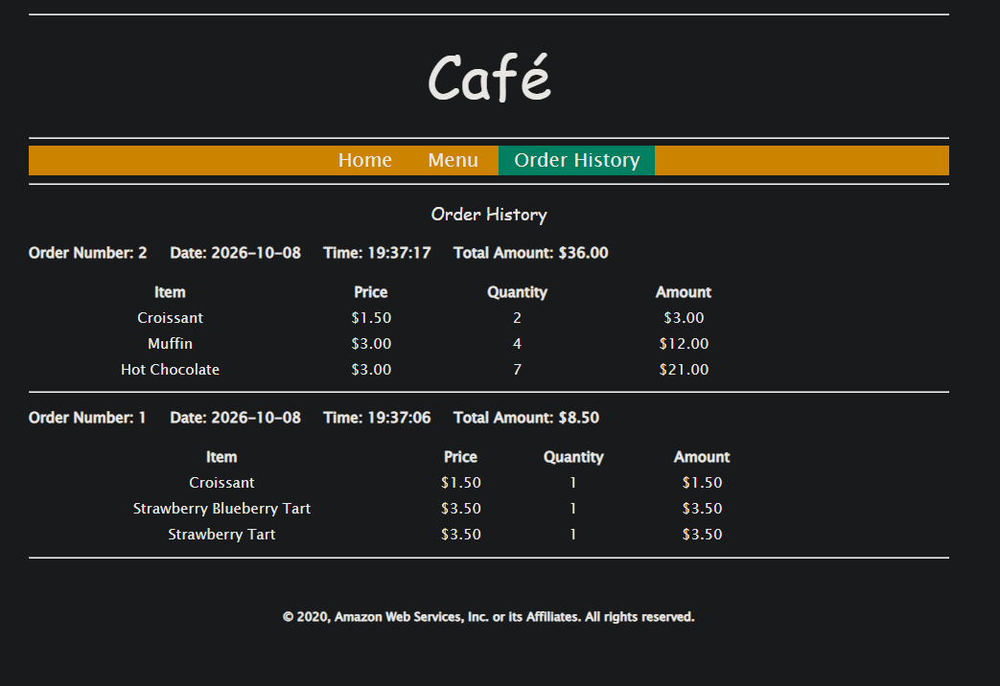
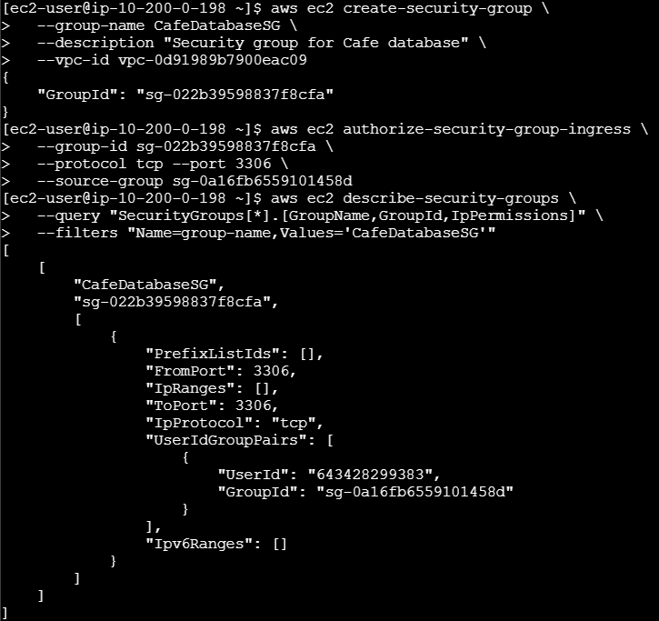
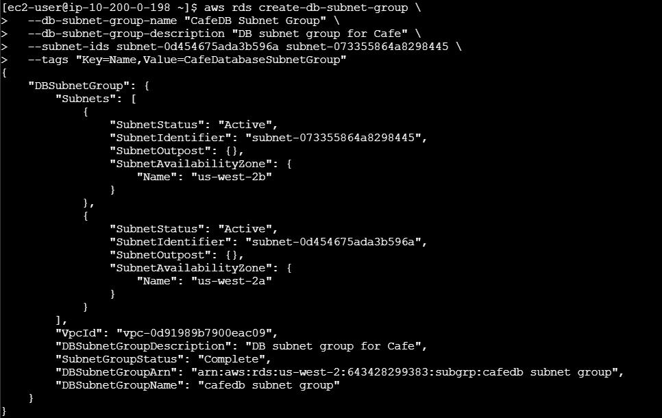
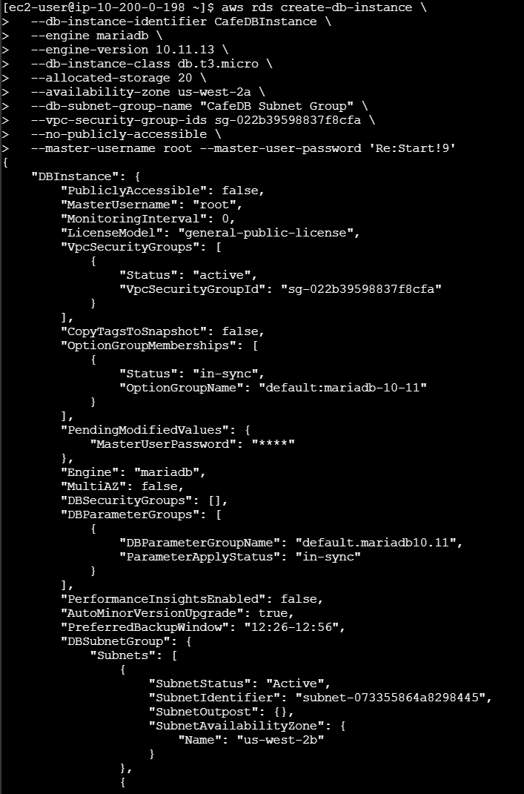
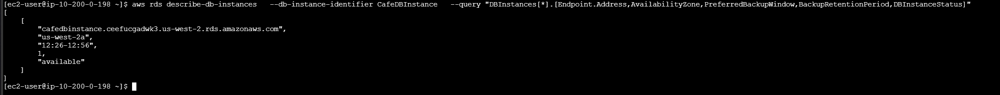
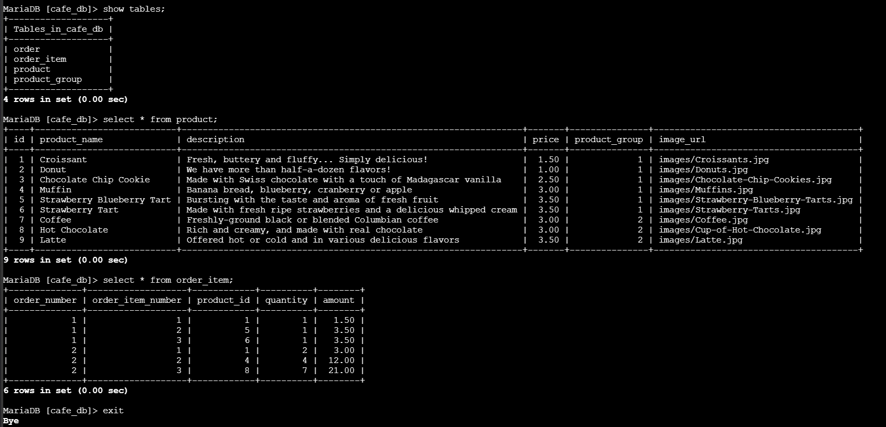
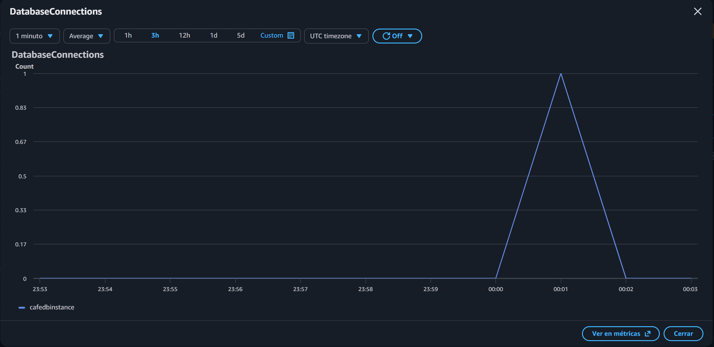

# Lab 179 Migración de Base de Datos Local a Amazon RDS (MariaDB)


## Descripción General

En este laboratorio se migró la arquitectura de datos de una aplicación web de cafetería desde una instancia de base de datos local ejecutada en un servidor EC2 (pila LAMP) hacia una instancia administrada de **Amazon Relational Database Service (Amazon RDS)** con motor MariaDB. El proceso abarcó la creación automatizada de componentes de red y seguridad (grupo de seguridad y subredes privadas), el respaldo y transferencia de datos relacionales mediante herramientas de la línea de comandos (`mysqldump` y cliente `mysql`), la reconfiguración de la aplicación mediante **AWS Systems Manager Parameter Store** y la supervisión del rendimiento con **Amazon CloudWatch**.

## Arquitectura Inicial

Antes de la migración, la aplicación web de la cafetería se ejecutaba completamente sobre una única instancia de Amazon EC2 con arquitectura **LAMP (Linux, Apache, MariaDB/MySQL y PHP)**. Tanto la lógica de la aplicación como la base de datos residían en el mismo servidor, ubicado en una subred pública dentro de la VPC.

Los clientes accedían a la aplicación a través de Internet, mientras que una instancia adicional denominada **CLI Host** permitía administrar el entorno mediante la AWS CLI.

**Componentes principales:**

- Amazon EC2 (CafeInstance) con Apache, PHP y MariaDB.
- Base de datos local alojada en la misma instancia EC2.
- Subred pública dentro de la VPC.
- CLI Host para tareas administrativas.
- Acceso de clientes desde Internet.

## Arquitectura Final

Después de la migración, la capa de base de datos fue desacoplada de la instancia de aplicación y trasladada a **Amazon RDS para MariaDB**, un servicio administrado que proporciona alta disponibilidad, monitoreo y administración simplificada.

La aplicación continúa ejecutándose en la instancia EC2, pero ahora establece conexiones hacia una instancia de Amazon RDS ubicada en subredes privadas dentro de la misma VPC. El acceso a la base de datos está restringido mediante un grupo de seguridad dedicado que permite conexiones únicamente desde la instancia de aplicación.

Para cumplir con las mejores prácticas de Amazon RDS, se creó un **DB Subnet Group** compuesto por dos subredes privadas distribuidas en diferentes Zonas de Disponibilidad (Availability Zones).


_Figura 1: Imagen de la arquitectura inicial y final del lab_

## Objetivos del Laboratorio

- Crear una instancia **MariaDB de Amazon RDS** y sus componentes de infraestructura asociados mediante la **AWS CLI**.
- Migrar datos relacionales desde una base de datos local en una instancia EC2 hacia la nueva instancia administrada de RDS.
- Reconfigurar los parámetros de conexión de la aplicación utilizando **AWS Systems Manager**.
- Supervisar el estado y las métricas de rendimiento de la base de datos mediante **Amazon CloudWatch**.

## Estructura y Paso a Paso del Laboratorio

### Tarea 1: Generar Datos de Pedido en el Sitio Web

1. Obtener la URL de la aplicación desde los detalles del entorno (`CafeInstanceURL`).
2. Acceder al sitio web de la cafetería, navegar al menú y realizar varios pedidos para registrar datos iniciales en la base de datos local.
3. Consultar la sección de historial de pedidos para contabilizar los registros generados antes de la migración.


_Figura 2: Detalles del tema de SNS_

### Tarea 2: Creación de Infraestructura y Configuración para RDS

#### 1. Security Group para Base de Datos

Se creó un grupo de seguridad dedicado para la instancia RDS con el objetivo de permitir conexiones TCP en el puerto 3306 y restringir el acceso únicamente desde la instancia de aplicación.

```bash
aws ec2 create-security-group \
--group-name CafeDatabaseSG \
--description "Security group for Cafe database" \
--vpc-id <vpc-id>
```

Regla de Entrada

```bash
aws ec2 authorize-security-group-ingress \
--group-id <db-sg-id> \
--protocol tcp \
--port 3306 \
--source-group <app-sg-id>
```


_Figura 3: Comandos ejecutados para crear un SG y configurar las reglas de entrada_

### 2. Creación de Subredes Privadas

Se implementaron dos subredes privadas en distintas Availability Zones para soportar la creación del DB Subnet Group requerido por Amazon RDS.

| Subred           | CIDR           | Zona de Disponibilidad |
| :--------------- | :------------- | :--------------------- |
| Private Subnet 1 | 10.200.2.0/23  | us-west-2a             |
| Private Subnet 2 | 10.200.10.0/23 | us-west-2b             |

### 3. Creación del DB Subnet Group

Amazon RDS requiere al menos dos subredes ubicadas en zonas de disponibilidad diferentes.

```bash
aws rds create-db-subnet-group \
--db-subnet-group-name "CafeDB Subnet Group" \
--db-subnet-group-description "DB subnet group for Cafe" \
--subnet-ids subnet-1 subnet-2
```


_Figura 4: Comandos ejecutados para crear el grupo de subred_

### 4. Creación de la Instancia Amazon RDS

Configuración aplicada:

- Motor: MariaDB
- Versión: 10.5
- Clase: db.t3.micro
- Almacenamiento: 20 GB
- Acceso Público: No

```bash
aws rds create-db-instance \
--db-instance-identifier CafeDBInstance \
--engine mariadb \
--db-instance-class db.t3.micro \
--allocated-storage 20 \
--db-subnet-group-name "CafeDB Subnet Group"
```


_Figura 5: Comandos ejecutados para crear instancia de Amazon RDS_

Posteriormente se verificó el estado de la instancia mediante la CLI con:

```bash
aws rds describe-db-instances \
--db-instance-identifier CafeDBInstance \
--query "DBInstances[*].[Endpoint.Address,AvailabilityZone,PreferredBackupWindow,BackupRetentionPeriod,DBInstanceStatus]"
```


_Figura 6: Comandos ejecutados para verificar el estado de la instancia_

### Tarea 3: Migrar los Datos de la Aplicación a Amazon RDS

1. **Respaldo Local (Dump):**
   - Conectarse a la instancia `CafeInstance` y generar un respaldo de la base de datos local `cafe_db` utilizando la herramienta `mysqldump`:
     ```bash
     mysqldump --user=root --password=<Password> --databases cafe_db --add-drop-database > cafedb-backup.sql
     ```
2. **Restauración en RDS:**
   - Restaurar el archivo de respaldo directamente en la instancia de Amazon RDS utilizando su punto de enlace:
     ```bash
     mysql --user=root --password=<Password> --host=<RDS-Endpoint-Address> < cafedb-backup.sql
     ```
3. **Verificación de Datos:**
   - Abrir una sesión de MySQL interactiva hacia la base de datos RDS y verificar la integridad de los registros:
     ```bash
     mysql --user=root --password=<Password> --host=<RDS-Endpoint-Address> cafe_db
     select * from product;
     ```

4. **Consulta de validación ejecutada:**
   - Se ingresa el enunciado de SQL para recuperar los datos de la tabla:

     ```sql
     SELECT * FROM order_item;
     ```


_Figura 7: Comandos SQL para recuperar los datos de las tablas_

### Tarea 4: Configurar el Sitio Web para Utilizar Amazon RDS

1. En la consola de administración de AWS, ir a **AWS Systems Manager** y seleccionar **Almacén de parámetros**.
2. Seleccionar el parámetro `/cafe/dbUrl` y hacer clic en **Editar**.
3. Reemplazar el valor actual por la dirección del punto de enlace de la instancia de RDS (`CafeDBInstance`) y guardar los cambios.
4. Validar el funcionamiento de la aplicación abriendo el sitio web y comprobando que el historial de pedidos refleje exactamente la misma cantidad de registros previos a la migración.

### Tarea 5: Supervisar la Base de Datos de Amazon RDS

1. Navegar a la consola de **Amazon RDS** y seleccionar `cafedbinstance`.
2. Ir a la pestaña **Monitorización** para revisar las métricas clave de CloudWatch (como `CPUUtilization`, `DatabaseConnections`, `FreeStorageSpace`, `ReadIOPS` y `WriteIOPS`).
3. Comprobar el comportamiento de la métrica `DatabaseConnections` abriendo una sesión interactiva hacia la base de datos desde la terminal y cerrándola posteriormente para verificar la variación de las conexiones activas en tiempo real.


_Figura 8: Métrica de `DatabaseConnections` de Cloudwatch_

## Resumen de Recursos y Componentes

| Servicio / Recurso       | Nombre del Componente       | Descripción y Función Técnica                                                                                   |
| :----------------------- | :-------------------------- | :-------------------------------------------------------------------------------------------------------------- |
| **Amazon RDS**           | `CafeDBInstance`            | Instancia administrada de base de datos MariaDB (v10.5.13) desplegada en subredes privadas.                     |
| **AWS Systems Manager**  | `/cafe/dbUrl`               | Almacén de parámetros utilizado para centralizar y actualizar la cadena de conexión de la aplicación.           |
| **Amazon EC2 / CLI**     | `CLI Host` & `CafeInstance` | Instancias de soporte para la ejecución de comandos AWS CLI, respaldos (`mysqldump`) y pruebas de conectividad. |
| **Amazon VPC & Subnets** | Subredes Privadas 1 y 2     | Infraestructura de red aislada que aloja de forma segura los recursos de base de datos.                         |
| **Security Group**       | `CafeDatabaseSG`            | Cortafuegos que restringe el acceso a la base de datos exclusivamente al puerto `3306` desde la aplicación.     |
| **Amazon CloudWatch**    | Métricas RDS                | Sistema de telemetría que recopila métricas de rendimiento y conexiones de base de datos por minuto.            |

## Conclusiones del Laboratorio

- **Administración Eficientizada:** La utilización de Amazon RDS elimina la necesidad de realizar mantenimiento operativo a nivel de sistema operativo en las bases de datos relacionales, delegando tareas como respaldos automatizados y alta disponibilidad.
- **Desacoplamiento Mediante Systems Manager:** Externalizar las cadenas de conexión en el Almacén de Parámetros permitió reconfigurar la aplicación web hacia la nueva base de datos sin necesidad de modificar ni recompilar el código fuente.
- **Monitoreo Continuo:** La integración nativa con Amazon CloudWatch proporciona visibilidad en tiempo real sobre el estado de salud, consumo de recursos y conexiones concurrentes de la base de datos.
