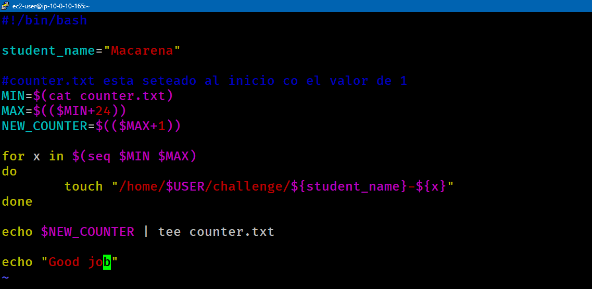
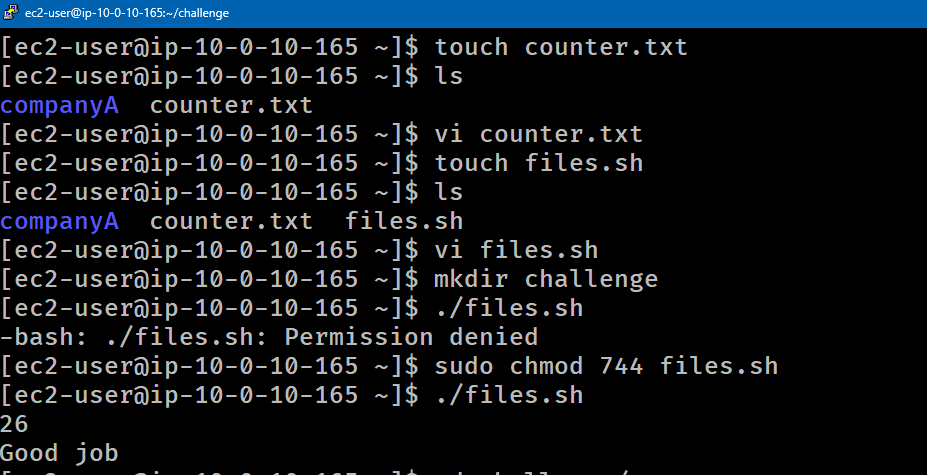
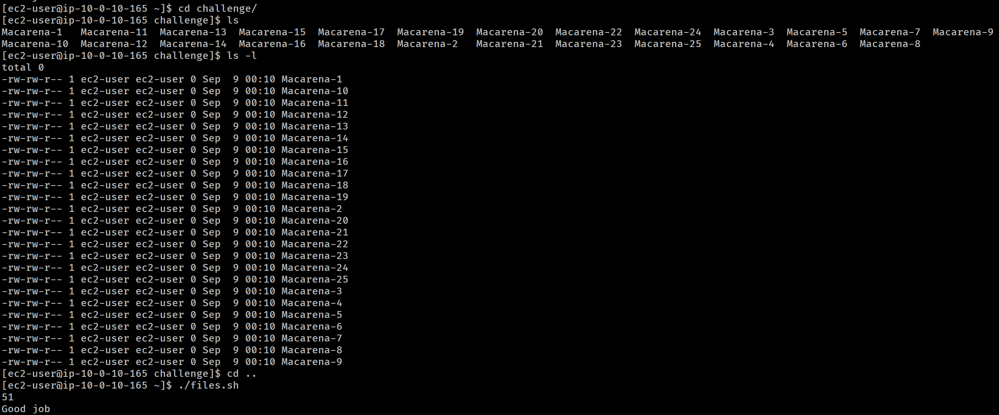
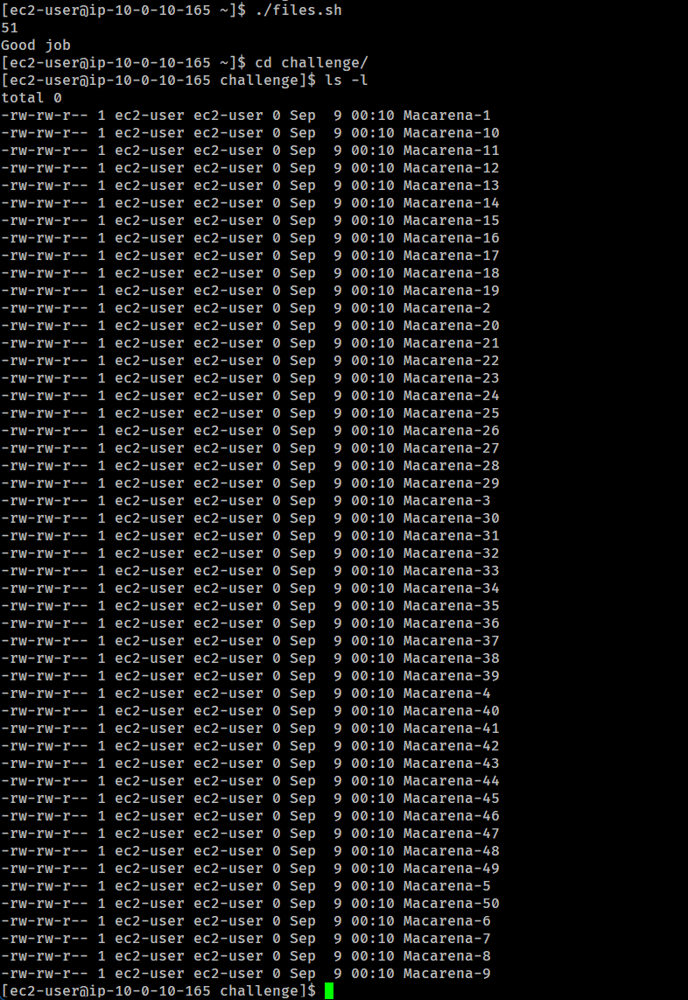

# Lab 253 Desafío Bash: Script de Generación Dinámica de Archivos con Control de Estado


## Descripción General

Este laboratorio consiste en un desafío práctico de automatización mediante _Shell Scripting_ en Linux. El objetivo es desarrollar un script funcional en Bash que genere lotes consecutivos de 25 archivos vacíos en cada ejecución, garantizando que la numeración sea incremental y persistente entre ejecuciones mediante la gestión de un archivo de estado interno (`counter.txt`).

## Requisitos del Desafío

- Crear 25 archivos vacíos de 0 KB por cada ejecución del script.
- Nombrar los archivos siguiendo el patrón `<nombreEstudiante>-<número>`.
- Garantizar que los números no estén estáticos (_hardcoded_), sino que se calculen automáticamente comenzando desde el último número generado.
- Mantener la persistencia del contador entre distintas ejecuciones.
- Validar la creación mediante una inspección detallada del directorio.

## Solución Implementada

### Archivo de Control de Estado (`counter.txt`)

Para almacenar el estado del lote actual de forma persistente, se inicializa el archivo `counter.txt` con el valor base:

```bash
echo 1 > counter.txt
```

### Script de Automatización (files.sh)

<p style="margin-bottom: 0px;">
  
</p>

_Figura 1: Captura del script `files.sh`_

### Pruebas de Validación y Ejecución

```bash
# Asignar permisos de ejecucion al script
chmod +x files.sh

# Primera ejecucion (genera del 1 al 25)
./files.sh

# Segunda ejecucion (genera del 26 al 50)
./files.sh

# Confirmar la creacion de archivos y sus tamaños (0 KB)
ls -la /home/$USER/challenge
```

<p style="margin-bottom: 0px;">
  
</p>

_Figura 2: Captura de todos los comandos ejecutados_

<p style="margin-bottom: 0px;">
  
</p>

_Figura 1: Lista de los archivos creados luego de la primera ejecucion del script `files.sh`_

<p style="margin-bottom: 0px;">
  
</p>

_Figura 4: Lista de los archivos creados luego de la segunda ejecucion del script `files.sh`_

## Resumen de Comandos y Sintaxis

| Comando | Opción / Flag | Descripción / Caso de Uso                                                             |
| :------ | :------------ | :------------------------------------------------------------------------------------ |
| `touch` | Directa       | Crea archivos vacíos o actualiza la marca de tiempo de archivos existentes.           |
| `seq`   | `MIN MAX`     | Genera una secuencia numérica desde un valor inicial hasta uno final.                 |
| `cat`   | Directa       | Lee el contenido del archivo de estado para asignar el valor inicial al script.       |
| `tee`   | Directa       | Escribe el nuevo valor del contador en `counter.txt` mientras lo muestra en pantalla. |
| `chmod` | `+x`          | Otorga permisos de ejecución al script de Bash.                                       |

## Aprendizajes Clave

- **Persistencia de Estado**: El uso de archivos auxiliares como `counter.txt` permite conservar variables entre distintas ejecuciones sin depender de procesos secundarios en segundo plano.

- **Aritmética en Bash**: La sintaxis `$((expresión))` facilita el cálculo de límites de iteración dinámicos dentro del entorno de la terminal.

- **Estructuras de Control Iterativas**: El bucle `for` combinado con la utilidad `seq` optimiza la creación masiva y secuencial de recursos en el sistema de archivos.
