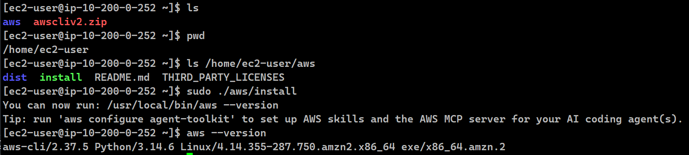
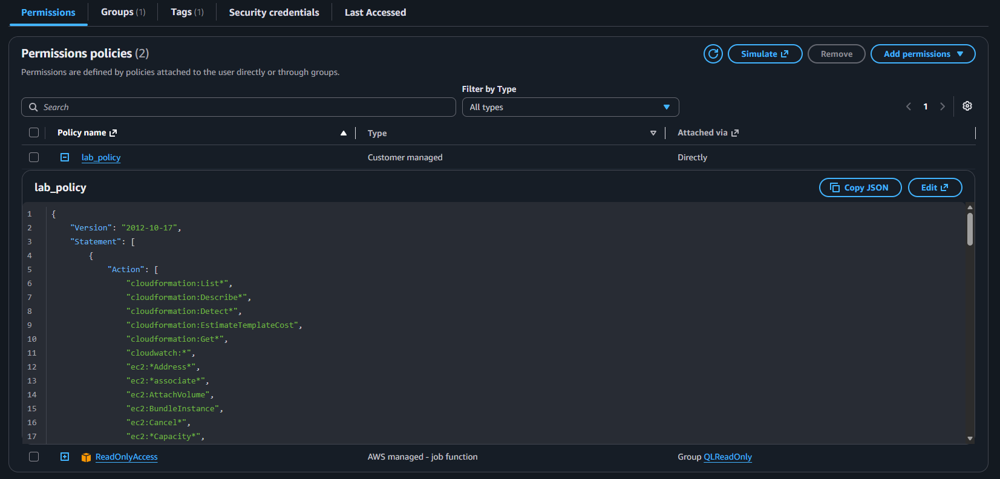
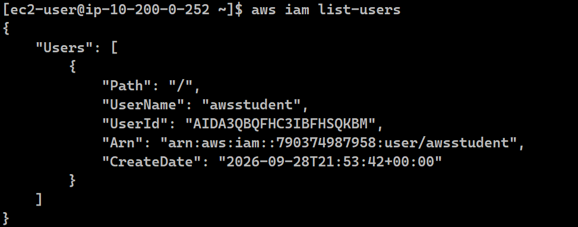
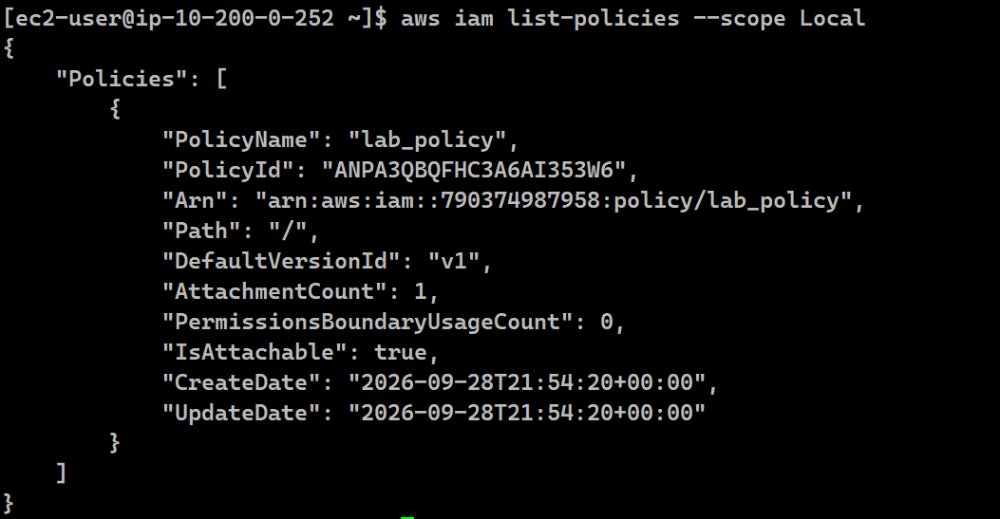
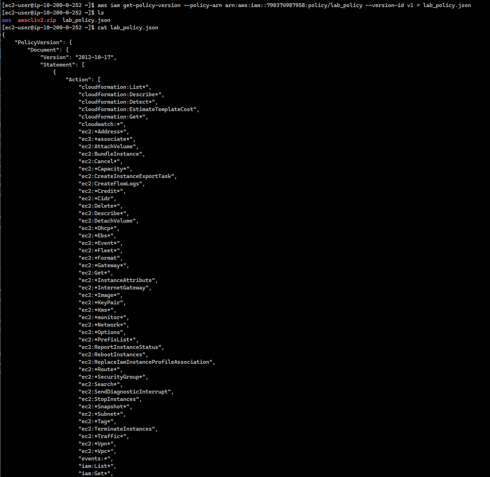

# Lab 168 Instalación y Configuración de la AWS CLI v2 en Red Hat Linux


## Descripción General

En este laboratorio práctico se desplegó e instaló la **AWS Command Line Interface (AWS CLI v2)** en un entorno **Red Hat Enterprise Linux (RHEL)** sobre **Amazon EC2**, un sistema operativo que no cuenta con esta herramienta preinstalada de fábrica. Se configuraron las credenciales de seguridad (**Access Key ID** y **Secret Access Key**) para enlazar la sesión CLI con la cuenta de AWS, y se practicaron comandos interactivos para auditar usuarios y extraer documentos de políticas en formato JSON dentro de **AWS IAM**.

## Arquitectura del Laboratorio

```text
[Cliente Local (SSH/PuTTY)]
         │ (Puerto 22)
         ▼
┌─────────────────────────────────────────────────────────────┐
│ AWS Cloud (LabVPC)                                          │
│  ┌───────────────────────────────────────────────────────┐  │
│  │ Amazon EC2 (Red Hat Enterprise Linux)                 │  │
│  │  └── AWS CLI v2                                       │  │
│  └──────────────────────────┬────────────────────────────┘  │
└─────────────────────────────┼───────────────────────────────┘
                              ▼ (API Calls)
                    ┌──────────────────┐
                    │     AWS IAM      │
                    │ (Users/Policies) │
                    └──────────────────┘
```

## Objetivos del Laboratorio

- Establecer conexión SSH segura hacia una instancia **Amazon EC2 Red Hat Linux**.
- Descargar, descomprimir e instalar **AWS CLI v2** desde los repositorios oficiales de AWS.
- Configurar credenciales programáticas (**Access Key ID** y **Secret Access Key**), región por defecto (`us-west-2`) y formato de salida (`json`).
- Interactuar con **AWS IAM** mediante la CLI para listar usuarios y recuperar políticas de seguridad.
- Resolver el desafío técnico extrayendo el documento de política `lab_policy.json` mediante comandos avanzados de la AWS CLI.

## Tarea 1: Instalar la AWS CLI en Red Hat Linux

1. Descargar el paquete de instalación oficial de AWS CLI v2:

```bash
curl "[https://awscli.amazonaws.com/awscli-exe-linux-x86_64.zip](https://awscli.amazonaws.com/awscli-exe-linux-x86_64.zip)" -o "awscliv2.zip"
```

2. Descomprimir el instalador descargado:

```bash
unzip -u awscliv2.zip
```

3. Ejecutar el script de instalación con permisos de superusuario (`sudo`):

```bash
sudo ./aws/install
```

4. Confirmar la instalación y versión instalada:

```bash
aws --version
```

_Resultado esperado: `aws-cli/2.x.x Python/3.x.x Linux/...`_


_Figura 1: Captura de los comandos ejecutados en la CLI de la tarea 1_

## Tarea 2: Observar la Configuración de IAM en la Consola

1. Navegar al servicio IAM en la Consola de Administración de AWS.

2. Seleccionar Users > awsstudent y revisar los permisos asignados bajo la política administrada por el cliente `lab_policy`.

3. Inspeccionar las credenciales programáticas asociadas al usuario en la pestaña Security credentials.


_Figura 2: Permisos observados en la consola del cliente `lab_policy`_

## Tarea 3: Configurar la AWS CLI para Conectarse a la Cuenta de AWS

1. Iniciar el asistente de configuración interactivo de la CLI:

```bash
aws configure
```

2. Ingresar los parámetros requeridos cuando la terminal lo solicite:
   - AWS Access Key ID: <SU_ACCESS_KEY_ID>
   - AWS Secret Access Key: <SU_SECRET_ACCESS_KEY>
   - Default region name: us-west-2
   - Default output format: json

## Tarea 4: Consultar IAM con la AWS CLI y Resolución del Desafío

1. Verificación Inicial de Usuarios
   Verificar la comunicación exitosa entre la CLI y el endpoint de IAM:

```bash
aws iam list-users
```


_Figura 3: Verificación de usuarios_

2. Desafío Práctico: Extracción de Política en Formato JSON \
   Listar las políticas administradas por el cliente (Customer Managed Policies) en la cuenta local:

```bash
aws iam list-policies --scope Local
```


_Figura 4: Lista de las políticas por el cliente_

Obtener la representación en formato JSON del documento `lab_policy` utilizando su ARN y su `DefaultVersionId` (`v1`), redirigiendo la salida hacia el archivo `lab_policy.json`:

```bash
aws iam get-policy-version --policy-arn arn:aws:iam::038946776283:policy/lab_policy --version-id v1 > lab_policy.json
```

Verificar la creación del archivo con el contenido de la política:

```bash
cat lab_policy.json
```


_Figura 5: `lab_policy` en formato JSON y el `cat` de la política_

## Resumen de Recursos y Componentes

| Servicio / Recurso | Nombre del Componente      | Descripción y Función Técnica                                                                               |
| :----------------- | :------------------------- | :---------------------------------------------------------------------------------------------------------- |
| **Amazon EC2**     | `Red Hat Enterprise Linux` | Instancia de cómputo utilizada como host ejecutor para instalar la utilidad de línea de comandos.           |
| **AWS CLI**        | `aws-cli/v2`               | Herramienta unificada de interfaz de línea de comandos para administrar servicios de AWS programáticamente. |
| **AWS IAM User**   | `awsstudent`               | Identidad programática configurada dentro de la CLI mediante Access Keys.                                   |
| **IAM Policy**     | `lab_policy`               | Documento de política en formato JSON que define los permisos y restricciones de acceso para el usuario.    |

## Conclusiones del Laboratorio

- **Versatilidad de AWS CLI:** Permite realizar tareas de administración, consulta y automatización de recursos de AWS de forma rápida desde entornos de servidor sin necesidad de la consola gráfica.
- **Seguridad y Credenciales Programáticas:** La autenticación se realiza de forma aislada mediante claves de acceso (**Access Key ID** y **Secret Access Key**) con permisos delimitados por el principio de mínimo privilegio.
- **Automatización y Canalización de Datos:** El uso de canalizaciones y redirecciones de comandos Shell (`>`) facilita la extracción de configuraciones del entorno (como políticas de seguridad JSON) para flujos de auditoría e infraestructura como código.
