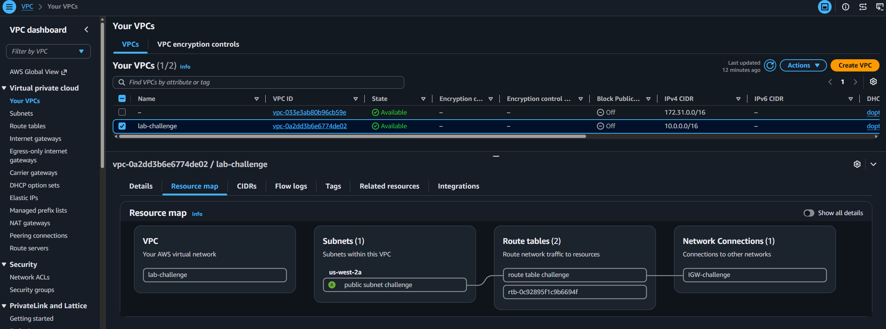
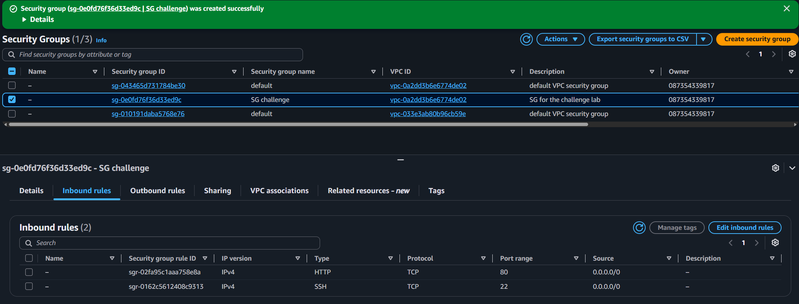
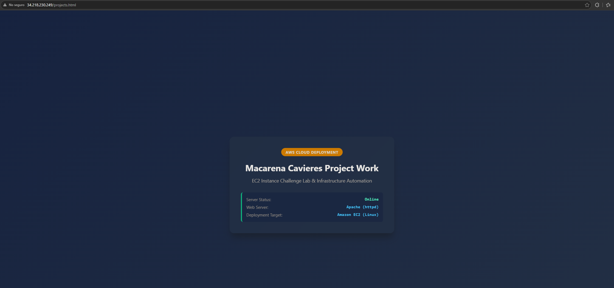

# Lab 172 Desafío de Aprovisionamiento de VPC, Subred Personalizada y Servidor Web Apache en Amazon EC2


## Descripción General

En este laboratorio de desafío (Lab 172) se diseñó e implementó una infraestructura en **Amazon Web Services (AWS)** adaptada a direccionamientos de red y scripts de inicialización específicos. Se configuró una red virtual personalizada en **Amazon VPC** (`192.168.0.0/18`) con una subred pública (`192.168.1.0/26`) y conectividad a Internet mediante un **Internet Gateway (IGW)**. Sobre esta red se lanzó una instancia **Amazon EC2** con **Amazon Linux** y almacenamiento **gp2**, utilizando **User Data** con `dnf` para automatizar la instalación de **Apache (`httpd`)** y delegar permisos de `/var/www/html` al usuario `ec2-user`. Finalmente, se desplegó `projects.html` vía **EC2 Instance Connect** y se capturó la evidencia requerida.

---

## Arquitectura del Laboratorio

```text
[Navegador / Evaluador] ──(HTTP / SSH)──► [Internet Gateway (IGW)]
                                                    │
┌───────────────────────────────────────────────────┼───────────────┐
│ Custom VPC (192.168.0.0/18)                       │               │
│  ┌────────────────────────────────────────────────┴────────────┐  │
│  │ Public Subnet (192.168.1.0/26)                              │  │
│  │  ┌───────────────────────────────────────────────────────┐  │  │
│  │  │ Web Security Group (Inbound: HTTP:80, SSH:22)         │  │  │
│  │  │  ┌─────────────────────────────────────────────────┐  │  │  │
│  │  │  │ Amazon EC2 (Amazon Linux - t3.micro / gp2)      │  │  │  │
│  │  │  │  ├── Auto-assigned Public IPv4                  │  │  │  │
│  │  │  │  ├── Apache HTTP Server (httpd via DNF)         │  │  │  │
│  │  │  │  └── Web Content: /var/www/html/projects.html   │  │  │  │
│  │  │  └─────────────────────────────────────────────────┘  │  │  │
│  │  └───────────────────────────────────────────────────────┘  │  │
│  └─────────────────────────────────────────────────────────────┘  │
└───────────────────────────────────────────────────────────────────┘
```

## Objetivos del Laboratorio

- Crear una **Amazon VPC** con direccionamiento `192.168.0.0/18` y una subred pública `192.168.1.0/26`.
- Aprovisionar e integrar un **Internet Gateway** y configurar la tabla de rutas con salida a `0.0.0.0/0`.
- Configurar un **Security Group** permitiendo tráfico entrante para **SSH** (puerto 22) y **HTTP** (puerto 80).
- Lanzar una instancia **Amazon EC2** (`t3.micro`, Amazon Linux) con volumen raíz **gp2** e IP pública automática.
- Inyectar un script de **User Data** optimizado con `dnf` para instalar, iniciar e integrar permisos en Apache.
- Conectarse con **EC2 Instance Connect** para crear el archivo `projects.html` en `/var/www/html`.
- Obtener y entregar las dos capturas de pantalla requeridas para la evaluación.

## Estructura del Desafío y Paso a Paso

### Paso 1: Configuración de la Red Virtual (VPC y Subred)

1. En la consola de **Amazon VPC**, seleccionar **Crear VPC** (_VPC únicamente_).
   - **Nombre:** `lab-challenge`
   - **Bloque CIDR IPv4:** `192.168.0.0/18`
2. Crear la subred pública asociada:
   - **VPC:** `lab-challenge`
   - **Nombre:** `Public-Subnet-challenge`
   - **Bloque CIDR IPv4:** `192.168.1.0/26`
3. Editar las propiedades de la subred `Public-Subnet-challenge` y habilitar **Asignar automáticamente IPv4 pública** (_Auto-assign public IPv4 address_).
4. Crear y adjuntar el **Internet Gateway**:
   - Crear IGW con nombre `IGW-challenge`.
   - Adjuntarlo (_Attach to VPC_) a la VPC `lab-challenge`.
5. Configurar la **Tabla de Enrutamiento (Route Table)**:
   - En la tabla de rutas asociada a `lab-challenge`, editar las rutas.
   - Agregar ruta: Destino `0.0.0.0/0` -> Objetivo: `IGW-challenge`.
   - Asociar expresamente la subred `Public-Subnet-challenge`.


_Figura 1: Recursos de la VPC_

### Paso 2: Creación del Grupo de Seguridad

1. En la consola de **Amazon EC2**, ir a **Grupos de seguridad** y seleccionar **Crear grupo de seguridad**.
2. **Nombre:** `SG-challenge`.
3. **VPC:** Seleccionar `lab-challenge`.
4. **Reglas de entrada (Inbound Rules):**
   - **Regla 1:** Tipo **SSH** | Puerto `22` | Origen `0.0.0.0/0` (o el bloque de EC2 Instance Connect).
   - **Regla 2:** Tipo **HTTP** | Puerto `80` | Origen `0.0.0.0/0`.


_Figura 2: Grupo de seguridad_

### Paso 3: Lanzamiento de la Instancia EC2 con User Data (DNF)

1. En la consola de Amazon EC2, hacer clic en **Lanzar una instancia**.
2. **Nombre:** `EC2 Challenge Lab 172`.
3. **AMI:** `Amazon Linux 2023` (o Amazon Linux AMI).
4. **Tipo de instancia:** `t3.micro` (menor a `t3.medium`).
5. **Par de claves:** _Continuar sin un par de claves_.
6. **Configuración de red:**
   - **VPC:** `Challenge-VPC-172`.
   - **Subred:** `Public-Subnet-172`.
   - **Asignar automáticamente IP pública:** Habilitado.
   - **Grupo de seguridad:** Seleccionar el grupo existente `Web-SSH-SG-172`.
7. **Configuración de almacenamiento:**
   - Volumen raíz de 8 GiB tipo **gp2 (SSD de uso general)**.
8. **Detalles avanzados (User Data):**
   Pegar el script exacto de inicialización en la sección de **Datos de usuario**:

   ```bash
   #!/bin/bash

   # 1. Actualizar los repositorios del sistema
   dnf update -y

   # 2. Instalar el servidor web Apache (httpd)
   dnf install -y httpd

   # 3. Configurar Apache para que inicie automáticamente con el sistema
   systemctl enable httpd

   # 4. Iniciar el servicio de Apache en este momento
   systemctl start httpd

   # 5. Otorgar permisos de escritura en la raíz de documentos (/var/www/html)
   chown -R ec2-user:apache /var/www/html
   chmod -R 775 /var/www/html
   ```

9. Hacer clic en Lanzar instancia.

### Paso 4: Creación de Contenido Web y Generación de Capturas Requeridas

1. Captura 1: Registro del sistema (System Log) mostrando la instalación de httpd
   - Ir a la consola de EC2, seleccionar la instancia y navegar a Acciones > Supervisión y solución de problemas > Obtener registro del sistema.

   - Buscar la sección donde se valida la ejecución del script de User Data y la instalación exitosa del paquete httpd.

2. Despliegue del archivo projects.html vía EC2 Instance Connect:
   - Seleccionar la instancia y hacer clic en Conectar > EC2 Instance Connect.

   - En la terminal abierta, crear el archivo en /var/www/html/projects.html (al haberse ajustado los permisos previamente en el script, no requiere sudo):

```html
<!DOCTYPE html>
<html lang="es">
  <head>
    <meta charset="UTF-8" />
    <meta name="viewport" content="width=device-width, initial-scale=1.0" />
    <title>AWS EC2 Challenge Project</title>
    <style>
      * {
        box-sizing: border-box;
        margin: 0;
        padding: 0;
        font-family: "Segoe UI", Tahoma, Geneva, Verdana, sans-serif;
      }
      body {
        background: linear-gradient(135deg, #0f172a 0%, #1e293b 100%);
        color: #f8fafc;
        min-height: 100vh;
        display: flex;
        justify-content: center;
        align-items: center;
        padding: 20px;
      }
      .container {
        background: rgba(30, 41, 59, 0.7);
        backdrop-filter: blur(10px);
        border: 1px solid rgba(255, 255, 255, 0.1);
        padding: 40px;
        border-radius: 16px;
        box-shadow: 0 20px 25px -5px rgba(0, 0, 0, 0.5);
        max-width: 600px;
        width: 100%;
        text-align: center;
      }
      .badge {
        background: #ff9900;
        color: #0f172a;
        padding: 6px 16px;
        border-radius: 20px;
        font-weight: 700;
        font-size: 0.85rem;
        text-transform: uppercase;
        letter-spacing: 1px;
        display: inline-block;
        margin-bottom: 20px;
      }
      h1 {
        font-size: 2rem;
        margin-bottom: 12px;
        color: #ffffff;
      }
      p {
        color: #94a3b8;
        font-size: 1.1rem;
        line-height: 1.6;
        margin-bottom: 28px;
      }
      .status-box {
        background: rgba(15, 23, 42, 0.6);
        border-left: 4px solid #10b981;
        padding: 16px;
        border-radius: 8px;
        text-align: left;
        font-size: 0.95rem;
      }
      .status-item {
        display: flex;
        justify-content: space-between;
        margin-bottom: 8px;
      }
      .status-item:last-child {
        margin-bottom: 0;
      }
      .label {
        color: #64748b;
      }
      .value {
        color: #38bdf8;
        font-family: monospace;
        font-weight: 600;
      }
    </style>
  </head>
  <body>
    <div class="container">
      <span class="badge">AWS Cloud Deployment</span>
      <h1>Macarena Cavieres Project Work</h1>
      <p>EC2 Instance Challenge Lab & Infrastructure Automation</p>

      <div class="status-box">
        <div class="status-item">
          <span class="label">Server Status:</span>
          <span class="value" style="color: #10b981;">Online</span>
        </div>
        <div class="status-item">
          <span class="label">Web Server:</span>
          <span class="value">Apache (httpd)</span>
        </div>
        <div class="status-item">
          <span class="label">Deployment Target:</span>
          <span class="value">Amazon EC2 (Linux)</span>
        </div>
      </div>
    </div>
  </body>
</html>
```

3. Captura 2: Página web funcionando correctamente
   - Copiar la IPv4 pública de la instancia EC2.
   - Abrir una pestaña en el navegador e ingresar a:http://<TU_IPV4_PUBLICA>/projects.html
   - Verificar la correcta renderización del texto en pantalla.


_Figura 3: Página web del desafío_

## Resumen de Recursos y Componentes

| Servicio / Recurso   | Nombre del Componente   | Descripción y Función Técnica                                                                    |
| :------------------- | :---------------------- | :----------------------------------------------------------------------------------------------- |
| **Amazon VPC**       | `Challenge-VPC-172`     | Red virtual aislada configurada con el bloque CIDR `192.168.0.0/18`.                             |
| **Subnet**           | `Public-Subnet-172`     | Subred pública dentro de la VPC configurada con la máscara `192.168.1.0/26`.                     |
| **Internet Gateway** | `Challenge-IGW-172`     | Componente adjunto a la VPC que habilita la comunicación desde y hacia Internet.                 |
| **Security Group**   | `Web-SSH-SG-172`        | Firewall virtual configurado con reglas de entrada en los puertos 22 (SSH) y 80 (HTTP).          |
| **Amazon EC2**       | `EC2 Challenge Lab 172` | Instancia `t3.micro` con disco `gp2` y servidor Apache aprovisionado dinámicamente mediante DNF. |

## Conclusiones del Laboratorio

- **Segmentación Personalizada de Red:** La creación de bloques CIDR específicos (`/18` para VPC y `/26` para subredes) demuestra el control preciso sobre el espacio de direcciones IP en arquitecturas de nube.
- **Administración Moderna de Paquetes (`dnf`):** La utilización de `dnf` en los scripts de bootstrap asegura la compatibilidad nativa con las distribuciones más recientes de Amazon Linux (como AL2023).
- **Gestión de Permisos POSIX en Servidores Web:** La asignación temprana del grupo `apache` y propietario `ec2-user` en `/var/www/html` facilita el mantenimiento colaborativo y la entrega continua de archivos estáticos sin comprometer la seguridad mediante el uso innecesario de elevación de privilegios (`sudo`).
