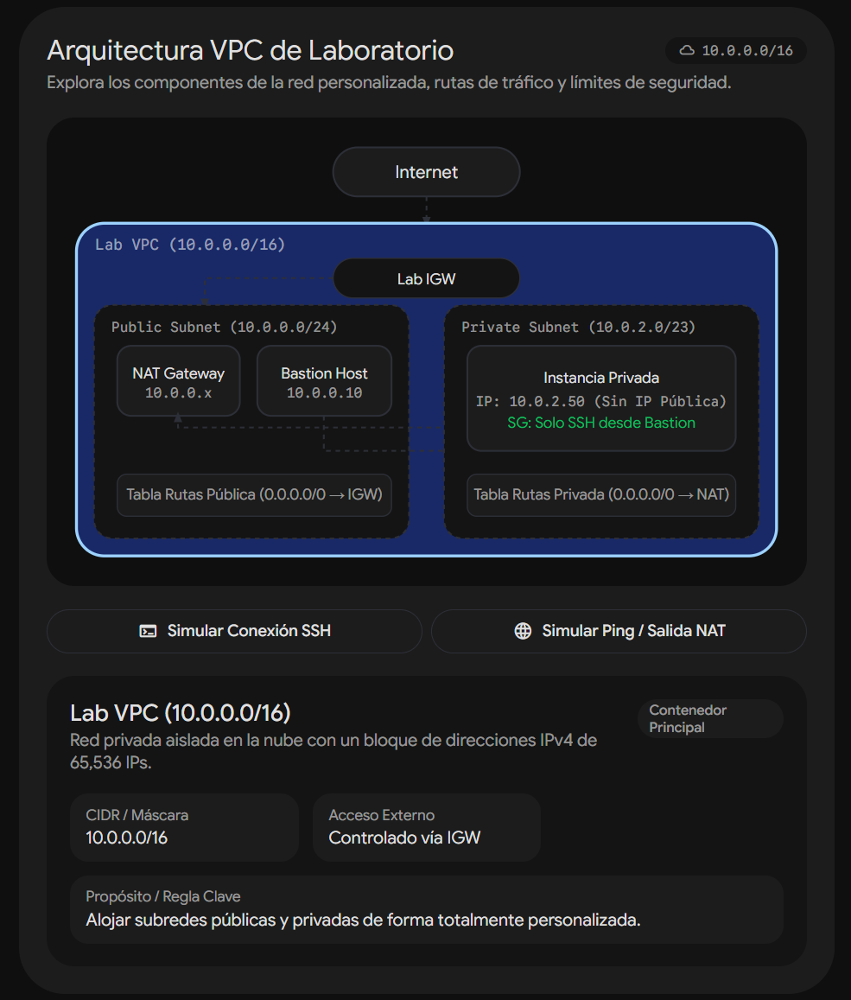
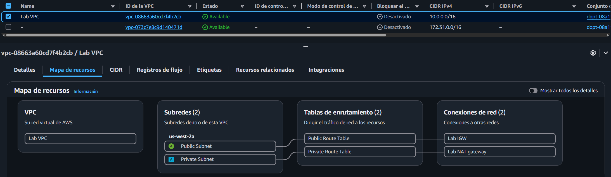
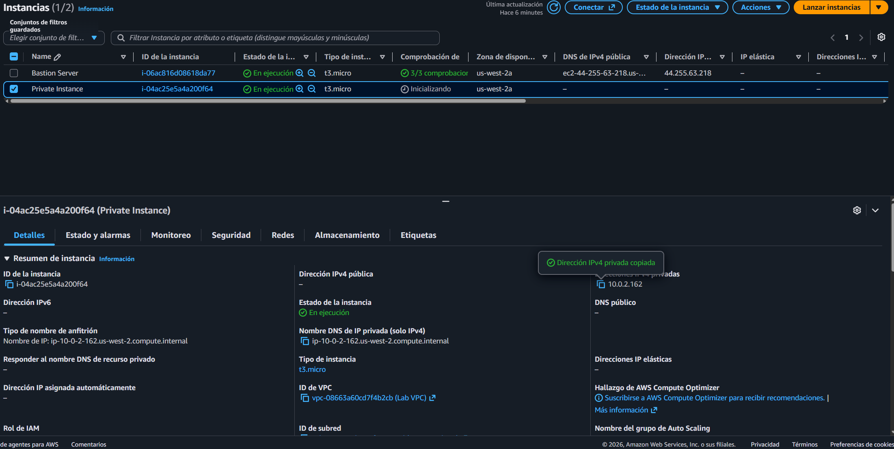
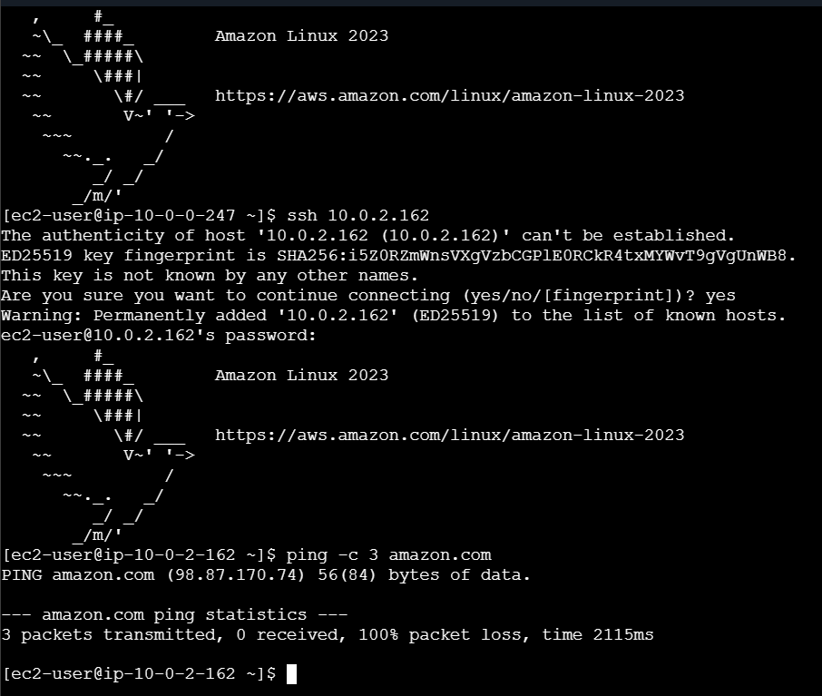

# Lab 180 Configuración de una Amazon VPC (Redes, Subredes, NAT y Servidor Bastión)

## Descripción General

En este laboratorio se diseñó y configuró una infraestructura de red virtual aislada en la nube de AWS mediante **Amazon Virtual Private Cloud (Amazon VPC)**. Se implementó una arquitectura de red avanzada que incluye una subred pública (con acceso directo a internet a través de un _Internet Gateway_) y una subred privada (aislada pero con capacidad de comunicación saliente mediante un _NAT Gateway_). Asimismo, se configuró un servidor bastión (_jump box_) en la subred pública para gestionar de forma segura el acceso administrativo hacia los recursos alojados en la subred privada.

## Arquitectura y Componentes Clave

La topología implementada en la **Amazon VPC** divide los recursos en zonas públicas y privadas para garantizar el aislamiento y la seguridad de las cargas de trabajo:

- **Lab VPC (`10.0.0.0/16`):** Red virtual lógicamente aislada que contiene todos los recursos del laboratorio, con la propiedad de nombres de host DNS habilitada.
- **Internet Gateway (IGW):** Puerta de enlace que conecta la VPC con el internet público, asociada a la tabla de enrutamiento pública.
- **Subred Pública (`10.0.0.0/24`):**
  - Configurada con autoasignación de direcciones IP públicas.
  - **Bastion Server:** Instancia EC2 en Amazon Linux 2023 que actúa como punto de entrada seguro (_jump box_) para la administración mediante SSH.
  - **NAT Gateway:** Puerta de enlace administrada que permite el acceso saliente a internet desde la subred privada de forma segura y oculta las IPs internas.
- **Subred Privada (`10.0.2.0/23`):**
  - **Private Instance:** Instancia EC2 aislada sin conectividad entrante directa desde internet.
  - Configurada con una tabla de enrutamiento privada cuyo objetivo de salida (`0.0.0.0/0`) apunta hacia la Puerta de Enlace NAT.

_Figura 1: Imagen de la arquitectura final del lab_

## Objetivos del Laboratorio

- Crear una **VPC** personalizada con rangos de direcciones IP definidos y nombres de host DNS habilitados.
- Configurar **subredes públicas y privadas** distribuidas con sus respectivos bloques CIDR.
- Crear y asociar una **Puerta de Enlace de Internet (IGW)** y una **Puerta de Enlace NAT (NAT Gateway)**.
- Configurar y asociar **tablas de enrutamiento** para gestionar el flujo de tráfico de red hacia internet de manera controlada.
- Desplegar un **servidor bastión** en la subred pública para permitir conexiones seguras hacia instancias en subredes privadas.

## Estructura y Paso a Paso del Laboratorio

### Tarea 1: Crear una VPC

1. Ir a la consola de **Amazon VPC** y seleccionar **Tus VPC**.
2. Elegir **Crear VPC** con los siguientes parámetros:
   - **Recursos que se van a crear:** Solo la VPC.
   - **Etiqueta de nombre:** `Lab VPC`
   - **Bloque CIDR IPv4:** Entrada manual (`10.0.0.0/16`).
   - **Tenencia:** Predeterminado.
3. Habilitar los nombres de host DNS: seleccionar la VPC creada, ir a **Acciones** > **Editar la configuración de VPC** y activar **Habilitar nombres de host DNS**.

### Tarea 2: Crear Subredes

#### Tarea 2.1: Crear una Subred Pública

1. En el panel de navegación, seleccionar **Subredes** > **Crear subred**:
   - **ID de la VPC:** `Lab VPC`
   - **Nombre de la subred:** `Public Subnet`
   - **Zona de disponibilidad:** Seleccionar la primera zona de disponibilidad disponible.
   - **Bloque CIDR de IPv4:** `10.0.0.0/24`
2. Configurar la asignación automática de IP: seleccionar la subred creada, ir a **Acciones** > **Editar la configuración de la subred** y habilitar la opción **Habilitar la asignación automática de dirección IPv4 pública**.

#### Tarea 2.2: Crear una Subred Privada

1. Repetir el proceso de creación de subred con los siguientes parámetros:
   - **ID de la VPC:** `Lab VPC`
   - **Nombre de la subred:** `Private Subnet`
   - **Zona de disponibilidad:** La misma zona de disponibilidad seleccionada anteriormente.
   - **Bloque CIDR de IPv4:** `10.0.2.0/23` (rango que abarca los bloques `10.0.2.x` y `10.0.3.x`).

### Tarea 3: Crear una Puerta de Enlace de Internet (IGW)

1. En el panel de navegación, seleccionar **Gateways de Internet** > **Crear gateway de Internet**:
   - **Etiqueta de nombre:** `Lab IGW`
2. Seleccionar el IGW creado, hacer clic en **Acciones** y elegir **Asociar a una VPC**, seleccionando `Lab VPC`.

### Tarea 4: Configurar Tablas de Enrutamiento

1. Identificar la tabla de enrutamiento creada por defecto con la VPC y renombrarla como `Private Route Table`.
2. Crear una nueva tabla de enrutamiento pública:
   - **Nombre:** `Public Route Table`
   - **VPC:** `Lab VPC`
3. Editar las rutas de la `Public Route Table` agregando una ruta hacia internet:
   - **Destino:** `0.0.0.0/0`
   - **Objetivo:** Gateway de Internet (`Lab IGW`).
4. Asociar la `Public Route Table` a la subred pública mediante la pestaña **Asociaciones de subredes** > **Editar asociaciones de subredes** seleccionando `Public Subnet`.

_Figura 2: Diagrama de los recurso de la `Lab VPC`_

### Tarea 5: Iniciar un Servidor Bastión en la Subred Pública

1. En la consola de **Amazon EC2**, hacer clic en **Lanzar instancias**:
   - **Nombre y etiquetas:** `Bastion Server`
   - **AMI:** Amazon Linux 2023 AMI
   - **Tipo de instancia:** `t3.micro`
   - **Par de claves:** Continuar sin un par de claves (se utilizará EC2 Instance Connect).
   - **Configuraciones de red:**
     - **VPC:** `Lab VPC`
     - **Subred:** `Public Subnet`
     - **Asignar automáticamente IP pública:** Habilitar.
     - **Grupo de seguridad:** Crear grupo de seguridad (`Bastion Security Group` / Descripción: _Allow SSH_) con una regla de entrada de tipo **SSH** (`Puerto 22`) desde origen **Cualquier lugar** (`0.0.0.0/0`).
2. Lanzar la instancia.

_Figura 3: Instancias EC2_

### Tarea 6: Crear una Puerta de Enlace de NAT y Configurar Enrutamiento Privado

1. En la consola de VPC, seleccionar **Gateways NAT** > **Crear gateway NAT**:
   - **Nombre:** `Lab NAT gateway`
   - **Subred:** `Public Subnet`
   - Asignar una **IP elástica** (_Elastic IP Address_).
2. Configurar la tabla de enrutamiento privada para enrutar el tráfico de salida:
   - Seleccionar **Tablas de enrutamiento** > `Private Route Table`.
   - Ir a la pestaña **Rutas** > **Editar rutas** y agregar una ruta:
     - **Destino:** `0.0.0.0/0`
     - **Objetivo:** Gateway NAT (`nat-xxxxxx`).
   - Guardar los cambios.

### Desafío Opcional: Validación de la Subred Privada y Bastión

1. **Lanzar Instancia Privada:** Desplegar una instancia EC2 en `Private Subnet` con un grupo de seguridad que permita SSH (`Puerto 22`) únicamente desde el bloque CIDR de la VPC (`10.0.0.0/16`) e inyectando un script de configuración de contraseña en los _Datos avanzados_ si se requiere acceso por contraseña.
2. **Conexión en Cascada:**
   - Conectarse primero al `Bastion Server` en la subred pública mediante **EC2 Instance Connect**.
   - Desde la terminal del servidor bastión, ejecutar el comando `ssh <IP-Privada-De-La-Instancia>` para saltar al entorno privado.
3. **Prueba de NAT:** Ejecutar `ping -c 3 amazon.com` desde la instancia privada para confirmar que el tráfico hacia internet es enrutado con éxito a través de la Puerta de Enlace NAT.

_Figura 4: Vista de la terminal conectada al `Bastion Server` y la conexión en cascada con el `Private Instance`_

## Resumen de Recursos y Componentes

| Servicio / Recurso         | Nombre del Componente              | Descripción y Función Técnica                                                                                        |
| :------------------------- | :--------------------------------- | :------------------------------------------------------------------------------------------------------------------- |
| **Amazon VPC**             | `Lab VPC`                          | Red virtual aislada con un bloque CIDR `10.0.0.0/16` y resolución de nombres DNS habilitada.                         |
| **Subredes**               | `Public Subnet` & `Private Subnet` | Segmentos de red públicos (`10.0.0.0/24`) y privados (`10.0.2.0/23`) adaptados para cargas de trabajo diferenciadas. |
| **Internet Gateway**       | `Lab IGW`                          | Puerta de enlace que conecta la VPC directamente con internet público.                                               |
| **NAT Gateway**            | `Lab NAT gateway`                  | Puerta de enlace administrada para permitir acceso saliente a internet desde la subred privada de forma segura.      |
| **Tablas de Enrutamiento** | `Public RT` & `Private RT`         | Tablas que rigen el direccionamiento del tráfico de red hacia el IGW y la NAT Gateway.                               |
| **Amazon EC2**             | `Bastion Server`                   | Instancia de salto desplegada en la subred pública para control de accesos administrativos.                          |

## Conclusiones del Laboratorio

- **Aislamiento y Seguridad de Red:** La separación lógica en subredes públicas y privadas mediante Amazon VPC permite proteger los recursos de bases de datos y backends críticos frente a exposiciones directas en internet.
- **Acceso Saliente Controlado:** La implementación de una Puerta de Enlace NAT facilita las actualizaciones y descargas de paquetes externos en instancias privadas sin comprometer su seguridad perimetral.
- **Arquitectura de Salto Segura (_Bastion Host_):** El uso de servidores bastión limita la superficie de ataque, permitiendo una administración centralizada y auditada hacia entornos internos no enrutables directamente desde el exterior.
