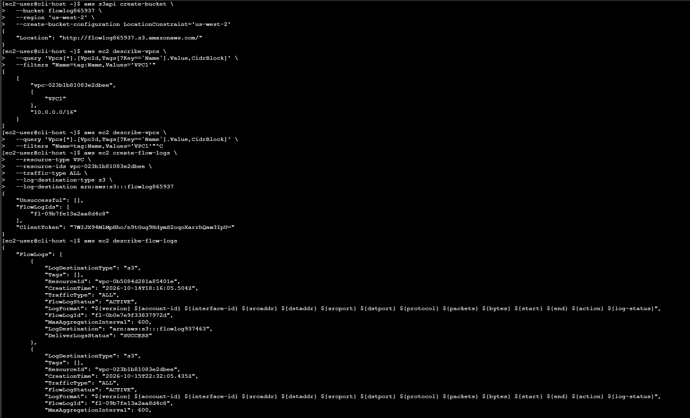
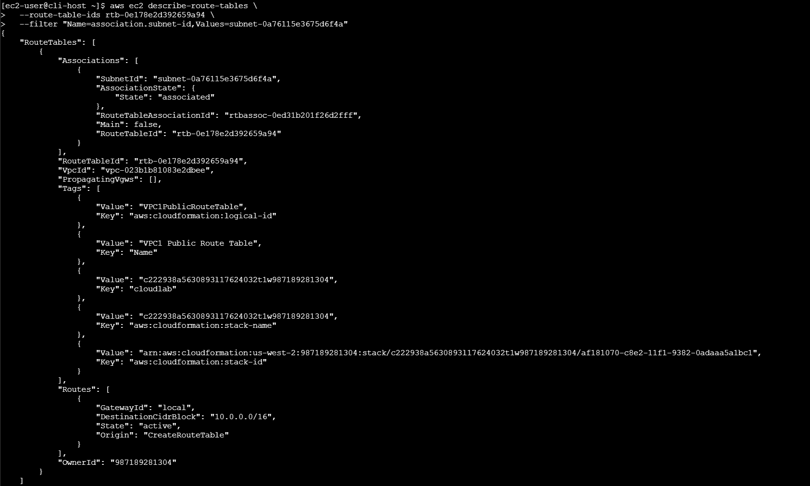
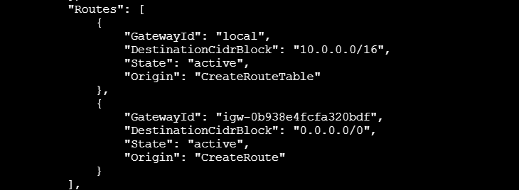
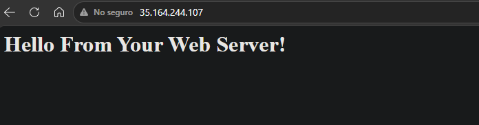
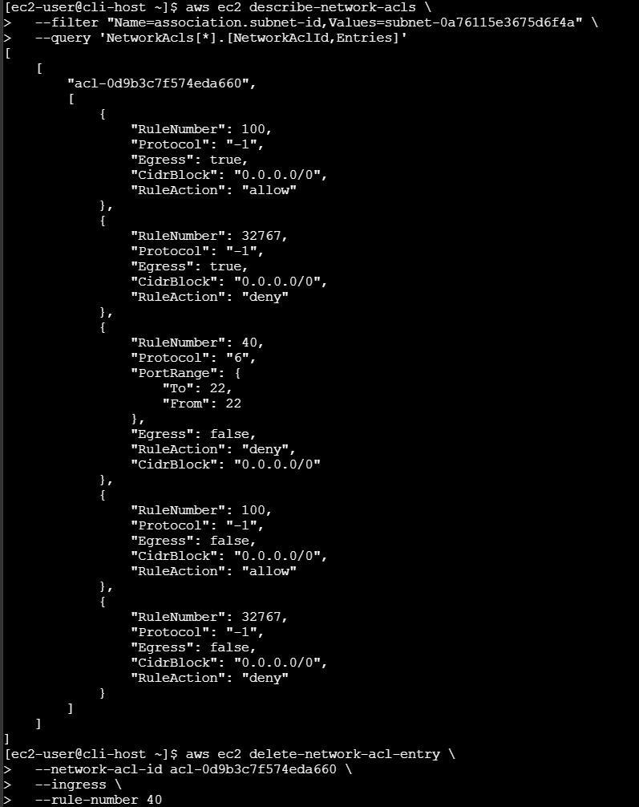
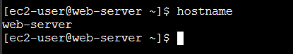
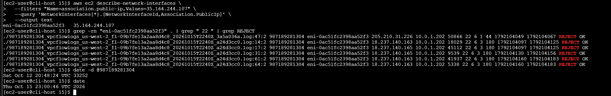

# Lab 181 Solución de Problemas de una Amazon VPC y Análisis de Registros de Flujo


## Descripción General

En este laboratorio se diagnosticaron y resolvieron problemas complejos de configuración de red en una **Amazon VPC**, implementando además la captura y análisis forense del tráfico mediante **VPC Flow Logs**. Utilizando de manera estricta comandos de la **AWS CLI**, se identificaron fallas en las tablas de enrutamiento y reglas restrictivas en las Listas de Control de Acceso de Red (Network ACLs) que impedían el acceso web y la conectividad SSH a los servidores de la cafetería. Finalmente, se descargaron los registros de flujo almacenados en un bucket de **Amazon S3** para auditar los paquetes rechazados (`REJECT`) mediante utilidades de Linux.

## Objetivos del Laboratorio

- Crear y configurar registros de **VPC Flow Logs** vinculados a un bucket de Amazon S3.
- Solucionar problemas de configuración de red en componentes clave de la VPC (tablas de enrutamiento y NACLs) usando la AWS CLI.
- Descargar, descomprimir y analizar archivos de registros de flujo para rastrear intentos de conexión fallidos (`REJECT`).

## Tarea 1: Conexión y Configuración de la AWS CLI

1. Conectarse a la instancia `CLI Host` mediante **EC2 Instance Connect**.
2. Configurar el perfil de la AWS CLI ejecutando `aws configure` e ingresando las credenciales temporales del laboratorio, especificando la región `us-west-2` y el formato de salida `json`.

## Tarea 2: Creación de Registros de Flujo de VPC (Flow Logs)

1. **Creación del Bucket de S3:** Crear un bucket de almacenamiento para los registros utilizando un identificador aleatorio:

   ```bash
   aws s3api create-bucket --bucket flowlog###### --region 'us-west-2' --create-bucket-configuration LocationConstraint='us-west-2'
   ```

2. **Obtención del ID de VPC:** Consultar el identificador de la VPC objetivo (`VPC1`):

```bash
aws ec2 describe-vpcs --query 'Vpcs[*].[VpcId,Tags[?Key==`Name`].Value,CidrBlock]' --filters "Name=tag:Name,Values='VPC1'"
```

3. Creación del Flow Log: Habilitar la captura de todo el tráfico IP (`ALL`) hacia el bucket de S3:

```bash
aws ec2 create-flow-logs --resource-type VPC --resource-ids <vpc-id> --traffic-type ALL --log-destination-type s3 --log-destination arn:aws:s3:::<flowlog######>
```

4. Confirmación: Validar que el estado del registro de flujo sea `ACTIVE`:

```bash
aws ec2 describe-flow-logs
```


_Figura 1: Comandos ejecutados en la terminal de la tarea 2_

## Tarea 3: Solución de Problemas de Configuración de la VPC

### Desafío de Solución de Problemas n.º 1 (Acceso Web HTTP)

Al intentar acceder a la IP del servidor web (`WebServerIP`), la conexión expiraba. Para solucionarlo mediante la CLI:

1. Inspección de puertos con `nmap`: Instalar e inspeccionar los puertos abiertos en la instancia:

```bash
sudo yum install -y nmap
nmap <WebServerIP>
```

2. Verificación de la Tabla de Enrutamiento: Consultar la asociación de subredes y rutas de la VPC1:

```bash
aws ec2 describe-route-tables --route-table-ids 'VPC1PubRouteTableId' --filter "Name=association.subnet-id,Values='VPC1PubSubnetID'"
```


_Figura 2: Captura de la terminal comando describe-route-tables ejecutado_

3. Creación de la Ruta Faltante: Se descubrió que la subred pública carecía de una ruta hacia el Internet Gateway (`IGW`). Se creó la ruta correspondiente:

```bash
aws ec2 create-route --route-table-id 'VPC1PubRouteTableId' --gateway-id 'VPC1GatewayId' --destination-cidr-block '0.0.0.0/0'
```

 \
_Figura 3: Vista de la ruta `0.0.0.0/0` agregada_

 \
_Figura 4: Validación: Al actualizar el navegador, se mostró el mensaje "Hello From Your Web Server!"._

### Desafío de Solución de Problemas n.º 2 (Acceso SSH - Puerto 22)

A pesar de funcionar el acceso HTTP, la conexión SSH mediante EC2 Instance Connect seguía fallando.

1. **Inspección de Network ACLs (NACLs):** Consultar las entradas asociadas a la subred pública:

```bash
aws ec2 describe-network-acls --filter "Name=association.subnet-id,Values='VPC1PublicSubnetID'" --query 'NetworkAcls[*].[NetworkAclId,Entries]'
```

2. **Eliminación de Regla Restrictiva:** Se identificó una regla de denegación en la regla número 40 que bloqueaba el tráfico de entrada. Se eliminó dicha entrada:

```bash
aws ec2 delete-network-acl-entry --network-acl-id 'acl-id' --ingress --rule-number 40
```

 \
_Figura 5: Comandos ejecutados en el paso 1 y 2 del desafío 2_

 \
_Figura 6: Validación: Se estableció la conexión SSH exitosamente y al ejecutar `hostname` se confirmó el retorno de `web-server`._

## Tarea 4: Análisis de Registros de Flujo (Flow Logs)

1. **Descarga de Logs:** Crear un directorio local, listar los buckets y descargar el contenido de los registros de flujo desde S3:

   ```bash
   mkdir flowlogs && cd flowlogs
   aws s3 cp s3://<flowlog######>/ . --recursive
   ```

2. **Extracción de Archivos:** Navegar por la estructura de directorios generada (AWSLogs/...) y descomprimir los archivos comprimidos en formato GNU zip:

   ```bash
   gunzip \*.gz
   ```

3. **Análisis y Filtrado con Utilidades de Linux:**
   - Buscar registros que contengan eventos rechazados (REJECT):

   ```bash
   grep -rn REJECT . | wc -l
   ```

   - Aislar los intentos fallidos específicos hacia el puerto SSH (22) originados desde una dirección IP de prueba:

   ```bash
   grep -rn 22 . | grep REJECT | grep <ip-address>
   ```

   - Traducir las marcas de tiempo en formato Unix registradas en los logs a un formato legible para seres humanos:

   ```bash
   date -d @1554496931
   ```

   
   _Figura 7: Vista de los logs_

## Resumen de Recursos y Componentes

| Servicio / Recurso         | Nombre del Componente        | Descripción y Función Técnica                                                                               |
| :------------------------- | :--------------------------- | :---------------------------------------------------------------------------------------------------------- |
| **Amazon VPC**             | `VPC1`                       | Red virtual principal evaluada durante los procesos de diagnóstico y solución de errores.                   |
| **Amazon S3**              | `flowlog######`              | Bucket de almacenamiento diseñado para centralizar y retener los registros de flujo de la VPC.              |
| **VPC Flow Logs**          | Registro Activo (`ACTIVE`)   | Mecanismo de captura de metadatos sobre el tráfico IP entrante y saliente en las interfaces de red.         |
| **Network ACLs (NACLs)**   | Control Perimetral de Subred | Capa de seguridad a nivel de subred cuyas reglas restrictivas fueron auditadas y depuradas mediante la CLI. |
| **Tablas de Enrutamiento** | `VPC1PubRouteTableId`        | Tabla de rutas corregida mediante la inserción de una ruta predeterminada hacia el Internet Gateway.        |
| **Amazon EC2 / CLI Host**  | Instancia de Apoyo           | Servidor de comandos utilizado para ejecutar la AWS CLI y herramientas de diagnóstico como `nmap` y `grep`. |

## Conclusiones del Laboratorio

- **Diagnóstico Basado en CLI:** El uso de la interfaz de línea de comandos de AWS permite realizar auditorías profundas y modificaciones precisas en la infraestructura de red sin depender de la consola gráfica.
- **Jerarquía de Seguridad (Security Groups vs. NACLs):** Se evidenció la importancia de revisar tanto las rutas y los grupos de seguridad como las Network ACLs a nivel de subred al momento de resolver bloqueos de conectividad.
- **Auditoría Forense con Flow Logs:** La integración de VPC Flow Logs con Amazon S3 proporciona una trazabilidad robusta del tráfico de red, permitiendo identificar patrones de tráfico rechazado y solucionar incidentes de seguridad mediante herramientas estándar de Linux y consultas analíticas.
