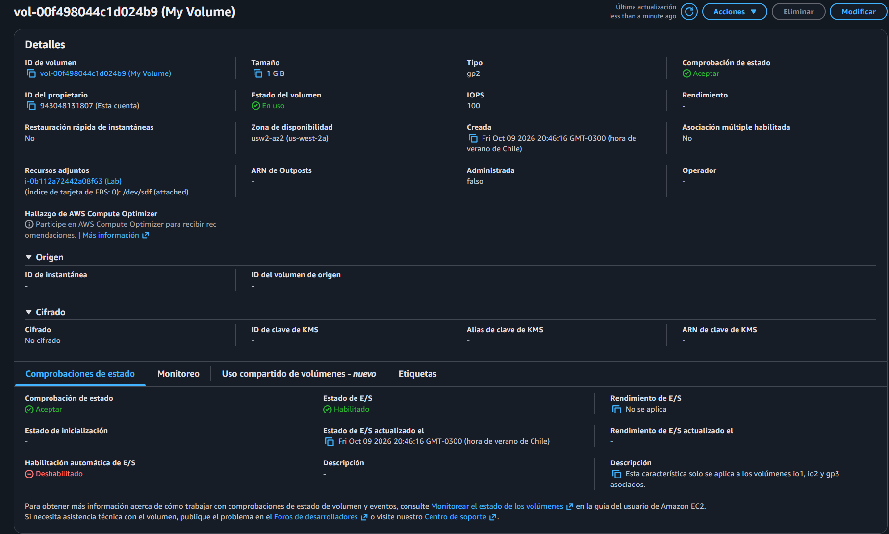
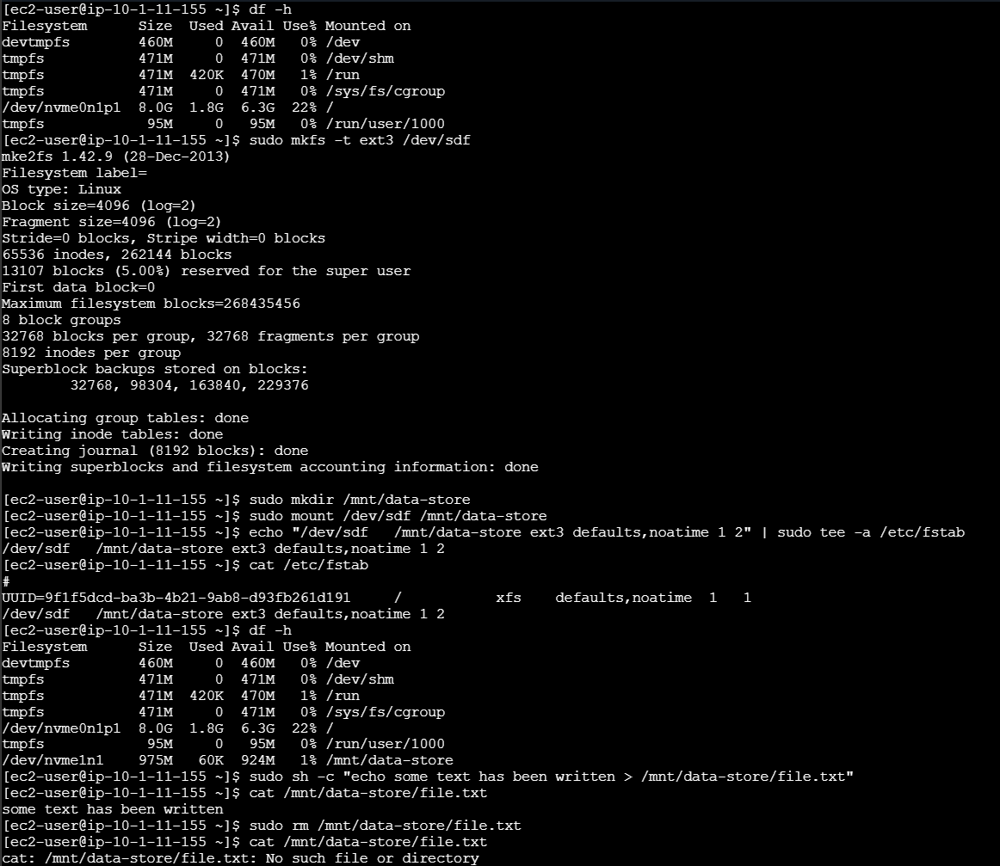
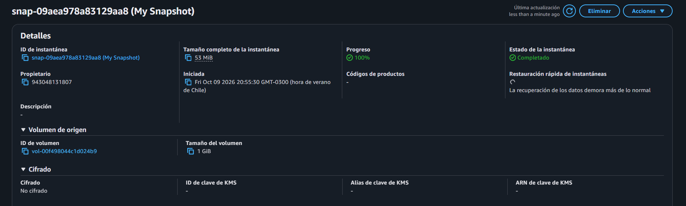
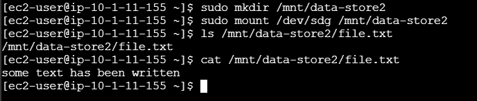

# Lab 182 Trabajo con Amazon EBS (Volúmenes, Montaje, Instantáneas y Restauración)


## Descripción General

En este laboratorio se trabajó con **Amazon Elastic Block Store (Amazon EBS)** para aprovisionar, configurar y administrar almacenamiento en bloque de alto rendimiento destinado a instancias de **Amazon EC2**. Se cubrió el ciclo de vida completo del almacenamiento: desde la creación y asociación de un volumen nuevo, la construcción de un sistema de archivos `ext3` y su montaje persistente en Linux, hasta la captura de instantáneas (_snapshots_) respaldadas en Amazon S3 y la posterior recuperación de datos mediante la restauración de un volumen clonado.

## Objetivos del Laboratorio

- Crear un volumen de **Amazon EBS** personalizado.
- Asociar el volumen de EBS a una instancia de EC2 y montarlo en un sistema operativo Linux.
- Crear una **instantánea (_snapshot_)** de un volumen de EBS para garantizar la durabilidad y el respaldo de los datos.
- Restaurar un nuevo volumen de EBS a partir de una instantánea para clonar o recuperar información.

## Tarea 1: Crear un Nuevo Volumen de EBS

1. En la consola de **Amazon EC2**, verificar la Zona de disponibilidad de la instancia `Lab` activa (por ejemplo, `us-west-2a`).
2. En el panel izquierdo, seleccionar **Volúmenes** y hacer clic en **Crear volumen**:
   - **Tipo de volumen:** SSD de uso general (`gp2`)
   - **Tamaño (GiB):** `1`
   - **Zona de disponibilidad:** La misma de la instancia EC2 (`us-west-2a`).
   - **Etiquetas:** Clave: `Name` / Valor: `My Volume`
3. Confirmar la creación del volumen hasta que su estado cambie de `Creando` a `Disponible`.


_Figura 1: Detalles de `My Volume`_

## Tarea 2: Asociar el Volumen a una Instancia de EC2

1. Seleccionar el volumen creado (`My Volume`) y hacer clic en **Acciones** > **Asociar volumen**.
2. Seleccionar la instancia `Lab` en el campo correspondiente.
3. Mantener el identificador de dispositivo predeterminado (`/dev/sdf`) y confirmar la asociación. El estado del volumen cambiará a `En uso`.

## Tarea 3: Conectarse a la Instancia Lab de EC2

1. En la consola de EC2, seleccionar la instancia `Lab` y hacer clic en **Conectar** > **EC2 Instance Connect** para abrir la terminal interactiva en el navegador.

## Tarea 4: Crear y Configurar el Sistema de Archivos

1. **Verificar almacenamiento disponible:** Ejecutar el comando para listar los discos montados:

   ```bash
   df -h
   ```

2. **Crear el sistema de archivos:** Formatear el nuevo dispositivo como `ext3`:

   ```bash
   sudo mkfs -t ext3 /dev/sdf
   ```

3. **Montar el volumen:** Crear el directorio de montaje y asociar el dispositivo de forma persistente editando `/etc/fstab`:

   ```bash
   sudo mkdir /mnt/data-store
   sudo mount /dev/sdf /mnt/data-store
   echo "/dev/sdf   /mnt/data-store ext3 defaults,noatime 1 2" | sudo tee -a /etc/fstab
   ```

4. **Verificar y escribir datos de prueba:** Comprobar el montaje con `df -h` y escribir un archivo de texto de prueba:

   ```bash
   sudo sh -c "echo some text has been written > /mnt/data-store/file.txt"
   cat /mnt/data-store/file.txt
   ```

   
   _Figura 2: Comandos ejecutados para la tarea 4_

## Tarea 5: Crear una Instantánea de Amazon EBS (Snapshot)

1. En la consola de EC2, seleccionar **Volúmenes** > `My Volume` > **Acciones** > **Crear instantánea.**
2. Agregar etiquetas opcionales (Clave: **Name** / Valor: **My Snapshot**) y confirmar.
3. Ir al menú Instantáneas en el panel izquierdo y esperar a que el estado cambie de **Pendiente** a **Finalizada**.


_Figura 3: Detalles de la snapshot `My Snapshot`_

4. **Simular eliminación de datos:** En la terminal de la instancia, eliminar el archivo de prueba para comprobar la eficacia del respaldo:

   ```bash
   sudo rm /mnt/data-store/file.txt
   ls /mnt/data-store/file.txt
   ```

## Tarea 6: Restaurar la Instantánea de Amazon EBS

### Tarea 6.1: Crear un Volumen Mediante la Instantánea

1. En la sección de **Instantáneas**, seleccionar `My Snapshot` > **Acciones** > **Crear volumen a partir de una instantánea**.
2. Configurar la zona de disponibilidad idéntica a la anterior y etiquetar el volumen como **Restored Volume**.
3. Seleccionar Crear volumen hasta que el estado del nuevo volumen sea **Disponible**.

### Tarea 6.2: Asociar el Volumen Restaurado a la Instancia de EC2

1. Seleccionar `Restored Volume` > **Acciones** > **Asociar volumen**, seleccionando la instancia `Lab` con el identificador de dispositivo `/dev/sdg`.

### Tarea 6.3: Montar el Volumen Restaurado y Validar Datos

1. En la terminal de la instancia, crear un segundo punto de montaje y montar el volumen restaurado:

   ```bash
   sudo mkdir /mnt/data-store2
   sudo mount /dev/sdg /mnt/data-store2
   ```

2. **Verificar la recuperación de datos:** Listar el archivo de prueba original respaldado en la instantánea:

   ```bash
   ls /mnt/data-store2/file.txt
   ```

    \
    _Figura 4: El archivo `file.txt` aparecerá correctamente gracias al respaldo previo._

## Resumen de Recursos y Componentes

| Servicio / Recurso          | Nombre del Componente | Descripción y Función Técnica                                                                               |
| :-------------------------- | :-------------------- | :---------------------------------------------------------------------------------------------------------- |
| **Amazon EBS**              | `My Volume`           | Volumen de almacenamiento SSD de uso general (gp2, 1 GiB) asociado a la instancia EC2.                      |
| **Amazon EC2**              | Instancia `Lab`       | Servidor Linux utilizado para alojar, formatear, montar y probar los volúmenes de almacenamiento.           |
| **Sistema de Archivos**     | `/mnt/data-store`     | Punto de montaje local configurado con formato `ext3` y persistencia mediante `/etc/fstab`.                 |
| **Amazon EBS Snapshot**     | `My Snapshot`         | Instantánea de respaldo de los bloques en uso del volumen, almacenada de forma duradera.                    |
| **Amazon EBS (Restaurado)** | `Restored Volume`     | Nuevo volumen de almacenamiento clonado directamente a partir de la instantánea para recuperación de datos. |

## Conclusiones del Laboratorio

- **Gestión de Almacenamiento en Bloque:** Amazon EBS simplifica el aprovisionamiento de discos virtuales escalables que pueden asociarse de forma dinámica a instancias EC2 según las necesidades de la aplicación.
- **Persistencia y Sistemas de Archivos:** La correcta estructuración de formatos (`ext3`) y puntos de montaje mediante tablas como `/etc/fstab` asegura la disponibilidad continua de los datos tras reinicios del sistema.
- **Respaldo y Recuperación ante Desastres:** Las instantáneas de EBS (`snapshots`) permiten capturar estados consistentes de los volúmenes con respaldo en Amazon S3, facilitando la clonación rápida y la recuperación de información crítica ante incidentes operativos.
