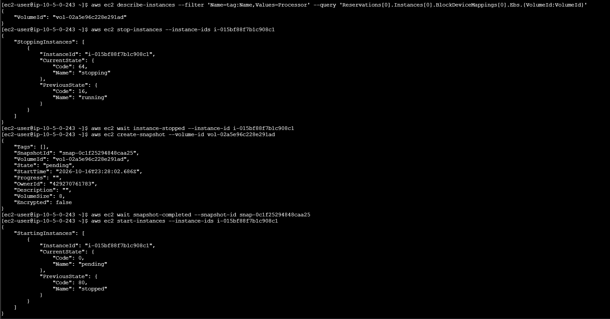
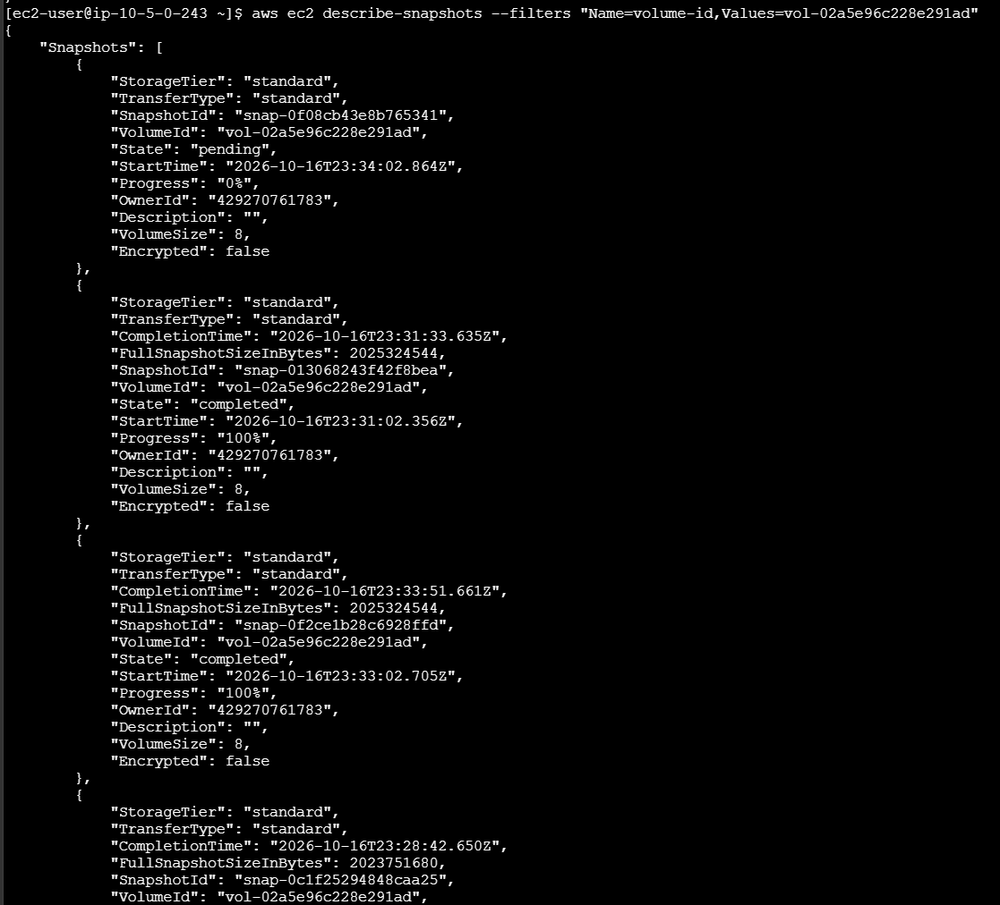
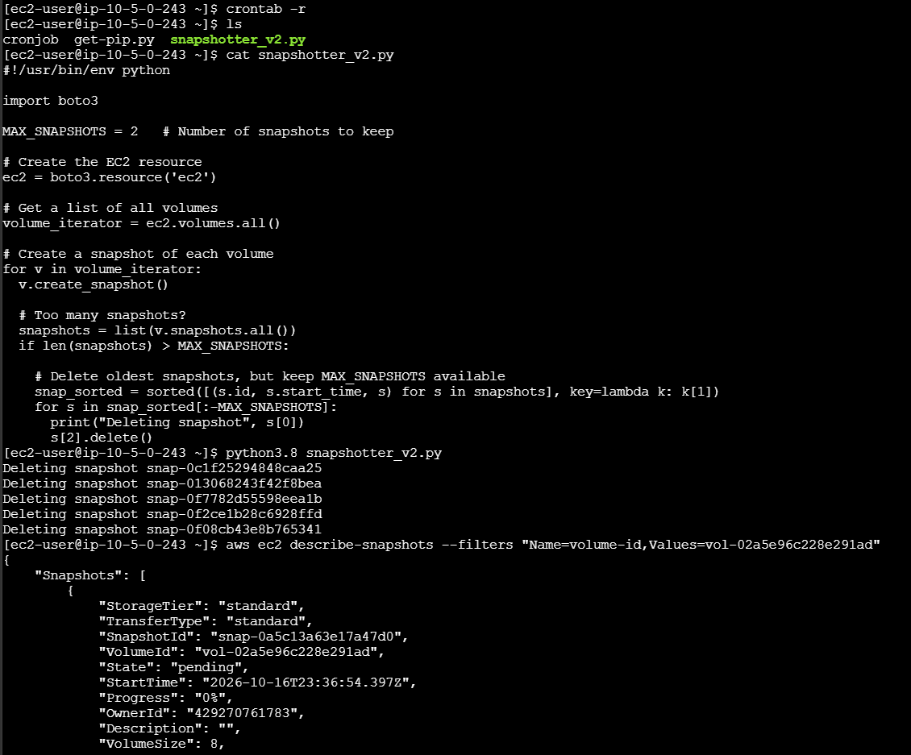
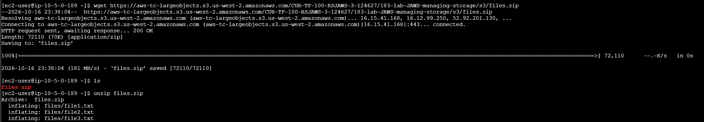
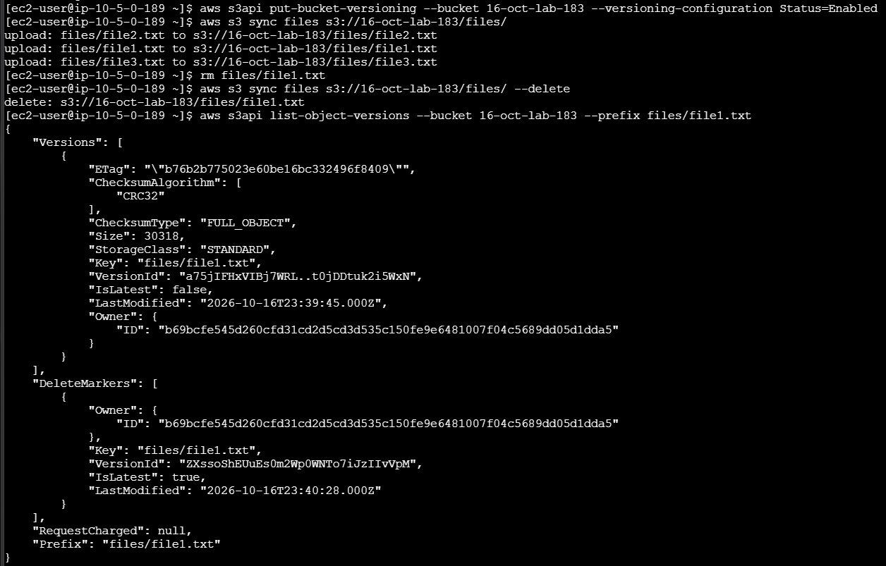
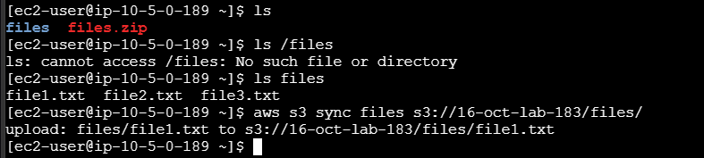

# Lab 183 Administración del Almacenamiento (Instantáneas de EBS, Automatización y Sincronización con S3)


## Descripción General

En este laboratorio se profundizó en la administración avanzada de datos en volúmenes de **Amazon EBS** y **Amazon S3** mediante la **AWS CLI**. Se automatizó la creación y retención de instantáneas (_snapshots_) utilizando tareas programadas en Linux (`cron`) y un script de Python diseñado para conservar únicamente las versiones más recientes. Asimismo, se completó un desafío práctico de sincronización de directorios locales hacia un bucket de S3 con control de versiones activo, simulando la eliminación y posterior recuperación de datos críticos mediante herramientas de auditoría de objetos.

## Objetivos del Laboratorio

- Crear, programar y mantener políticas de retención para instantáneas de volúmenes de **Amazon EBS**.
- Utilizar el comando `aws s3 sync` para respaldar y sincronizar archivos locales con un bucket de S3.
- Habilitar e interactuar con el **control de versiones de Amazon S3** para recuperar archivos eliminados accidentalmente.

## Tarea 1: Creación y Configuración de Recursos

1. **Creación del Bucket de S3:** Crear un bucket con un nombre único a través de la consola de S3 (`s3-bucket-name`).
2. **Asociación de Rol IAM:** Modificar la instancia EC2 `Processor` para asignarle el rol de IAM `S3BucketAccess` como perfil de instancia, otorgando permisos para interactuar con EBS y S3.

## Tarea 2: Creación y Automatización de Instantáneas de EBS

### Tarea 2.1 y 2.2: Instantánea Inicial

1. Conectarse a la instancia `Command Host` mediante **EC2 Instance Connect**.
2. Obtener el ID del volumen de EBS asociado a la instancia `Processor`:

   ```bash
   aws ec2 describe-instances --filter 'Name=tag:Name,Values=Processor' --query 'Reservations[0].Instances[0].BlockDeviceMappings[0].Ebs.{VolumeId:VolumeId}'
   ```

3. Detener la instancia `Processor` de forma segura, crear la instantánea inicial y reiniciar la instancia:

   ```bash
   aws ec2 stop-instances --instance-ids <INSTANCE-ID>
   aws ec2 wait instance-stopped --instance-id <INSTANCE-ID>
   aws ec2 create-snapshot --volume-id <VOLUME-ID>
   aws ec2 wait snapshot-completed --snapshot-id <SNAPSHOT-ID>
   aws ec2 start-instances --instance-ids <INSTANCE-ID>
   ```

   
   _Figura 1: Comandos ejecutados para la tareas 2.1 y 2.2_

### Tarea 2.3: Programación de Instantáneas con Cron

1. Configurar un trabajo cron para generar una instantánea cada minuto con fines de prueba:

   ```bash
   echo "* * * * *  aws ec2 create-snapshot --volume-id <VOLUME-ID> 2>&1 >> /tmp/cronlog" > cronjob
   crontab cronjob
   ```

2. Verificar la generación continua de las instantáneas:

   ```bash
   aws ec2 describe-snapshots --filters "Name=volume-id,Values=<VOLUME-ID>"
   ```

   
   _Figura 2: Captura de las snapshots_

### Tarea 2.4: Conservación Automatizada (Script de Python)

1. Detener el trabajo cron con `crontab -r`.

2. Examinar y ejecutar el script en Python `snapshotter_v2.py`, el cual audita el volumen y elimina todas las instantáneas excepto las dos más recientes:

   ```bash
   python3.8 snapshotter_v2.py
   ```

   
   _Figura 3: Ejecución del script `snapshotter_v2.py`_

## Tarea 3: Desafío de Sincronización y Recuperación en Amazon S3

### Tarea 3.1: Descarga y Preparación de Archivos

1. Conectarse a la instancia `Processor` y descargar un paquete de archivos de muestra:

   ```bash
   wget https://aws-tc-largeobjects.s3.us-west-2.amazonaws.com/CUR-TF-100-RSJAWS-3-124627/183-lab-JAWS-managing-storage/s3/files.zip
   unzip files.zip
   ```

   
   _Figura 4: Descarga del paquete de archivos de muestra_

### Tarea 3.2: Sincronización y Control de Versiones

1. Activar Versionado en S3:

   ```bash
   aws s3api put-bucket-versioning --bucket <S3-BUCKET-NAME> --versioning-configuration Status=Enabled
   ```

2. Sincronización Inicial:

   ```bash
   aws s3 sync files s3://<S3-BUCKET-NAME>/files/
   ```

3. Sincronización con Supresión (`--delete`): Tras eliminar un archivo localmente (`rm files/file1.txt`), propagar la eliminación al bucket:

   ```bash
   aws s3 sync files s3://<S3-BUCKET-NAME>/files/ --delete
   ```

4. Recuperación de la Versión Anterior:
   - Listar las versiones e identificadores (`VersionId`) del objeto eliminado:

     ```bash
     aws s3api list-object-versions --bucket <S3-BUCKET-NAME> --prefix files/file1.txt
     ```

     
     _Figura 5: Ejecución de la tarea 3.2_

   - Descargar la versión anterior específica del archivo utilizando su ID de versión:

     ```bash
     aws s3api get-object --bucket <S3-BUCKET-NAME> --key files/file1.txt --version-id <VERSION-ID> files/file1.txt
     ```

   - Volver a sincronizar el directorio local con S3 para restaurar formalmente el archivo en el bucket.

     
     _Figura 6: Sincronización del directorio local con S3_

## Resumen de Recursos y Componentes

| Servicio / Recurso       | Nombre del Componente        | Descripción y Función Técnica                                                                                       |
| :----------------------- | :--------------------------- | :------------------------------------------------------------------------------------------------------------------ |
| **Amazon EBS**           | Volumen de `Processor`       | Disco de bloques principal cuyas instantáneas de respaldo fueron automatizadas.                                     |
| **Amazon S3**            | `<S3-BUCKET-NAME>`           | Bucket de almacenamiento configurado con control de versiones para sincronización y respaldo.                       |
| **IAM Role**             | `S3BucketAccess`             | Perfil de instancia asignado a la EC2 `Processor` para permitir la comunicación segura con S3 y EBS.                |
| **Automatización Linux** | `cron` & `snapshotter_v2.py` | Gestor de tareas programadas y script de depuración para retener exclusivamente las dos instantáneas más recientes. |
| **Amazon EC2**           | `Command Host` & `Processor` | Instancias de control y procesamiento utilizadas para la ejecución de comandos CLI y pruebas de almacenamiento.     |

## Conclusiones del Laboratorio

- **Automatización de Respaldos:** La combinación de la AWS CLI, herramientas del sistema como `cron` y scripts programados permite mantener políticas de respaldo eficientes y controladas en volúmenes EBS.
- **Sincronización Eficaz:** El comando `aws s3 sync` optimiza la transferencia y mantenimiento de directorios completos hacia Amazon S3, permitiendo gestionar altas y bajas de archivos con la opción `--delete`.
- **Recuperación ante Errores con Versionado:** El control de versiones en Amazon S3 actúa como una red de seguridad indispensable, facilitando la auditoría y restauración de objetos eliminados mediante identificadores de versión únicos.
