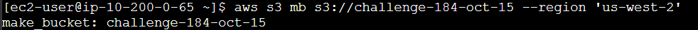
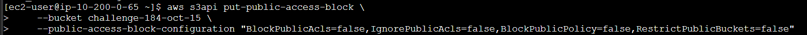
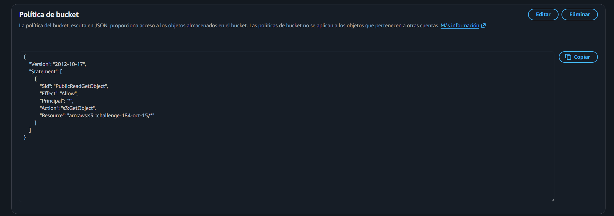
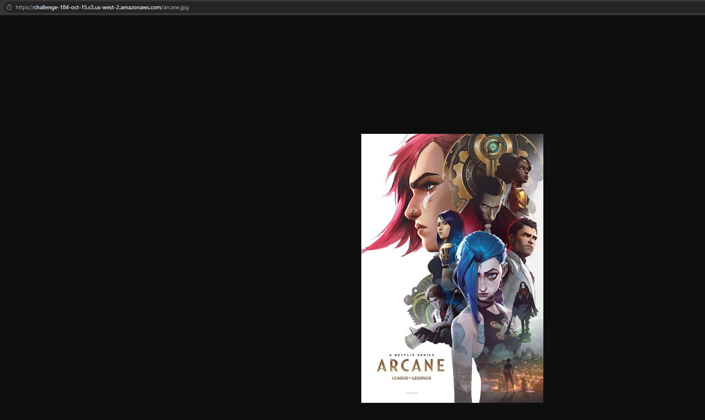

# Lab 184 Laboratorio de Desafío - Amazon S3 (Buckets, Permisos y AWS CLI)


## Descripción General

En este laboratorio de desafío se evaluaron y aplicaron los conceptos fundamentales de **Amazon Simple Storage Service (Amazon S3)**. Se configuró el entorno de la línea de comandos de AWS mediante credenciales temporales en una instancia EC2 de apoyo (_CLI Host_), se crearon buckets de S3 y se gestionaron objetos multimedia o de texto. Asimismo, se configuraron permisos detallados de acceso público por objeto para permitir su visualización mediante un navegador web, concluyendo con la auditoría y listado de contenidos utilizando comandos de la **AWS CLI**.

## Objetivos del Laboratorio

- Crear y configurar un bucket de **Amazon S3** con nombre único.
- Cargar objetos de prueba en el bucket de almacenamiento.
- Configurar y validar los permisos de acceso público para consultar los objetos a través de un navegador web.
- Enumerar y auditar el contenido del bucket mediante la **AWS CLI**.

## Tarea 1: Conectarse a la Instancia CLI Host

1. En la consola de **Amazon EC2**, seleccionar la instancia de apoyo denominada `CLI Host`.
2. Hacer clic en **Conectar** y utilizar la pestaña **EC2 Instance Connect** para abrir la terminal interactiva basada en navegador.

## Tarea 2: Configurar la AWS CLI

1. Configurar el perfil predeterminado de la herramienta de línea de comandos ejecutando:

   ```bash
   aws configure
   ```

2. Proveer las credenciales obtenidas en los detalles del laboratorio:
   - AWS Access Key ID: Ingresar el valor de `AccessKey`.
   - AWS Secret Access Key: Ingresar el valor de `SecretKey`.
   - Default region name: `us-west-2`
   - Default output format: `json`

## Tarea 3: Resolución del Desafío en Amazon S3

1.  **Creación del Bucket y Carga de Objetos**
    1.  Crear un nuevo bucket de S3 con un identificador único para evitar colisiones globales:

        ```bash
        aws s3 mb s3://<s3-bucket-name> --region us-west-2
        ```

        
        _Figura 1: Creación del bucket_

    2.  Listar y verificar el bucket creado:

        ```bash
        aws s3 ls s3://<s3-bucket-name>
        ```

2.  **Configuración de Accesos Públicos y Carga de Objetos**
    1. **Desactivación de Bloqueo Público:** Modificar la configuración de bloqueo de acceso público del bucket para permitir políticas públicas:

       ```bash
       aws s3api put-public-access-block \
       --bucket <s3-bucket-name> \
       --public-access-block-configuration "BlockPublicAcls=false,IgnorePublicAcls=false,BlockPublicPolicy=false,RestrictPublicBuckets=false"
       ```

       
       _Figura 2: Desactivación del bloqueo público_

    2. **Carga de Archivos:** La carga de los archivos se realizó de manera interactiva a través de la Consola de administración de AWS desde el equipo local hacia el bucket.

    3. **Aplicación de Política de Bucket:** Establecer una política basada en recursos para garantizar la lectura pública de los objetos (s3:GetObject):

       ```bash
       {
           "Version": "2012-10-17",
           "Statement": [
               {
                   "Sid": "PublicReadGetObject",
                   "Effect": "Allow",
                   "Principal": "*",
                   "Action": "s3:GetObject",
                   "Resource": "arn:aws:s3:::<s3-bucket-name>/*"
               }
           ]
       }
       ```

       
       _Figura 3: Aplicación de la política del bucket_

3.  **Validación Web**
    1. Copiar la URL del objeto cargado y verificar su correcta visualización pública a través de cualquier navegador web.

    
    _Figura 4: Vista web con la imagen_

## Resumen de Recursos y Componentes

| Servicio / Recurso       | Nombre del Componente | Descripción y Función Técnica                                                                            |
| :----------------------- | :-------------------- | :------------------------------------------------------------------------------------------------------- |
| **Amazon S3**            | `<s3-bucket-name>`    | Bucket de almacenamiento de objetos utilizado para alojar los archivos de prueba del desafío.            |
| **Amazon EC2**           | `CLI Host`            | Instancia Linux utilizada como servidor de control para la ejecución de comandos de la AWS CLI.          |
| **AWS CLI**              | Perfil Configurado    | Herramienta de gestión programática para interactuar con las APIs de S3 y EC2.                           |
| **Control de Acceso S3** | Permisos de Objeto    | Configuración aplicada para permitir la lectura y visualización pública de archivos específicos vía web. |

## Conclusiones del Laboratorio

- **Administración de Almacenamiento Escalable:** Amazon S3 permite aprovisionar espacios de almacenamiento altamente duraderos y seguros de manera instantánea mediante la consola o la línea de comandos.
- **Control Granular de Permisos:** Se comprendió la diferencia entre la seguridad a nivel de bucket y de objeto, valorando las políticas de bloqueo público predeterminadas en AWS.
- **Automatización y Auditoría:** El uso de la AWS CLI facilita la verificación rápida del estado y contenido de los recursos en la nube sin depender exclusivamente de interfaces gráficas.
