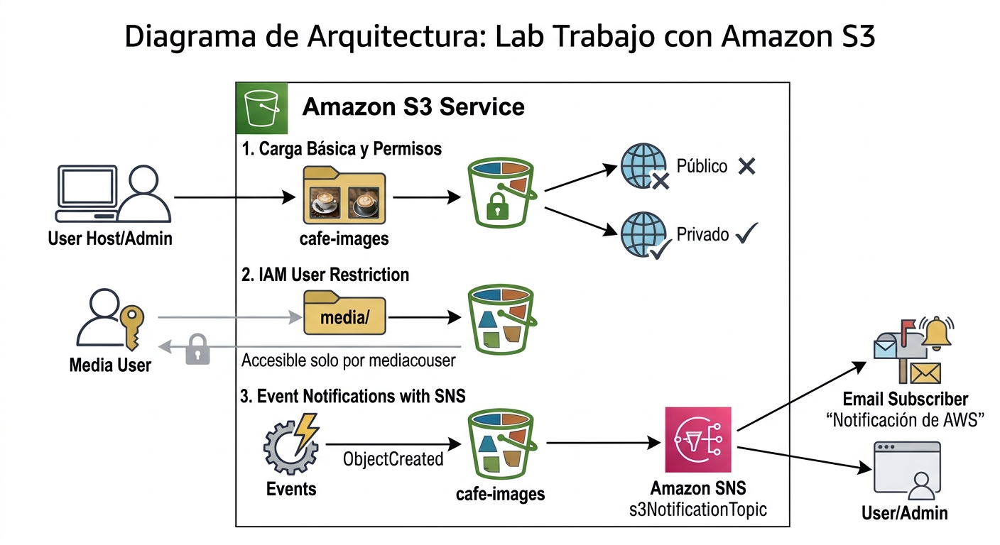
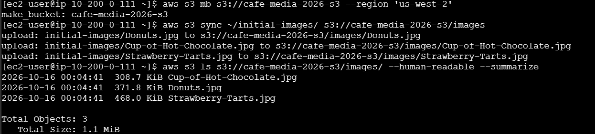
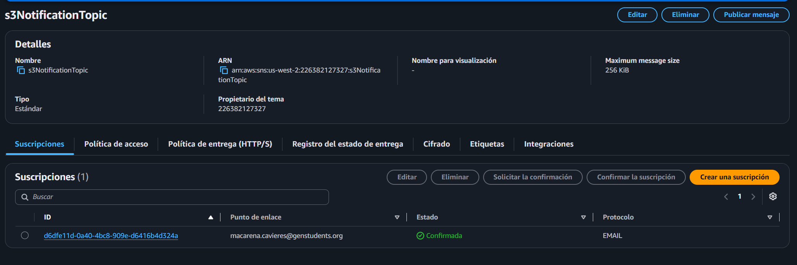
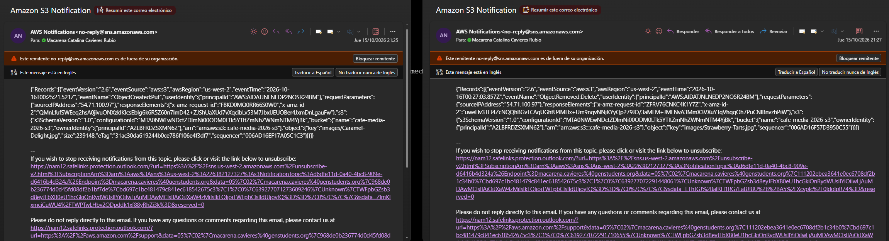
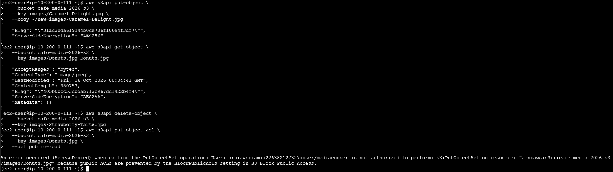

# Lab 185 Trabajo con Amazon S3 (Compartir Archivos, Permisos IAM y Notificaciones SNS)


## Descripción General

En este laboratorio se configuró un bucket de **Amazon Simple Storage Service (Amazon S3)** destinado al uso compartido y seguro de imágenes con un usuario externo de medios (`mediacouser`). Utilizando la **AWS CLI**, se automatizó la sincronización de contenidos y se auditaron los permisos restrictivos basados en roles de **AWS IAM**. Asimismo, se implementó una arquitectura orientada a eventos mediante **Amazon Simple Notification Service (Amazon SNS)** para despachar alertas automáticas por correo electrónico cada vez que se agregaran o eliminaran archivos dentro de la carpeta designada (`images/`).

## Arquitectura del Laboratorio



### Explicación de la Arquitectura

La solución implementada en este laboratorio establece una arquitectura segura y orientada a eventos para el uso compartido de recursos multimedia entre la cafetería y colaboradores externos:

1. **Gestión de Permisos y Carga de Archivos (IAM & S3):**
   - El administrador instala e inicializa la estructura del bucket `cafe-images` en Amazon S3.
   - Mediante **AWS IAM**, se aplican políticas de seguridad restrictivas al usuario externo (`mediacouser`), otorgándole acceso exclusivo al prefijo `/media/` (o `/images/`) con permisos específicos de lectura, escritura y eliminación (`GetObject`, `PutObject`, `DeleteObject`). Se bloquea cualquier intento de modificar las políticas o configuraciones globales del bucket.

2. **Procesamiento de Eventos y Notificaciones (S3 & SNS):**
   - Amazon S3 monitorea de forma continua los cambios en el bucket. Cada vez que se detecta una modificación (eventos `ObjectCreated` u `ObjectRemoved`), S3 dispara una notificación automática hacia el tema de **Amazon SNS** (`s3NotificationTopic`).

3. **Suscripción y Alertas al Administrador:**
   - El tema de Amazon SNS distribuye de inmediato el mensaje de evento hacia la dirección de correo electrónico del administrador (suscriptor), notificándole en tiempo real los detalles de las imágenes agregadas o eliminadas por el usuario de medios.

## Objetivos del Laboratorio

- Utilizar los comandos de la AWS CLI (`s3` y `s3api`) para aprovisionar y estructurar un bucket compartido de S3.
- Verificar y probar los permisos granulares de lectura, escritura y eliminación asignados a usuarios y grupos de IAM.
- Configurar notificaciones de eventos en el bucket de S3 integradas con un tema de Amazon SNS para auditoría en tiempo real.

## Tarea 1: Conexión y Configuración de la AWS CLI

1. Conectarse a la instancia `CLI Host` mediante **EC2 Instance Connect** en la consola de Amazon EC2.
2. Configurar el perfil de la herramienta de línea de comandos ejecutando `aws configure` e ingresando las credenciales temporales del laboratorio, la región `us-west-2` y el formato de salida `json`.

## Tarea 2: Creación e Inicialización del Bucket Compartido

1. **Creación del Bucket:** Crear un depósito único para el proyecto mediante la CLI:

   ```bash
   aws s3 mb s3://<cafe-xxxnnn> --region 'us-west-2'
   ```

2. **Sincronización de Imágenes Iniciales:** Cargar el conjunto de fotografías base utilizando el comando de sincronización:

   ```bash
   aws s3 sync ~/initial-images/ s3://<cafe-xxxnnn>/images
   ```

3. **Verificación de Contenido:** Listar los objetos cargados confirmando el resumen y tamaño total:

   ```bash
   aws s3 ls s3://<cafe-xxxnnn>/images/ --human-readable --summarize
   ```

   
   _Figura 1: Creación, sincronización y verificación del contenido del bucket_

## Tarea 3: Revisión de Permisos de IAM y Pruebas de Usuario

1. **Auditoría de Políticas (`mediaco` y `mediacouser`):** Revisar en la consola de IAM las políticas asociadas al grupo, destacando los permisos específicos (`GetObject`, `PutObject`, `DeleteObject`) limitados al prefijo `/images/*`.

2. **Pruebas de Casos de Uso:** Iniciar sesión de forma independiente con las credenciales de `mediacouser` para validar operaciones legítimas (visualizar imágenes, cargar nuevos recursos multimedia y eliminar archivos específicos) y comprobar restricciones ante intentos no autorizados (como modificar permisos o la raíz del bucket).

## Tarea 4: Configuración de Notificaciones de Eventos en S3

### Tarea 4.1: Creación y Configuración del Tema SNS

1. Crear un tema estándar de Amazon SNS denominado `s3NotificationTopic` y registrar su ARN.

2. Asignar una política de acceso JSON al tema de SNS para conceder explícitamente permisos de publicación al servicio de Amazon S3:

   ```json
   {
     "Version": "2008-10-17",
     "Id": "S3PublishPolicy",
     "Statement": [
       {
         "Sid": "AllowPublishFromS3",
         "Effect": "Allow",
         "Principal": { "Service": "s3.amazonaws.com" },
         "Action": "SNS:Publish",
         "Resource": "<ARN of s3NotificationTopic>",
         "Condition": {
           "ArnLike": { "aws:SourceArn": "arn:aws:s3:*:*:<cafe-xxxnnn>" }
         }
       }
     ]
   }
   ```

3. Crear una suscripción de tipo Correo electrónico vinculada al tema y confirmar la suscripción mediante el enlace recibido en la bandeja de entrada.

   
   _Figura 2: Detalles del tema_

### Tarea 4.2: Asociación de Notificaciones al Bucket de S3

1.  Crear un archivo de configuración JSON local (`s3EventNotification.json`) para filtrar eventos de creación y eliminación en la ruta especificada:

    ```json
    {
      "TopicConfigurations": [
        {
          "TopicArn": "<ARN of s3NotificationTopic>",
          "Events": ["s3:ObjectCreated:*", "s3:ObjectRemoved:*"],
          "Filter": {
            "Key": {
              "FilterRules": [{ "Name": "prefix", "Value": "images/" }]
            }
          }
        }
      ]
    }
    ```

2.  Aplicar la configuración de notificaciones al bucket utilizando la API de S3:

        ```bash
        aws s3api put-bucket-notification-configuration --bucket <cafe-xxxnnn> --notification-configuration file://s3EventNotification.json
        ```

## Tarea 5: Pruebas de Operaciones y Alertas de Eventos

1. **Configuración de Credenciales CLI para `mediacouser`:** Actualizar el perfil local de la CLI con las claves de acceso del usuario externo:

   ```bash
   aws configure
   ```

2. **Carga de Objetos (`Put`):** Enviar una nueva imagen de prueba al bucket:

   ```bash
   aws s3api put-object --bucket <cafe-xxxnnn> --key images/Caramel-Delight.jpg --body ~/new-images/Caramel-Delight.jpg
   ```

(Verificar la recepción inmediata de la notificación por correo electrónico con `eventName` igual a `ObjectCreated:Put`).

3. Consulta de Objetos (`Get`): Obtener un objeto existente:

   ```bash
   aws s3api get-object --bucket <cafe-xxxnnn> --key images/Donuts.jpg Donuts.jpg
   ```

   _(Confirmar que esta acción no genera correos de alerta, ya que no está contemplada en los filtros del evento)._

4. Eliminación de Objetos (`Delete`): Borrar una imagen del bucket:

   ```bash
   aws s3api delete-object --bucket <cafe-xxxnnn> --key images/Strawberry-Tarts.jpg
   ```

   _(Verificar la llegada del correo de notificación con eventName igual a ObjectRemoved:Delete)._

   
   _Figura 3: Correos con el eventName `ObjectCreated:Put` y `ObjectRemoved:Delete`_

5. Prueba de Restricción: Intentar modificar la ACL pública de un objeto con el usuario externo, confirmando el bloqueo de seguridad:

   ```bash
   aws s3api put-object-acl --bucket <cafe-xxxnnn> --key images/Donuts.jpg --acl public-read
   ```

   
   _Figura 4: Comandos de la tarea 5 pasos 2, 3, 4 y 5_

## Resumen de Recursos y Componentes

| Servicio / Recurso            | Nombre del Componente                   | Descripción y Función Técnica                                                                                                   |
| :---------------------------- | :-------------------------------------- | :------------------------------------------------------------------------------------------------------------------------------ |
| **Amazon S3**                 | `<cafe-xxxnnn>`                         | Bucket principal configurado para el almacenamiento y uso compartido de imágenes con restricciones de prefijo.                  |
| **AWS IAM**                   | Grupo `mediaco` & Usuario `mediacouser` | Entidades de seguridad con políticas personalizadas para permitir operaciones controladas de lectura, escritura y borrado.      |
| **Amazon SNS**                | `s3NotificationTopic`                   | Tema estándar encargado de procesar y enrutar las notificaciones generadas por S3 hacia los suscriptores.                       |
| **Automatización de Eventos** | `s3EventNotification.json`              | Archivo de reglas vinculado al bucket para disparar alertas exclusivamente ante eventos de creación y eliminación en `images/`. |
| **Amazon EC2**                | Instancia `CLI Host`                    | Servidor Linux de apoyo utilizado para ejecutar comandos avanzados de la AWS CLI (`s3` y `s3api`).                              |

## Conclusiones del Laboratorio

- **Control de Acceso Basado en Identidad (IAM):** El uso estructurado de grupos y políticas adaptadas a prefijos específicos permite delegar operaciones de almacenamiento a terceros de forma totalmente segura y auditada.
- **Arquitectura Dirigida por Eventos:** La integración nativa entre Amazon S3 y Amazon SNS simplifica la implementación de sistemas de monitoreo y notificaciones automáticas ante modificaciones en la infraestructura de datos.
- **Gestión Avanzada con la AWS CLI:** Los comandos de la familia `s3api` ofrecen un control profundo sobre las configuraciones avanzadas del servicio, como políticas de notificación y metadatos de objetos a nivel de programación.
