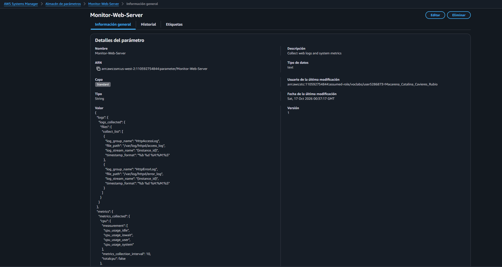
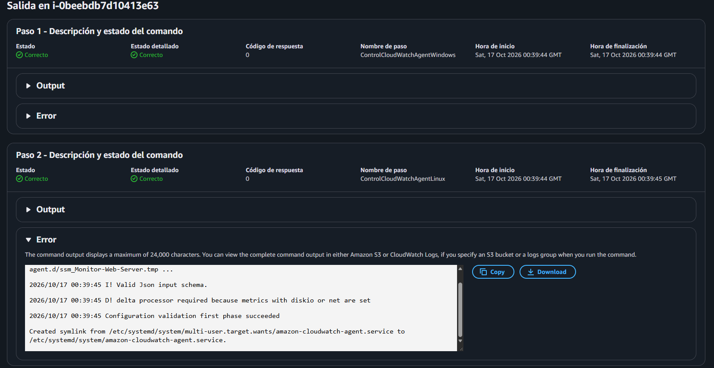
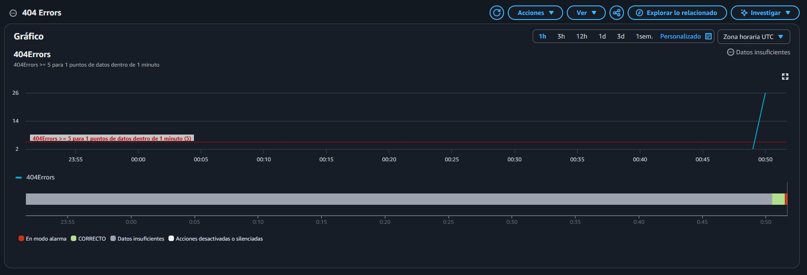
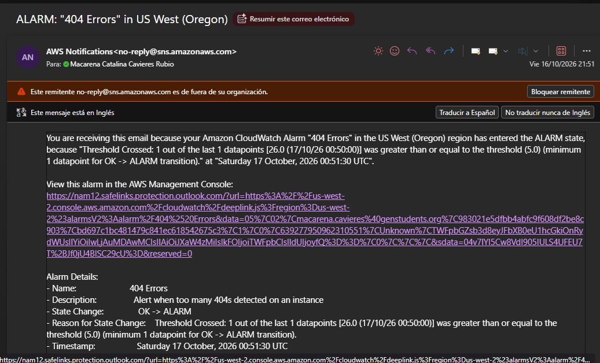
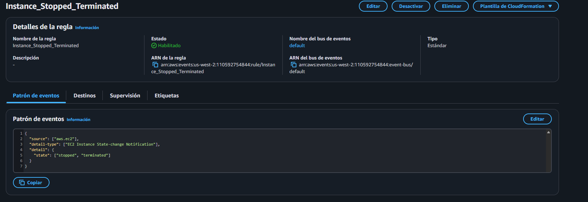
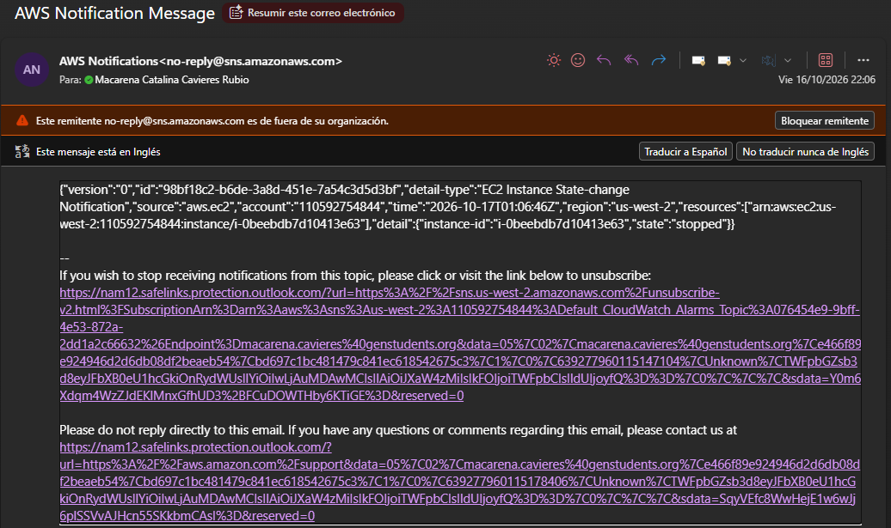
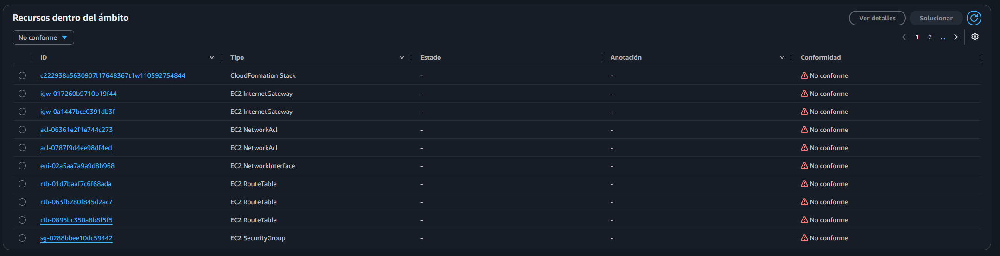

# Lab 186 Supervisión de la Infraestructura (CloudWatch, Sistemas, Logs, Eventos y AWS Config)

## Descripción General

En este laboratorio se implementó una estrategia integral de observabilidad, monitoreo de sistemas y gobernanza de cumplimiento sobre una arquitectura en la nube de **AWS**. Se utilizó **AWS Systems Manager (SSM)** para instalar y configurar de forma centralizada el agente de **Amazon CloudWatch** en servidores Linux, permitiendo recolectar métricas detalladas a nivel de sistema operativo (CPU, memoria, disco, swap) y registros de aplicaciones web (`access_log` y `error_log`). Asimismo, se configuraron filtros de métricas avanzados, alarmas automatizadas para la detección de errores HTTP 404, respuestas operativas en tiempo real mediante **EventBridge (CloudWatch Events)** con notificaciones en **Amazon SNS**, y auditorías continuas de cumplimiento normativo y de etiquetado mediante **AWS Config**.

## Objetivos del Laboratorio

- Instalar y configurar de forma remota el agente de **CloudWatch** en instancias de Amazon EC2 mediante Systems Manager (Run Command y Parameter Store).
- Supervisar métricas extendidas del sistema operativo y registros de aplicaciones en tiempo real.
- Crear filtros de registros personalizados, alarmas en CloudWatch y activar pruebas de detonación de alarmas por errores HTTP 404 mediante notificaciones de correo electrónico (SNS).
- Configurar reglas de eventos operativos para reaccionar ante cambios de ciclo de vida de los recursos de cómputo.
- Evaluar, examinar y auditar el cumplimiento normativo y de recursos de la infraestructura mediante políticas automatizadas en **AWS Config**.

## Estructura y Paso a Paso del Laboratorio

### Tarea 1: Instalación y Configuración del Agente de CloudWatch

1. **Despliegue con SSM Run Command:**
   - Ingresar a la consola de **Systems Manager**, seleccionar **Run Command** y hacer clic en **Ejecutar un comando**.
   - Elegir el documento predefinido `AWS-ConfigureAWSPackage`.
   - Configurar los parámetros con `Acción: Install`, `Nombre: AmazonCloudWatchAgent` y `Versión: latest`.
   - En **Destinos**, seleccionar "Elegir instancias manualmente" y marcar la casilla de la instancia `Web Server`. Hacer clic en **Ejecutar**.
2. **Centralización de Configuración en Parameter Store:**
   - En el panel de Systems Manager, acceder a **Almacén de parámetros** y seleccionar **Crear parámetro**.
   - Asignar el nombre `Monitor-Web-Server`, descripción `Collect web logs and system metrics`, e insertar la estructura JSON que define la recolección de los logs de Apache (`HttpAccessLog`, `HttpErrorLog`) y las métricas de rendimiento (CPU, disco, memoria, swap con intervalos de 10 segundos).

     
     _Figura 1: Información general del `Monitor-Web-Server`_

3. **Puesta en Marcha del Agente:**
   - Volver a **Run Command**, buscar y seleccionar el documento `AmazonCloudWatchAgent-ManageAgent`.
   - En los parámetros del comando, configurar `Acción: configurar`, `Modo: ec2`, `Optional Configuration Source: ssm`, `Optional Configuration Location: Monitor-Web-Server` y `Optional Restart: yes`.
   - Seleccionar nuevamente la instancia `Web Server` como destino y ejecutar para poner en marcha el servicio de monitoreo.

     
     _Figura 2: Resultados de la puesta en marcha del agente_

### Tarea 2: Supervisión de Registros de Aplicaciones y Activación de Alarmas (CloudWatch Logs)

1. **Generación de Tráfico de Prueba (Errores 404):**
   - Obtener la dirección IP pública (`WebServerIP`) desde los detalles del laboratorio.
   - Abrir una nueva pestaña en el navegador web con dicha IP para visualizar la página de prueba del servidor web.
   - Agregar intencionalmente rutas inexistentes a la URL (por ejemplo, añadiendo `/start` y presionando Enter repetidas veces) para generar entradas de registro con errores HTTP 404.
2. **Creación de Grupos de Registros y Filtro de Métricas:**
   - En la consola de **CloudWatch**, ir a **Grupos de registros** para comprobar la existencia de `HttpAccessLog` y `HttpErrorLog`.
   - Seleccionar la secuencia de registro asociada al ID de la instancia para verificar las solicitudes entrantes y los códigos HTTP.
   - Marcar la casilla junto a `HttpAccessLog`, desplegar el menú **Acciones** y seleccionar **Crear un filtro de métricas**.
   - Ingresar el patrón de filtro: `[ip, id, user, timestamp, request, status_code=404, size]`. Probar el patrón seleccionando la instancia EC2 y haciendo clic en **Probar patrón** para validar los resultados con código 404.
   - Completar los detalles de la métrica asignando `Nombre del filtro: 404Errors`, `Espacio de nombres de métrica: LogMetrics`, `Nombre de la métrica: 404Errors` y `Valor de métrica: 1`. Finalizar creando el filtro.
3. **Creación y Detonación de la Alarma CloudWatch (Salto de Alarma):**
   - Seleccionar el filtro `404Errors` y elegir **Crear alarma**.
   - En la sección de métricas, configurar el **Periodo** en `1 minute` (1 minuto).
   - En condiciones, definir que siempre que `404Errors` sea `Mayor/Igual` que `5`, se active la alarma.
   - En la sección de notificación, seleccionar **Crear un tema nuevo**, ingresar una dirección de correo electrónico accesible y hacer clic en **Crear un tema**.
   - Asignar el nombre de la alarma `404 Errors` con su respectiva descripción y hacer clic en **Crear alarma**.
   - Revisar la bandeja de entrada del correo electrónico registrado, buscar el mensaje de confirmación de suscripción de SNS y hacer clic en **Confirmar la suscripción**.
   - **Simulación y Activación de la Alarma:** Regresar a la pestaña del servidor web e ingresar de forma continua a páginas que no existan (por ejemplo, `http://<WebServerIP>/start2`, `start3`, `start4`, etc.) al menos 5 veces consecutivas para acumular los eventos requeridos.
   - Esperar de 1 a 2 minutos en la consola de CloudWatch hasta que el gráfico de la alarma cambie de color a **rojo**, indicando que ha saltado al estado de _Alarma_. Verificar la llegada del correo electrónico de alerta con el asunto `ALARM: "404 Errors"`.

     
     _Figura 3: Alarma de `404 Errors` activada_
     
     _Figura 4: Correo indicando la activación de la alarma_

### Tarea 3: Supervisión de Métricas del Sistema (CloudWatch Metrics)

1. Examinar el comportamiento del clúster de cómputo evaluando las métricas nativas que provee por defecto Amazon EC2 (rendimiento de red y consumo general de hipervisor).
2. Explorar y contrastar las métricas extendidas recopiladas por el agente de CloudWatch bajo el espacio de nombres `CWAgent`, analizando variables críticas internas del sistema operativo huésped como espacio libre en inodos, particiones de almacenamiento (`device`, `fstype`, `path`) y porcentaje de uso de memoria RAM.

### Tarea 4: Automatización de Notificaciones en Tiempo Real (EventBridge)

1. En la consola de CloudWatch, expandir la sección de Eventos y seleccionar **Reglas** -> **Crear una regla**.
2. En el origen del evento, seleccionar como `Nombre del servicio: EC2` y `Tipo de evento: EC2 Instance State-change Notification`, marcando la casilla de estados específicos para elegir **detenida** (`stopped`) y **terminada** (`terminated`).
3. En la sección de destinos, agregar un destino seleccionando `Tema de SNS` y eligiendo el tema predeterminado `Default_CloudWatch_Alarms_Topic`.
4. Configurar los detalles de la regla con el nombre `Instance_Stopped_Terminated` y crearla.
   
   _Figura 5: Detalles de la regla `Instance_Stopped_Terminated`_

5. **Prueba de Notificación:** Ir a la consola de EC2, seleccionar la instancia `Web Server`, desplegar el menú **Estado de instancia**, elegir **Detener instancia** y confirmar. Comprobar la recepción de la notificación en formato JSON en el correo electrónico suscrito.

   
   _Figura 6: Notificación por correo en formato JSON_

### Tarea 5: Supervisión y Auditoría de Cumplimiento (AWS Config)

1. Inicializar y configurar el servicio **AWS Config** para habilitar la grabación y evaluación continua de los cambios de configuración en los recursos de la cuenta.
2. **Implementación de Reglas de Gobernanza Administradas:**
   - Seleccionar **Reglas** en el panel de navegación de AWS Config y hacer clic en **Agregar regla**.
   - Buscar y seleccionar la regla administrada `required-tags`, configurar en los parámetros de la regla la clave de etiqueta `tag1Key` con el valor `project`, y agregarla.
   - Agregar una segunda regla administrada buscando `ec2-volume-inuse-check` para auditar volúmenes de EBS huérfanos o no asociados a instancias.
3. Esperar a que el servicio complete la evaluación de los recursos y revisar los tableros de cumplimiento para verificar los resultados detallados entre recursos conformes y no conformes.

   
   _Figura 7: Tablero de cumplimiento de AWS Config_

## Resumen de Recursos y Componentes

| Servicio / Recurso      | Nombre del Componente              | Descripción y Función Técnica                                                                                                                       |
| :---------------------- | :--------------------------------- | :-------------------------------------------------------------------------------------------------------------------------------------------------- |
| **Amazon CloudWatch**   | Agente de Monitoreo & Logs         | Subsistema de observabilidad dedicado a la recolección de métricas internas y trazas de logs de aplicaciones web (`HttpAccessLog`, `HttpErrorLog`). |
| **AWS Systems Manager** | `Monitor-Web-Server` & Run Command | Plataforma centralizada de gestión operativa utilizada para la instalación remota del agente y persistencia de parámetros JSON.                     |
| **Amazon SNS**          | Tema de Alertas y Notificaciones   | Servicio de mensajería asíncrona configurado para enviar correos electrónicos de alerta ante alarmas métricas y eventos de infraestructura.         |
| **CloudWatch Events**   | `Instance_Stopped_Terminated`      | Motor de reglas orientado a eventos para capturar y reportar modificaciones operativas en el ciclo de vida de los servidores EC2.                   |
| **AWS Config**          | Reglas de Conformidad              | Servicio de gobernanza para auditar políticas de etiquetado obligatorio (`required-tags`) y uso correcto de discos EBS (`ec2-volume-inuse-check`).  |

## Conclusiones del Laboratorio

- **Observabilidad Sistémica Unificada:** La integración de Systems Manager con el agente de CloudWatch simplifica drásticamente la estandarización y recolección centralizada de métricas de rendimiento y logs de múltiples servidores de forma automatizada.
- **Detección Proactiva y Detonación de Alarmas:** La combinación de filtros de registros con umbrales configurados permite disparar alarmas de forma automatizada (como el salto de estado por errores 404) y notificar incidencias críticas en tiempo real.
- **Gobernanza y Auditoría de Configuración:** El uso de AWS Config garantiza un control continuo sobre el cumplimiento de los estándares operativos, de seguridad y de etiquetado definidos por la organización.
