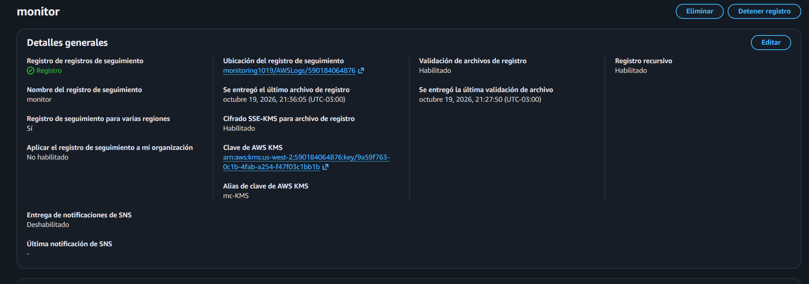
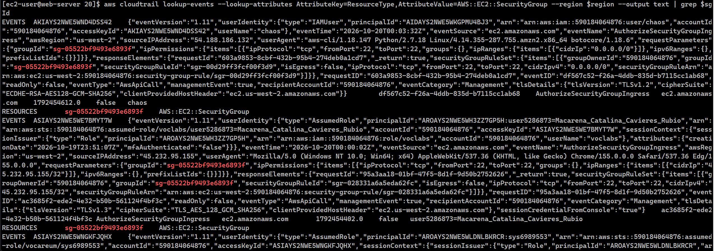
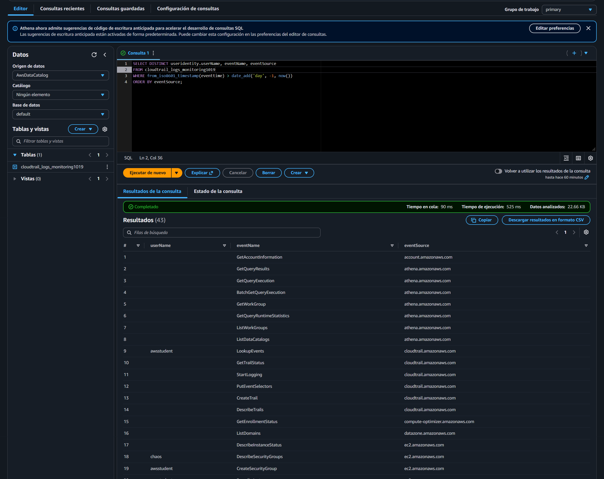
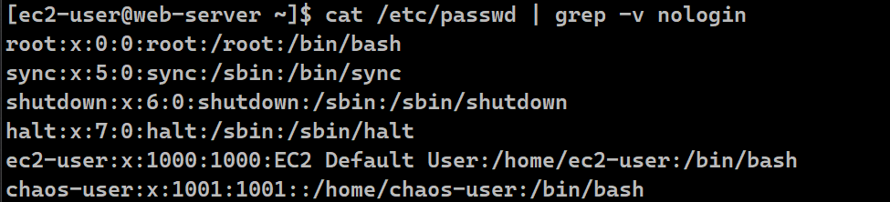
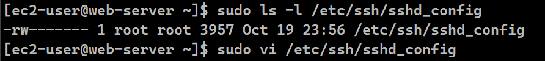
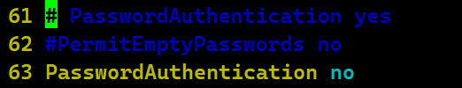
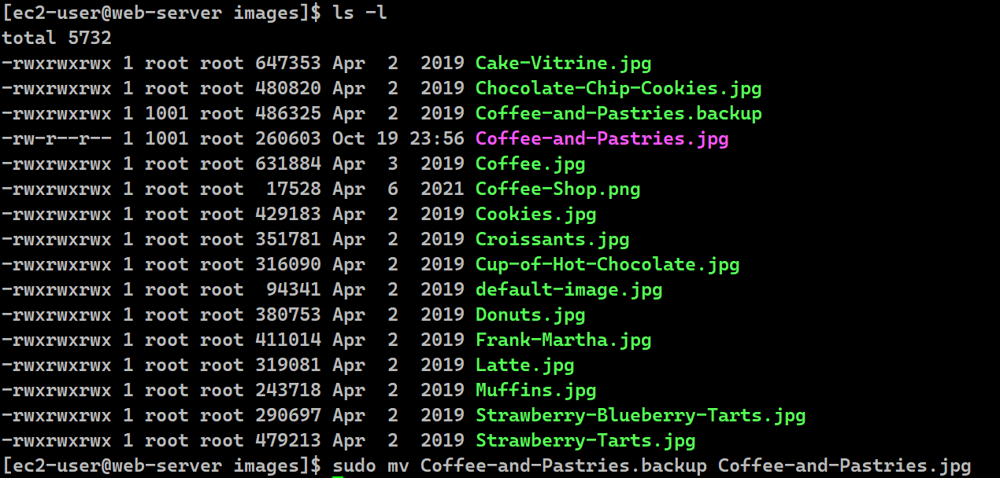

# Lab 187 Trabajo con AWS CloudTrail (Auditoría, Análisis Forense con Athena y Mitigación de Brechas)


## Descripción General

En esta actividad de investigación forense y seguridad en la nube, se simuló un escenario de ataque en una infraestructura de **AWS** donde el sitio web de la cafetería fue vulnerado mediante la modificación no autorizada de un grupo de seguridad de **Amazon EC2**. Para resolver el incidente, se configuró y utilizó una pista de auditoría de **AWS CloudTrail**, analizando los registros mediante herramientas de línea de comandos (`grep`), la **AWS CLI** y consultas SQL estructuradas en **Amazon Athena**. Finalmente, se ejecutaron procedimientos de mitigación, expulsión de usuarios maliciosos (`chaos-user`), endurecimiento de la configuración de seguridad de **SSH** y restauración de los servicios web afectados.

## Objetivos del Laboratorio

- Configurar y desplegar una pista de auditoría en **AWS CloudTrail** vinculada a un bucket cifrado de Amazon S3.
- Analizar registros de CloudTrail mediante comandos de Linux y herramientas de la AWS CLI para rastrear acciones maliciosas.
- Importar datos de registro a **Amazon Athena** y ejecutar consultas SQL interactivas para identificar al atacante.
- Resolver problemas de seguridad en una instancia Linux de EC2 y en la cuenta de AWS (eliminación de accesos no autorizados y configuración SSH segura).

## Estructura y Paso a Paso del Laboratorio

### Tarea 1: Modificación de Grupos de Seguridad y Validación Inicial

1. Ubicar la instancia `Café Web Server` en la consola de **Amazon EC2**.
2. Modificar temporalmente el grupo de seguridad para permitir acceso SSH exclusivo desde la dirección IP propia (`My IP /32`).
3. Comprobar que el sitio web operaba con normalidad antes del ataque accediendo a la URL pública `http://<WebServerIP>/cafe/`.

### Tarea 2: Creación de CloudTrail y Detección de la Brecha

1.  **Configuración de CloudTrail:**
    - Crear una pista de auditoría denominada `monitor` en la consola de CloudTrail.
    - Seleccionar la creación de un nuevo bucket de S3 (`monitoring####`) y configurar un alias de cifrado KMS (`-KMS`).

      
      _Figura 1: Detalles del trail `monitor`_

2.  **Detección del Ataque:**
    - Actualizar el navegador tras unos minutos y notar que el sitio web fue vulnerado (alteración de imágenes).

    
    _Figura 2: Vista del navegador después del ataque_
    - Revisar los detalles de la instancia EC2 y descubrir que el grupo de seguridad fue modificado por un agente externo, abriendo el puerto 22 (SSH) a todo internet (`0.0.0.0/0`).

### Tarea 3: Análisis de Registros de CloudTrail mediante Grep y CLI

1. **Conexión SSH:** Conectarse a la instancia `Café Web Server` mediante SSH utilizando las claves provistas (`labsuser.pem` o `labsuser.ppk`).
2. **Descarga y Extracción de Logs:**
   - Crear un directorio de trabajo (`ctraillogs`) y acceder a él:
     ```bash
     mkdir ctraillogs
     cd ctraillogs
     ```
   - Obtener la lista de buckets de S3 para recordar el nombre exacto del bucket de auditoría:
     ```bash
     aws s3 ls
     ```
   - Descargar de manera recursiva todos los archivos de registro de CloudTrail almacenados en el bucket:
     ```bash
     aws s3 cp s3://<monitoring####>/ . --recursive
     ```
   - Navegar a través de la estructura de subdirectorios generada (`AWSLogs/<account-num>/CloudTrail/<Region>/<yyyy>/<mm>/<dd>/`) utilizando comandos `cd` y `ls` hasta localizar los archivos comprimidos con extensión `.json.gz`.
   - Extraer todos los archivos de registro comprimidos ejecutando:
     ```bash
     gunzip *.gz
     ```
3. **Análisis detallado de los registros empleando Linux (Grep y bucles):**
   - **Estructura de un registro individual:** Para examinar el formato JSON estándar de una entrada de registro y legibilidad, ejecutar:
     ```bash
     cat <filename.json> | python -m json.tool
     ```
   - **Filtrado por Dirección IP de Origen (`sourceIPAddress`):** Establecer la IP de la instancia como una variable de entorno e implementar un bucle `for` para inspeccionar la coincidencia de IPs en todos los archivos de registro:
     ```bash
     ip=<WebServerIP>
     for i in $(ls); do echo $i && cat$i | python -m json.tool | grep sourceIPAddress ; done
     ```
   - **Filtrado por Nombre de Evento (`eventName`):** Ejecutar un bucle similar para auditar los nombres de las operaciones ejecutadas en la cuenta y detectar eventos de modificación o actualización (`update`):
     ```bash
     for i in $(ls); do echo $i && cat$i | python -m json.tool | grep eventName ; done
     ```
4. **Análisis mediante Comandos de CloudTrail de la AWS CLI:**
   - Consultar eventos relacionados con inicios de sesión en la consola de administración:
     ```bash
     aws cloudtrail lookup-events --lookup-attributes AttributeKey=EventName,AttributeValue=ConsoleLogin
     ```
   - Buscar de forma general acciones realizadas sobre grupos de seguridad en la cuenta de AWS:
     ```bash
     aws cloudtrail lookup-events --lookup-attributes AttributeKey=ResourceType,AttributeValue=AWS::EC2::SecurityGroup --output text
     ```
   - **Filtrado Avanzado por Grupo de Seguridad Específico:**
     - Obtener de manera dinámica la región y el ID del grupo de seguridad vinculado a la instancia `Café Web Server`:
       ```bash
       region=$(curl http://169.254.169.254/latest/dynamic/instance-identity/document | grep region | cut -d '"' -f4)
       sgId=$(aws ec2 describe-instances --filters "Name=tag:Name,Values='Cafe Web Server'" --query 'Reservations[*].Instances[*].SecurityGroups[*].[GroupId]' --region $region --output text)
       echo $sgId
       ```
     - Cruzar el ID del grupo de seguridad obtenido con los eventos de CloudTrail para aislar exclusivamente la traza del ataque:
       ```bash
       aws cloudtrail lookup-events --lookup-attributes AttributeKey=ResourceType,AttributeValue=AWS::EC2::SecurityGroup --region $region --output text \vert{} grep$sgId
       ```

     
     _Figura 3: Ejecución en la CLI del comando `aws cloudtrail lookup-events`_

### Tarea 4: Análisis Avanzado de Registros con Amazon Athena

1. **Creación de la Tabla de Athena:**
   - Desde la consola de CloudTrail (o historial de eventos), seleccionar **Crear tabla de Athena** utilizando el bucket de S3 `monitoring####` donde se centralizan los registros.
2. **Consultas SQL Interactivas:**
   - Acceder al servicio **Amazon Athena** y configurar la ubicación de los resultados de consulta en `s3://monitoring####/results/`.
   - Ejecutar consultas SELECT iniciales sobre la tabla generada (`cloudtrail_logs_monitoring####`) para examinar las columnas clave (`useridentity.userName`, `eventtime`, `eventsource`, `eventname`).
   - **Consulta de prueba inicial (limitada a 5 filas):** Para verificar la estructura y los datos disponibles en los registros:
     ```sql
     SELECT *
     FROM cloudtrail_logs_monitoring####
     LIMIT 5;
     ```
   - **Consulta estructurada de columnas clave (limitada a 30 filas):** Para aislar la información relevante facilitando la lectura de los campos principales:
     ```sql
     SELECT
     useridentity.userName, eventtime, eventsource, eventname, requestparameters
     FROM cloudtrail_logs_monitoring####
     LIMIT 30;
     ```
3. **Desafío - Identificación del Pirata Informático:**
   - Utilizar sentencias SQL con cláusulas `WHERE` (`eventsource = 'ec2.amazonaws.com'`) o realizar búsquedas de patrones (`LIKE '%Security%'`) para aislar la acción exacta de apertura del puerto 22.
   - **Consulta general orientada a auditoría de actividad reciente:** Para listar de forma distintiva a los usuarios activos del día anterior y sus acciones ejecutadas ordenadas por servicio:
     ```sql
     SELECT
     DISTINCT useridentity.userName, eventName, eventSource
     FROM cloudtrail_logs_monitoring####
     WHERE from_iso8601_timestamp(eventtime) > date_add('day', -1, now())
     ORDER BY eventSource;
     ```
   - Identificar al usuario infractor (`chaos-user`), la hora exacta del ataque, la IP de origen y el método de acceso empleado.

     
     _Figura 4: Consulta ejecutada del paso 3 e identificación del usuario `chaos`_

### Tarea 5: Respuesta ante Incidentes, Refuerzo de Seguridad y Recuperación

1. **Verificación y Expulsión de Usuarios No Autorizados del SO:**
   - Inspeccionar los registros de autenticación del sistema operativo para rastrear las actividades de inicio de sesión recientes y detectar el acceso del intruso:
     ```bash
     sudo aureport --auth
     ```
   - Listar los usuarios activos con el comando para ver quién está conectado:
     ```bash
     who
     ```
   - Intentar la eliminación directa del usuario detectado (`chaos-user`), la cual puede generar un bloqueo si el proceso sigue activo:
     ```bash
     sudo userdel -r chaos-user
     ```
   - Localizar el número de proceso (`ProcNum`) asociado a la sesión remota del intruso y forzar su finalización inmediata para liberar el bloqueo:
     ```bash
     sudo kill -9 <ProcNum>
     ```
   - Verificar nuevamente con el comando `who` que el único usuario conectado sea el legítimo (`ec2-user`), y proceder con la eliminación exitosa del usuario del sistema junto con su directorio personal:
     ```bash
     sudo userdel -r chaos-user
     ```

   > **💡 Nota práctica / Complemento de la experiencia real:**
   > Durante la ejecución de este laboratorio, los pasos oficiales pueden presentar ligeras variaciones prácticas. En este caso particular, para identificar con total seguridad al usuario intruso (`chaos-user`) y limpiar el sistema, resultó muy efectivo utilizar directamente el comando de filtrado de usuarios con shell interactiva:
   >
   > ```bash
   > sudo cat /etc/passwd | grep -v nologin
   > ```
   >
   > Gracias a esta validación, se logró confirmar el rastro del usuario malicioso en el sistema operativo y ejecutar con éxito el comando definitivo de borrado (`sudo userdel -r chaos-user`), desviándose un poco del flujo estándar del manual para asegurar la resolución completa de la tarea.
   > 
   > _Figura 5: Identificación del intruso con el comando `sudo cat /etc/passwd | grep -v nologin`_

2. **Endurecimiento (Hardening) de la Configuración SSH:**
   - Revisar la fecha de modificación reciente del archivo de configuración del demonio SSH:
     ```bash
     sudo ls -l /etc/ssh/sshd_config
     ```

   
   _Figura 6: Revisión de la fecha del archivo de configuración del demonio SSH_

   > 💡 **Nota**
   > Este laboratorio se ejecuto el día 19-10-2026, que coincide con la fecha de modificación del demonio SSH
   - Abrir el archivo de configuración en el editor `vi`:
     ```bash
     sudo vi /etc/ssh/sshd_config
     ```
   - Ingresar `:set number` para visualizar los números de línea y ubicar la directiva `PasswordAuthentication yes` (línea 61). Comentar dicha línea agregando un `#` al inicio para deshabilitar el acceso por contraseñas predecibles.
   - Descomentar la directiva correspondiente eliminando el `#` en `PasswordAuthentication no` (línea 63) para forzar exclusivamente el uso de pares de claves cifradas. Guardar los cambios y salir del editor con `:wq`.

      \
      _Figura 7: Vista del vim de las líneas 61 y 63 con la configuración correcta_

   - Reiniciar el servicio SSH del sistema para aplicar las nuevas directivas de seguridad:
     ```bash
     sudo service sshd restart
     ```
   - **Corrección en la Consola de AWS:** Dirigirse a la consola de Amazon EC2, acceder al grupo de seguridad asociado al servidor web, editar las reglas de entrada y eliminar permanentemente la regla que exponía el puerto TCP 22 a todo internet (`0.0.0.0/0`).

3. **Restauración y Limpieza del Sitio Web:**
   - Navegar hacia el directorio raíz donde se almacenan los recursos multimedia de la cafetería y listar los archivos para identificar la copia de respaldo generada por el atacante:
     ```bash
     cd /var/www/html/cafe/images/
     ls -l
     ```
   - Renombrar el archivo de respaldo original para reestablecer la imagen legítima del sitio web:

     ```bash
     sudo mv Coffee-and-Pastries.backup Coffee-and-Pastries.jpg
     ```

     
     _Figura 8: Comandos ejecutados para el paso 3 de restauración y limpieza del sitio web_

   - Cargar nuevamente la URL pública en el navegador (utilizando `Shift + F5` para limpiar la caché local) y comprobar la correcta visualización del sitio web restaurado.

   
   _Figura 9: Visualización correcta del sitio web restaurado_

4. **Revocación y Eliminación del Usuario Malicioso en AWS IAM:**
   - Iniciar sesión en la Consola de administración de AWS y navegar al servicio **IAM (Identity and Access Management)**.
   - Seleccionar **Usuarios** en el panel de navegación izquierdo y ubicar la entidad de seguridad asociada al atacante (`chaos-user`).
   - Seleccionar la opción **Eliminar**, reconfirmar ingresando el nombre exacto del usuario en la casilla solicitada y confirmar la eliminación definitiva para revocar por completo sus permisos y credenciales programáticas sobre la cuenta de AWS.

## Resumen de Recursos y Componentes

| Servicio / Recurso               | Nombre del Componente            | Descripción y Función Técnica                                                                                                      |
| :------------------------------- | :------------------------------- | :--------------------------------------------------------------------------------------------------------------------------------- |
| **AWS CloudTrail**               | Pista `monitor`                  | Servicio de auditoría encargado de registrar y almacenar de forma centralizada todas las llamadas a la API y eventos de la cuenta. |
| **Amazon S3**                    | `monitoring####`                 | Depósito seguro de objetos utilizado para almacenar los archivos de registro sin procesar y los resultados de Athena.              |
| **Amazon Athena**                | `cloudtrail_logs_monitoring####` | Motor de consultas interactivo basado en SQL estándar para analizar grandes volúmenes de logs almacenados en S3.                   |
| **Amazon EC2 & Security Groups** | `Café Web Server`                | Instancia de cómputo y grupo de seguridad vulnerado y posteriormente asegurado mediante endurecimiento SSH y limpieza de reglas.   |
| **AWS IAM**                      | Usuario `chaos-user`             | Entidad de seguridad identificada como el origen del acceso no autorizado y eliminada durante la respuesta al incidente.           |

## Conclusiones del Laboratorio

- **Importancia de la Auditoría Continua:** La habilitación temprana de AWS CloudTrail resulta indispensable para realizar análisis forenses precisos y reconstruir la cronología exacta de eventos tras una brecha de seguridad.
- **Potencia de Análisis con Athena:** El uso de Amazon Athena permite transformar registros semiestructurados masivos en bases de datos consultables mediante SQL, facilitando enormemente la detección de anomalías.
- **Respuesta Integral ante Incidentes:** Mitigar una brecha de seguridad requiere un enfoque multifacético que abarque desde la expulsión de procesos y usuarios en el sistema operativo y la mejora de directivas SSH, hasta la revocación de credenciales en IAM y la restauración de los datos afectados.
