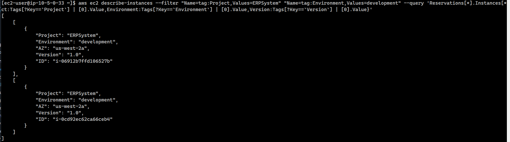
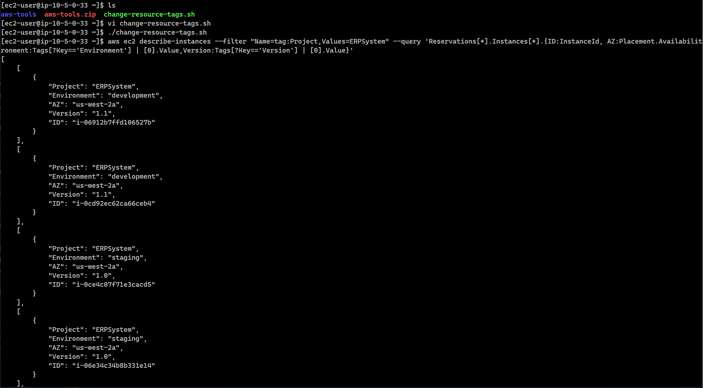
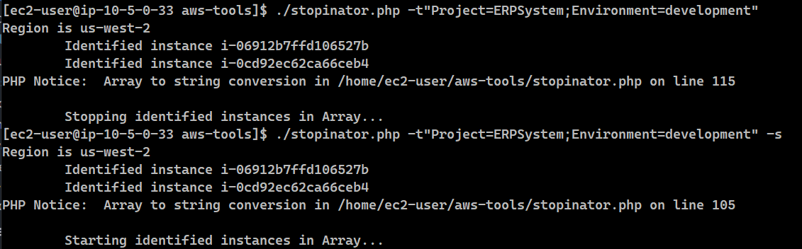
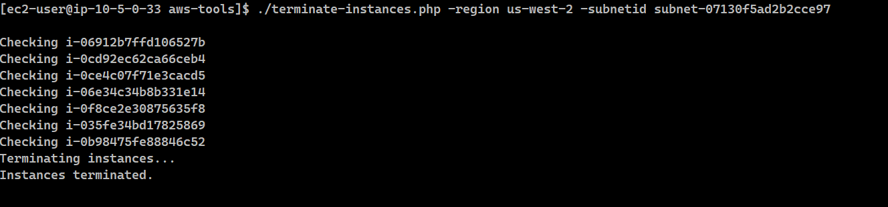
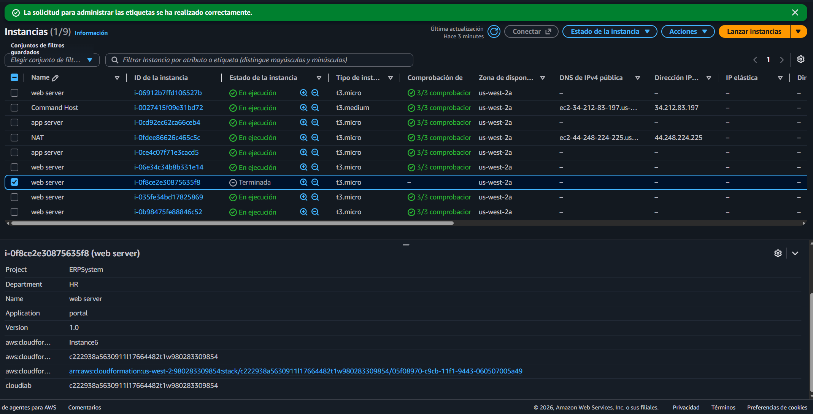

# Lab 188 Administración de Recursos mediante el Etiquetado (AWS CLI, JMESPath, PHP SDK y Automatización)


## Descripción General

En este laboratorio se implementó una estrategia integral de administración, control operativo y gobernanza de seguridad basada en el **etiquetado de recursos (Tagging)** en **AWS**. Mediante el uso de la **AWS CLI** combinada con consultas avanzadas de **JMESPath**, se inspeccionaron y modificaron masivamente etiquetas en instancias de **Amazon EC2**. Asimismo, se utilizaron scripts en Bash y en el **SDK de AWS para PHP** (como la herramienta _Stopinator_ y la política automatizada _Tag-Or-Terminate_) para gestionar de manera simultánea el ciclo de vida de los servidores de desarrollo y aplicar políticas estrictas de seguridad ante recursos no conformes.

## Objetivos del Laboratorio

- Aplicar y modificar etiquetas dinámicamente en recursos existentes de AWS mediante la línea de comandos.
- Buscar y filtrar recursos de EC2 utilizando consultas avanzadas con sintaxis **JMESPath** (`--query`).
- Utilizar scripts automatizados en Bash y PHP para detener, reiniciar y terminar instancias de Amazon EC2 en función de atributos y etiquetas específicas.

## Tarea 1: Utilizar Etiquetas para Administrar Recursos

1. **Conexión a Command Host:** Conectarse mediante SSH a la instancia de administración `Command Host` utilizando las claves provistas (`labsuser.pem` o `labsuser.ppk`).
2. **Filtrado Avanzado con AWS CLI y JMESPath:**
   - Describir las instancias asociadas al proyecto `ERPSystem`:

     ```bash
     aws ec2 describe-instances --filter "Name=tag:Project,Values=ERPSystem"
     ```

     > **¿Qué hace este comando?** Consulta las instancias EC2 y filtra los resultados para incluir las que tengan una etiqueta `Project` cuyo valor sea `ERPSystem`. El resultado muestra el conjunto completo de parámetros, lo cual permite verificar la existencia de los recursos.

   - Limitar los resultados para obtener únicamente los ID de las instancias mediante JMESPath:

     ```bash
     aws ec2 describe-instances --filter "Name=tag:Project,Values=ERPSystem" --query 'Reservations[*].Instances[*].InstanceId'
     ```

     > **¿Para qué lo ejecutamos?** En el paso anterior obtuvimos todos los detalles de las instancias. Ahora utilizamos una consulta para mostrar solo sus identificadores. Esto hace que los resultados sean más fáciles de leer y utilizar en scripts.

   - Incluir múltiples propiedades (ID y Zona de Disponibilidad) utilizando alias y llaves de formato:
     ```bash
     aws ec2 describe-instances --filter "Name=tag:Project,Values=ERPSystem" --query 'Reservations[*].Instances[*].{ID:InstanceId,AZ:Placement.AvailabilityZone}'
     ```
   - Extraer valores de etiquetas personalizadas (`Project`, `Environment` y `Version`) mediante consultas estructuradas en matrices:

     ```bash
     aws ec2 describe-instances --filter "Name=tag:Project,Values=ERPSystem" --query 'Reservations[*].Instances[*].{ID:InstanceId,AZ:Placement.AvailabilityZone,Project:Tags[?Key==`Project`] | [0].Value,Environment:Tags[?Key==`Environment`] | [0].Value,Version:Tags[?Key==`Version`] | [0].Value}'
     ```

     > **¿Por qué se usa?** Una instancia puede tener muchas etiquetas. Mediante JMESPath podemos recuperar una etiqueta específica y mostrarla junto con otros datos del recurso. Las etiquetas no solo sirven para buscar recursos, sino que también nos permiten comprender su función y tomar decisiones automatizadas según el proyecto, el entorno o la versión.

   - Aplicar múltiples filtros de etiquetas combinados (proyecto y entorno de desarrollo):

     ```bash
     aws ec2 describe-instances --filter "Name=tag:Project,Values=ERPSystem" "Name=tag:Environment,Values=development" --query 'Reservations[*].Instances[*].{ID:InstanceId,AZ:Placement.AvailabilityZone,Project:Tags[?Key==`Project`] | [0].Value,Environment:Tags[?Key==`Environment`] | [0].Value,Version:Tags[?Key==`Version`] | [0].Value}'
     ```

     > **Explicación del paso:** Ahora se aplican dos filtros (`Project=ERPSystem` y `Environment=development`). Los dos filtros deben cumplirse simultáneamente para que la instancia aparezca en el resultado.

     
     _Figura 1: Comando ejecutado para filtrar por proyecto y entorno_

3. **Actualización Masiva de Etiquetas por Lotes:**
   - Examinar el contenido del script Bash `/home/ec2-user/change-resource-tags.sh`, el cual recopila los ID de las instancias de desarrollo y sobrescribe la etiqueta `Version` a `1.1` usando `aws ec2 create-tags`.
   - Ejecutar el script y verificar la actualización exitosa:

     ```bash
     ./change-resource-tags.sh
     ```

     > **¿Para qué se ejecuta?** En esta sección se utiliza un script Bash para modificar la etiqueta `Version` de las instancias que pertenecen al proyecto `ERPSystem` y al entorno `development`. El script automatiza dos operaciones: primero identifica las instancias de desarrollo y después cambia su etiqueta `Version` a `1.1`, evitando modificar cada instancia de forma manual.

     
     _Figura 2: Comando ejecutado para actualización masiva_

## Tarea 2: Detener e Iniciar Recursos en Función de la Etiqueta (Stopinator)

1. **Revisión del Script Stopinator:** Navegar al directorio `aws-tools` y examinar el archivo `stopinator.php`, el cual utiliza el SDK de PHP para interactuar con las API de EC2 y administrar servidores según argumentos de etiquetas (`-t`) y operaciones de encendido (`-s`).
   > **¿Qué función cumple?** El script permite buscar instancias que coincidan con determinadas etiquetas y detenerlas o iniciarlas de forma centralizada.
2. **Ejecución de Pruebas de Encendido y Apagado:**
   - Detener de forma simultánea las instancias asociadas al entorno de desarrollo del proyecto ERP:

     ```bash
     ./stopinator.php -t"Project=ERPSystem;Environment=development"
     ```

   - Comprobar en la consola de EC2 que los servidores se encuentran detenidos, y reiniciar el clúster agregando el parámetro booleano de inicio (`-s`):

     ```bash
     ./stopinator.php -t"Project=ERPSystem;Environment=development" -s
     ```

     
     _Figura 3: Detención y encendido de las instancias_

## Tarea 3 (Desafío): Terminar Instancias No Conformes (Tag-Or-Terminate)

1. **Simulación de Incumplimiento de Seguridad:** Seleccionar instancias en la subred privada desde la consola de EC2, editar sus etiquetas y eliminar la etiqueta obligatoria `Environment` para generar vulnerabilidades de gobernanza.

   > **¿Por qué realizamos esto?** Estamos simulando una desviación de seguridad. La instancia pierde temporalmente la etiqueta que la organización exige para identificar su entorno.

2. **Revisión del Script de Terminación:** Examinar el script `terminate-instances.php`.

   > **Nota de corrección del script (Paso 35):** Si el script presenta problemas al consultar todas las regiones automáticamente, es necesario corregir temporalmente el código en el archivo PHP reemplazando:
   > `$regions = $ec2->describeRegions();`
   > por:
   > `$regions = array('Regions' => array(array('RegionName' => 'us-west-2')));`
   > (Asignando explícitamente la región de trabajo, por ejemplo, `us-west-2`).

   El script recopila todas las instancias con la etiqueta `Environment` definida, las contrasta con los recursos activos de una subred específica y ejecuta la llamada `terminateInstances()` sobre los elementos no conformes.

   > **Lógica de la automatización:** En una automatización de seguridad, no basta con identificar una condición de incumplimiento; también debemos delimitar correctamente los recursos sobre los que actuará el proceso. El script primero crea una lista de las instancias que sí tienen la etiqueta `Environment` y después compara esa lista con las instancias existentes en la subred para detectar las que carecen de ella. Este proceso es similar a una auditoría: primero identificamos los recursos que cumplen una condición y después buscamos los que quedan fuera de ese conjunto.

3. **Ejecución del Script de Mitigación:**
   - Obtener los parámetros de región y ID de subred desde los detalles de la infraestructura (por ejemplo, región `us-west-2` y `subnet-07998217feb1612e9`).
   - Ejecutar el script de terminación forzosa pasando los argumentos correspondientes:

     ```bash
     ./terminate-instances.php -region us-west-2 -subnetid subnet-07998217feb1612e9
     ```

     > **¿Por qué pasamos estos parámetros?** Una región puede tener varias zonas de disponibilidad, por lo que para identificar la región debemos quitar el sufijo de la zona siguiendo el formato indicado. Asimismo, es fundamental utilizar el ID de la subred correcta; si seleccionamos otra subred, el script evaluaría recursos distintos a los que pretendíamos revisar.

     
     _Figura 4: Comando de ejecución del script `./terminate-instances.php` para la terminación de las instancias_

   - **Acción Correctiva:** Estamos ante una automatización de remediación. El script no solo detecta el incumplimiento, sino que también ejecuta una acción correctiva (terminación de la instancia). En un entorno empresarial, una acción de este tipo debe estar aprobada, probada y limitada estrictamente a los recursos correctos.
   - Verificar que las instancias no etiquetadas hayan sido eliminadas automáticamente de la cuenta.

   
   _Figura 5: Vista del panel de instancias, con la instancia que no cumple terminada_

## Resumen de Recursos y Componentes

| Servicio / Recurso          | Nombre del Componente                                | Descripción y Función Técnica                                                                                           |
| :-------------------------- | :--------------------------------------------------- | :---------------------------------------------------------------------------------------------------------------------- |
| **Amazon EC2**              | `Command Host` & Servidores                          | Instancias Linux de administración dotadas con herramientas de AWS CLI y SDKs preinstalados.                            |
| **AWS CLI & JMESPath**      | Consultas con `--query`                              | Interfaz y lenguaje de consulta estructurada empleado para extraer y dar formato a los metadatos de los recursos.       |
| **AWS SDK para PHP**        | Scripts `stopinator.php` y `terminate-instances.php` | Herramientas de automatización programática para la gestión del ciclo de seguridad y energía de la infraestructura.     |
| **Políticas de Etiquetado** | `Project`, `Environment`, `Version`                  | Metadatos clave utilizados para la clasificación lógica, filtrado y gobernanza automatizada de los recursos en la nube. |

## Conclusiones del Laboratorio

- **Poder del Etiquetado Estructurado:** Las etiquetas de AWS no solo sirven para organizar costos, sino que actúan como metadatos críticos para la automatización operativa a escala.
- **Eficiencia con JMESPath:** El uso de consultas estructuradas en la AWS CLI evita la sobrecarga de datos JSON crudos, permitiendo extraer información precisa de forma rápida.
- **Gobernanza Automatizada (Tag-Or-Terminate):** Hemos construido una automatización que aplica una política de seguridad a los recursos de AWS. El proceso identifica las instancias que no tienen la etiqueta `Environment` dentro de la subred seleccionada y solicita su terminación, neutralizando proactivamente los recursos mal configurados.
