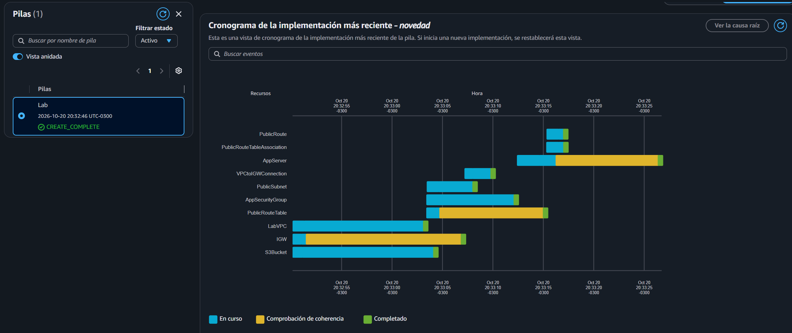
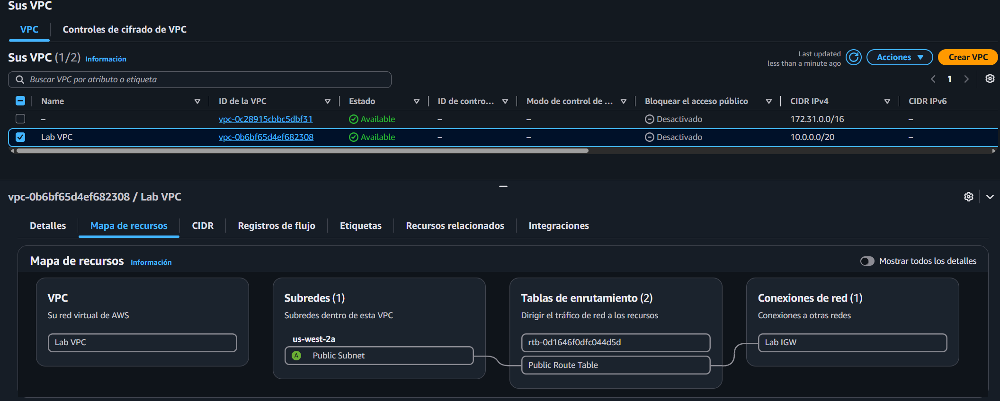

# Lab 190 Automatización de la Infraestructura con AWS CloudFormation (Plantillas YAML, EC2, S3 y VPC)


## Descripción General

En este laboratorio se implementó una estrategia de **Infraestructura como Código (IaC)** utilizando **AWS CloudFormation** para automatizar el aprovisionamiento y la gestión coherente de recursos en la nube. Mediante el uso y la edición iterativa de plantillas escritas en formato **YAML**, se configuró una pila inicial con una Red Virtual Privada (VPC) y grupos de seguridad, se añadieron dinámicamente buckets de **Amazon S3** y se integraron instancias de **Amazon EC2** utilizando referencias relacionales (`!Ref`) y parámetros del almacén de **Systems Manager (SSM)**. Finalmente, se exploró el ciclo de vida completo de las pilas CloudFormation, incluyendo la actualización directa de recursos y su posterior eliminación automatizada.

## Objetivos del Laboratorio

- Implementar y gestionar pilas de AWS CloudFormation a partir de archivos de plantillas YAML personalizados.
- Modificar plantillas existentes de manera incremental para incorporar nuevos recursos (Amazon S3 e instancias EC2) sin necesidad de rediseñar toda la infraestructura.
- Utilizar el almacén de parámetros de AWS Systems Manager para resolver dinámicamente identificadores de imágenes de máquina (AMI).
- Eliminar de forma automática y controlada todos los recursos asociados a una pila de CloudFormation.

## Tarea 1: Implementar una Pila de AWS CloudFormation

1. **Descarga y Análisis de la Plantilla Inicial:** Descargar el archivo de configuración `task1.yaml`, el cual contiene secciones clave como `Parameters` (para definir rangos de IP CIDR de la VPC), `Resources` (para declarar la VPC y el grupo de seguridad) y `Outputs`.

   **Plantilla task1.yaml**

   ```yaml
   AWSTemplateFormatVersion: 2010-09-09
   Description: Lab template

   # Lab VPC with public subnet and Internet Gateway

   Parameters:
   LabVpcCidr:
       Type: String
       Default: 10.0.0.0/20

   PublicSubnetCidr:
       Type: String
       Default: 10.0.0.0/24

   Resources:
   ###########
   # VPC with Internet Gateway
   ###########

   LabVPC:
       Type: AWS::EC2::VPC
       Properties:
       CidrBlock: !Ref LabVpcCidr
       EnableDnsSupport: true
       EnableDnsHostnames: true
       Tags:
           - Key: Name
           Value: Lab VPC

   IGW:
       Type: AWS::EC2::InternetGateway
       Properties:
       Tags:
           - Key: Name
           Value: Lab IGW

   VPCtoIGWConnection:
       Type: AWS::EC2::VPCGatewayAttachment
       DependsOn:
       - IGW
       - LabVPC
       Properties:
       InternetGatewayId: !Ref IGW
       VpcId: !Ref LabVPC

   ###########
   # Public Route Table
   ###########

   PublicRouteTable:
       Type: AWS::EC2::RouteTable
       DependsOn: LabVPC
       Properties:
       VpcId: !Ref LabVPC
       Tags:
           - Key: Name
           Value: Public Route Table

   PublicRoute:
       Type: AWS::EC2::Route
       DependsOn:
       - PublicRouteTable
       - IGW
       Properties:
       DestinationCidrBlock: 0.0.0.0/0
       GatewayId: !Ref IGW
       RouteTableId: !Ref PublicRouteTable

   ###########
   # Public Subnet
   ###########

   PublicSubnet:
       Type: AWS::EC2::Subnet
       DependsOn: LabVPC
       Properties:
       VpcId: !Ref LabVPC
       MapPublicIpOnLaunch: true
       CidrBlock: !Ref PublicSubnetCidr
       AvailabilityZone: !Select
           - 0
           - !GetAZs
           Ref: AWS::Region
       Tags:
           - Key: Name
           Value: Public Subnet

   PublicRouteTableAssociation:
       Type: AWS::EC2::SubnetRouteTableAssociation
       DependsOn:
       - PublicRouteTable
       - PublicSubnet
       Properties:
       RouteTableId: !Ref PublicRouteTable
       SubnetId: !Ref PublicSubnet

   ###########
   # App Security Group
   ###########

   AppSecurityGroup:
       Type: AWS::EC2::SecurityGroup
       DependsOn: LabVPC
       Properties:
       GroupName: App
       GroupDescription: Enable access to App
       VpcId: !Ref LabVPC
       SecurityGroupIngress:
           - IpProtocol: tcp
           FromPort: 80
           ToPort: 80
           CidrIp: 0.0.0.0/0
       Tags:
           - Key: Name
           Value: App

   ###########
   # Outputs
   ###########

   Outputs:
   LabVPCDefaultSecurityGroup:
       Value: !Sub ${LabVPC.DefaultSecurityGroup}

   ```

2. **Creación de la Pila en la Consola:**
   - Acceder al servicio **CloudFormation** en la consola de AWS y hacer clic en **Crear pila**.
   - Seleccionar **Cargar un archivo de plantilla**, subir el archivo `task1.yaml` y hacer clic en **Siguiente**.
   - Asignar el nombre de la pila `Lab`, revisar los parámetros predeterminados de la VPC y avanzar a través de las opciones hasta hacer clic en **Crear pila**.
   - Monitorear el progreso en las pestañas **Eventos** y **Recursos** hasta que el estado general cambie a `CREATE_COMPLETE`.

   
   _Figura 1: Recursos creados en CloudFormation_

   
   _Figura 2: VPC creada en base a la plantilla_

## Tarea 2: Agregar un Bucket de Amazon S3 a la Pila

1. **Modificación de la Plantilla YAML:** Editar el archivo `task1.yaml` añadiendo la declaración de un bucket de Amazon S3 bajo la sección `Resources:` utilizando una estructura limpia de dos líneas (identificador y tipo de recurso con sangrías de dos espacios).
2. **Actualización de la Pila:**
   - En la consola de CloudFormation, seleccionar la pila `Lab` y hacer clic en **Actualizar**.
   - Seleccionar **Reemplazar la plantilla actual**, cargar el archivo `task1.yaml` modificado y avanzar por los detalles.
   - **Nota práctica de la interfaz:** Realizar una actualización directa cargando la nueva plantilla y generando un conjunto de cambios (_Change Set_) para verificar que CloudFormation solo añadirá el nuevo bucket de S3 sin alterar la VPC preexistente.
   - Confirmar la actualización haciendo clic en **Actualizar pila** y verificar en la pestaña **Recursos** que el bucket se haya creado correctamente con un nombre asignado de forma aleatoria para evitar conflictos.

## Tarea 3: Agregar una Instancia de Amazon EC2 a la Pila

2. **Incorporación de Parámetros SSM para la AMI:** Añadir a la sección `Parameters` de la plantilla la referencia al almacén de parámetros de Systems Manager para recuperar de forma automatizada la última versión de Amazon Linux 2 adaptada a la región:

   ```yaml
   AmazonLinuxAMIID:
     Type: AWS::SSM::Parameter::Value<AWS::EC2::Image::Id>
     Default: /aws/service/ami-amazon-linux-latest/amzn2-ami-hvm-x86_64-gp2
   ```

3. Definición de la Instancia EC2: Agregar el recurso de cómputo bajo la sección `Resources:` configurando propiedades clave y vinculándolas mediante la palabra clave `!Ref`:

- `ImageId`: Referenciando al parámetro `AmazonLinuxAMIID`.
- `InstanceType`: `t3.micro`.
- `SecurityGroupIds`: Listando el grupo de seguridad mediante `!Ref AppSecurityGroup`.
- `SubnetId`: Referenciando a la subred pública `!Ref PublicSubnet`.
- `Tags`: Etiquetando la instancia con la clave `Name` y el valor `App Server`.

  ```yaml
  AppServer:
      Type: AWS::EC2::Instance
      Properties:
      ImageId: !Ref AmazonLinuxAMIID
      InstanceType: t3.micro
      SecurityGroupIds:
          - !Ref AppSecurityGroup
      SubnetId: !Ref PublicSubnet
      Tags:
          - Key: Name
          Value: App Server
  ```

4. Aplicación de Cambios: Actualizar nuevamente la pila en CloudFormation cargando la plantilla revisada (`task3.yaml`), inspeccionar el conjunto de cambios y confirmar la actualización para desplegar el servidor de aplicaciones.

## Tarea 4: Eliminar la Pila y Limpiar Recursos

1. Seleccionar la pila `Lab` en la consola de CloudFormation y hacer clic en **Eliminar** -> **Eliminar pila**.
2. Observar cómo la pila entra en el estado `DELETE_IN_PROGRESS` y cómo el motor de CloudFormation elimina de manera automática, ordenada y segura todos los recursos asociados (instancia EC2, bucket de S3, grupo de seguridad y VPC) hasta que la pila desaparece por completo de la consola.

## Resumen de Recursos y Componentes

| Servicio / Recurso     | Nombre del Componente     | Descripción y Función Técnica                                                                                           |
| :--------------------- | :------------------------ | :---------------------------------------------------------------------------------------------------------------------- |
| **AWS CloudFormation** | Pila `Lab`                | Servicio de infraestructura como código encargado del aprovisionamiento, actualización y baja automatizada de recursos. |
| **Amazon VPC**         | `Lab VPC`                 | Red virtual aislada desplegada y configurada automáticamente a partir de parámetros definidos en la plantilla.          |
| **Amazon S3**          | Bucket S3 dinámico        | Almacén de objetos añadido de forma incremental mediante la actualización directa de la plantilla YAML.                 |
| **Amazon EC2 & SSM**   | `App Server` (`t3.micro`) | Instancia de cómputo vinculada a subredes y grupos de seguridad mediante referencias `!Ref` y AMIs dinámicas de SSM.    |

## Conclusiones del Laboratorio

- **Automatización Fiable (IaC):** AWS CloudFormation elimina los errores humanos asociados al aprovisionamiento manual mediante la estricta definición declarativa de la infraestructura en código YAML.
- **Actualizaciones Incrementales Seguras:** El uso de conjuntos de cambios (_Change Sets_) permite auditar y prever exactamente qué recursos serán modificados, añadidos o eliminados antes de aplicar cualquier cambio en producción.
- **Gestión Dinámica de Dependencias:** CloudFormation interpreta de manera inteligente las relaciones jerárquicas y referencias entre componentes (`!Ref`), determinando automáticamente el orden óptimo de creación y destrucción de los recursos.
