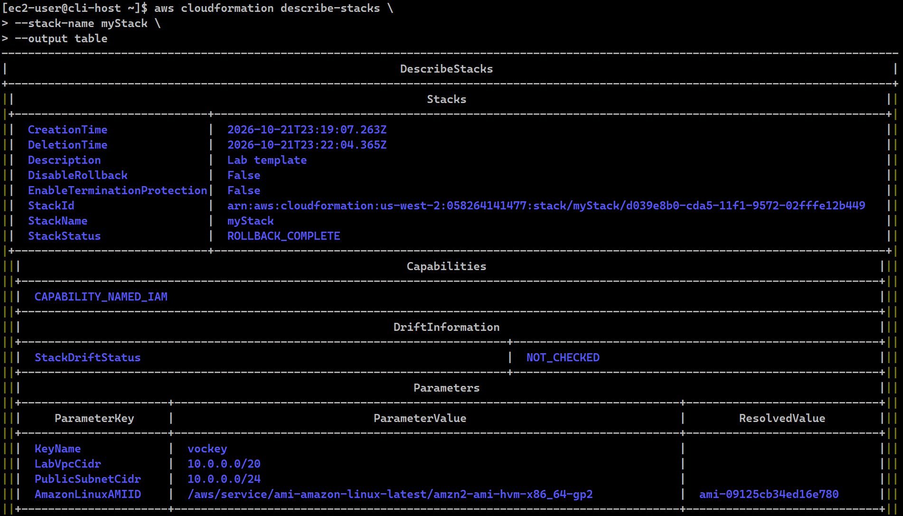
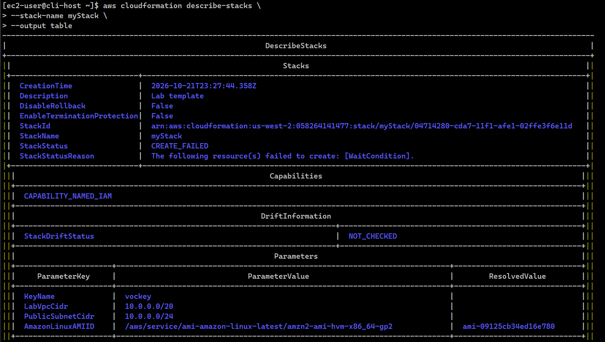
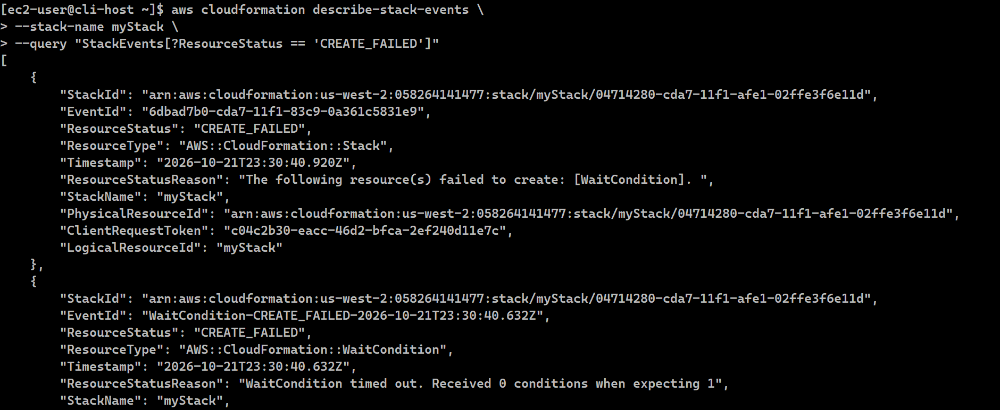
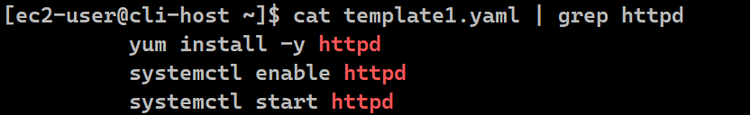
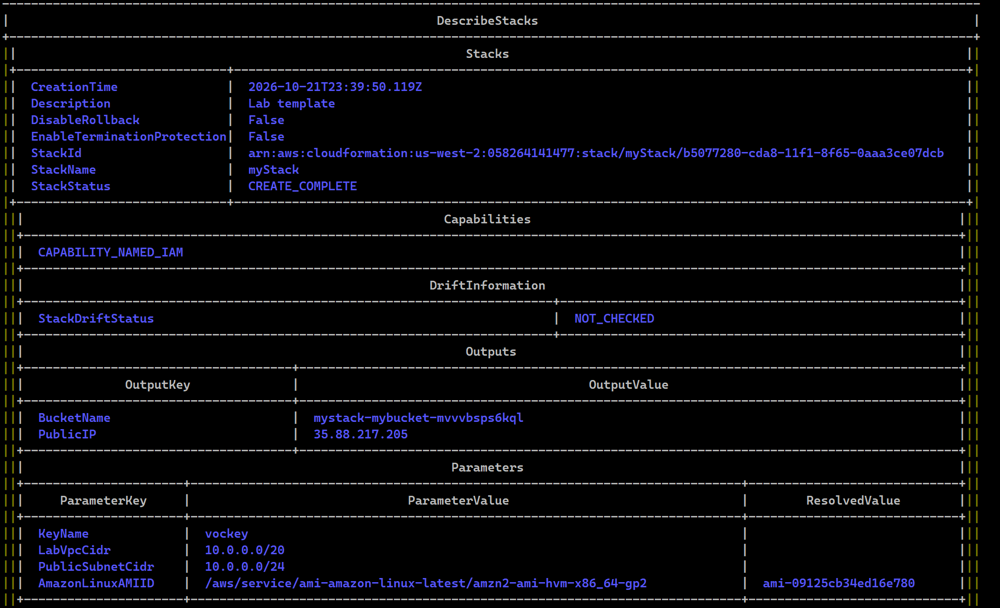
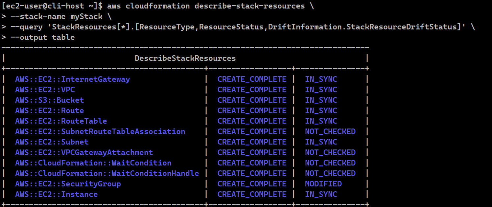
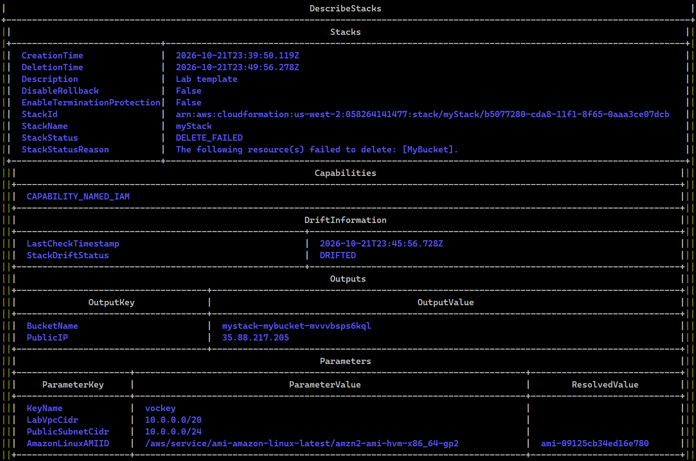
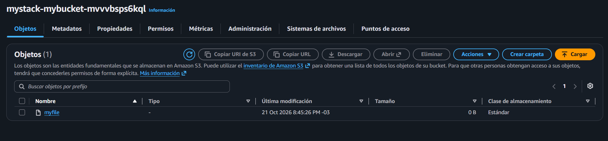

# Lab 191 Solución de Problemas de AWS CloudFormation (JMESPath, Depuración de Errores, Drift Detection y Retención de Recursos)


## Descripción General

En este laboratorio avanzado se abordaron técnicas de diagnóstico, depuración y resolución de problemas en implementaciones de **AWS CloudFormation**. Se inició practicando consultas de datos JSON con **JMESPath** para dominar el filtrado de recursos mediante la AWS CLI. Posteriormente, se desplegó una plantilla defectuosa en un entorno controlado (`CLI Host` / `VPC2`), utilizando el parámetro `--on-failure DO_NOTHING` para evitar el borrado automático (Rollback) y analizar los registros internos de inicialización (`cloud-init-output.log`). Tras corregir un error crítico en el script de `UserData`, se reestructuró la pila con éxito, se implementaron modificaciones manuales para auditar desviaciones (_Stack Drift_), y finalmente se superó el desafío de eliminación de pilas bloqueadas por buckets con objetos mediante la retención selectiva de recursos.

## Objetivos del Laboratorio

- Dominar la sintaxis de consultas **JMESPath** para filtrar y extraer información estructurada de respuestas JSON en la AWS CLI.
- Solucionar fallos en implementaciones de CloudFormation mediante el análisis de registros del sistema operativo en instancias EC2.
- Prevenir el comportamiento predeterminado de reversión (`Rollback`) utilizando banderas de control de errores.
- Detectar y auditar modificaciones manuales no autorizadas utilizando la herramienta de detección de desviaciones (_Stack Drift_).
- Resolver problemas complejos en operaciones de eliminación de pilas (`delete-stack`) conservando datos críticos mediante la retención de recursos.

## Tarea 1: Práctica de Consulta de Datos JSON mediante JMESPath

1. **Ejercicios interactivos:** Utilizar la plataforma `jmespath.org` para evaluar expresiones sobre documentos JSON complejos, aplicando operadores de indexación (`desserts[1]`), recuperación de atributos (`desserts[0].name`), listas múltiples (`[name, price]`), asteriscos de comodín (`[]`) y filtrado condicional avanzado (`?name=='Carrot cake'`).
2. **Aplicación en CloudFormation:** Diseñar expresiones JMESPath orientadas a extraer identificadores lógicos de recursos específicos a partir de estructuras devueltas por la CLI:

   ```bash
   StackResources[?ResourceType == 'AWS::EC2::Instance'].LogicalResourceId
   ```

   > **¿Por qué se practica esto?** Los comandos de la AWS CLI devuelven grandes volúmenes de datos JSON. Dominar JMESPath con los parámetros `--query` permite extraer de forma limpia exactamente la información necesaria para la automatización y el diagnóstico.

## Tarea 2: Solución de Problemas y Depuración en AWS CloudFormation

1. **Conexión al Entorno de Pruebas:** Conectarse mediante SSH a la instancia de administración `CLI Host` y configurar las credenciales ejecutando `aws configure`.
2. **Intento de Creación de Pila con Fallo Inicial:**
   - Descubrir la región de ejecución actual para configurar adecuadamente el entorno:
     ```bash
     curl http://169.254.169.254/latest/dynamic/instance-identity/document | grep region
     ```
   - Configurar las credenciales y parámetros por defecto de la AWS CLI:
     ```bash
     aws configure
     ```
   - Inspeccionar previamente el contenido de la plantilla de CloudFormation utilizando la utilidad de lectura:
     ```bash
     less template1.yaml
     ```
   - Ejecutar el comando para crear la pila a partir de la plantilla provista `template1.yaml`:
     ```bash
     aws cloudformation create-stack \
       --stack-name myStack \
       --template-body file://template1.yaml \
       --capabilities CAPABILITY_NAMED_IAM \
       --parameters ParameterKey=KeyName,ParameterValue=vockey
     ```
   - Monitorear el progreso y estado de los recursos creados con la utilidad `watch`:
     ```bash
     watch -n 5 -d \
     aws cloudformation describe-stack-resources \
       --stack-name myStack \
       --query 'StackResources[*].[ResourceType,ResourceStatus]' \
       --output table
     ```
   - Consultar el estado general de la pila en tiempo de ejecución:
     ```bash
     watch -n 5 -d \
     aws cloudformation describe-stacks \
       --stack-name myStack \
       --output table
     ```
   - Analizar los eventos específicos de fallo filtrando únicamente aquellos con estado de error:
     ```bash
     aws cloudformation describe-stack-events \
       --stack-name myStack \
       --query "StackEvents[?ResourceStatus == 'CREATE_FAILED']"
     ```
   - **Comportamiento observado:** Al finalizar la secuencia, tras agotarse el tiempo de espera del recurso `WaitCondition` (60 segundos), CloudFormation detecta un error e inicia automáticamente el borrado de todos los recursos (`ROLLBACK_IN_PROGRESS` -> `ROLLBACK_COMPLETE`).

     
     _Figura 1: Captura con el estado de la pila en `ROLLBACK_COMPLETE`_

   - Eliminar el objeto de pila anterior antes de reintentar el despliegue:
     ```bash
     aws cloudformation delete-stack --stack-name myStack
     ```

3. **Evitar el Borrado Automático para Análisis Forense:**
   - Volver a crear la pila especificando el parámetro `--on-failure DO_NOTHING`. Esto evita que CloudFormation destruya la instancia EC2 defectuosa, dándonos tiempo para investigar los registros:

     ```bash
     aws cloudformation create-stack \
       --stack-name myStack \
       --template-body file://template1.yaml \
       --capabilities CAPABILITY_NAMED_IAM \
       --on-failure DO_NOTHING \
       --parameters ParameterKey=KeyName,ParameterValue=vockey
     ```

     > Cuando en lugar de `ROLLBACK_COMPLETE` aparece el estado `CREATE_FAILED`, significa que >**CloudFormation se detuvo al encontrar un error durante la creación de la pila, pero >decidió no borrar ni revertir ningún recurso**.
     >
     > ### Diferencia clave entre comportamientos:
     >
     > - **Sin `--on-failure DO_NOTHING` (`ROLLBACK_COMPLETE`):** Por defecto, cuando ocurre un >error en el despliegue (como el fallo en el `WaitCondition`), CloudFormation asume que la >infraestructura está incompleta y ejecuta un **Rollback automático**. Esto destruye y >elimina todos los recursos que se alcanzaron a crear (incluyendo la instancia EC2), borrando >toda evidencia y dejándote sin la posibilidad de inspeccionar el servidor.
     > - **Con `--on-failure DO_NOTHING` (`CREATE_FAILED`):** Al incorporar este parámetro, le >ordenas a CloudFormation que **congele la pila en el estado exacto de error**. La pila se >queda en el estado `CREATE_FAILED` y **los recursos se mantienen intactos** en tu cuenta de >AWS.
     >
     > ### ¿Por qué nos favorece esto para el diagnóstico?
     >
     > Este comportamiento es fundamental para el **análisis forense y la depuración >(_troubleshooting_)**:
     >
     > - **Preservación del entorno:** Al no borrarse la instancia EC2 (`Web Server`), el servidor >sigue operativo y accesible en la red.
     > - **Acceso a registros en vivo:** Nos permite conectarnos por SSH al servidor que falló para >revisar los archivos de registro (`/var/log/cloud-init-output.log`) y los scripts de >inicialización (`part-001`), facilitando identificar la causa raíz exacta del problema (por >ejemplo, el error tipográfico al intentar instalar `http` en lugar de `httpd`).

   - Verificar el estado de los recursos sin rollback activo:
     ```bash
     watch -n 5 -d \
     aws cloudformation describe-stack-resources \
       --stack-name myStack \
       --query 'StackResources[*].[ResourceType,ResourceStatus]' \
       --output table
     ```
   - Consultar el estado actual de la pila:

     ```bash
     watch -n 5 -d \
     aws cloudformation describe-stacks \
       --stack-name myStack \
       --output table
     ```

   - Ejecute el comando describe-stacks.

     ```bash
     aws cloudformation describe-stacks \
     --stack-name myStack \
     --output table
     ```

     
     _Figura 2: Captura con el estado de la pila con el estado `CREATE_FAILED`_

   - Volver a auditar los eventos de error detallados:

     ```bash
     aws cloudformation describe-stack-events \
       --stack-name myStack \
       --query "StackEvents[?ResourceStatus == 'CREATE_FAILED']"
     ```

     
     _Figura 3: Resultado luego del comando de la auditoría del evento_

     > ### Interpretación de los Resultados:
     >
     > - **`ResourceStatusReason` (Nivel Pila):** Indica que el recurso global `[WaitCondition]` > falló en su creación (_"The following resource(s) failed to create: [WaitCondition]"_).
     > - **`ResourceStatusReason` (Nivel Recurso Específico):** Explica detalladamente la causa > raíz del fallo con el mensaje: _"WaitCondition timed out. Received 0 conditions when > expecting 1"_.
     > - **Conclusión del diagnóstico:** Esto confirma que el script de inicialización (`UserData`) > ejecutado dentro de la instancia EC2 no logró enviar la señal de éxito a tiempo (esperaba 1 > y recibió 0), lo que evidencia un error de ejecución en la configuración interna del > servidor.

4. **Análisis de Registros en la Instancia EC2 (`Web Server`):**
   - Obtener la dirección IP pública de la instancia de servidor web creada por la pila:
     ```bash
     aws ec2 describe-instances \
       --filters "Name=tag:Name,Values='Web Server'" \
       --query 'Reservations[].Instances[].[State.Name,PublicIpAddress]'
     ```
   - Conectarse mediante SSH a la instancia `Web Server` utilizando la clave privada y la IP pública obtenida.
   - Revisar las últimas líneas del registro de inicialización del sistema operativo:
     ```bash
     tail -50 /var/log/cloud-init-output.log
     ```
   - **Salida típica detectada en el log:**
     ```text
     + hostnamectl set-hostname Web-Server
     + yum install -y http
     Loaded plugins: extras_suggestions, langpacks, priorities, update-motd
     No package http available.
     Error: Nothing to do
     Oct 21 18:35:31 cloud-init[2335]: util.py[WARNING]: Failed running /var/lib/cloud/instance/scripts/part-001 [1]
     ```
   - Inspeccionar el script compilado de userdata para entender el origen del fallo:
     ```bash
     sudo cat /var/lib/cloud/instance/scripts/part-001
     ```
   - **Diagnóstico del fallo:** El script comienza con `#!/bin/bash -ex`, lo que indica que si cualquier comando falla, la ejecución se detiene inmediatamente con un código distinto de cero. En la línea de instalación se especificó erróneamente `yum install -y http` en lugar de `httpd`. Como el paquete `http` no existe, el script falló, la condición de espera (`WaitCondition`) nunca recibió la señal de éxito y la pila abortó.
   - Desconectarse de la instancia del servidor web:
     ```bash
     exit
     ```

5. **Corrección de la Plantilla y Recreación Exitosa:**
   - Volver a la terminal de la instancia `CLI Host` y modificar la plantilla `template1.yaml` utilizando el editor de texto:
     ```bash
     vim template1.yaml
     ```
   - Validar que el cambio del paquete de instalación se haya guardado correctamente buscando la cadena corregida:

     ```bash
     cat template1.yaml | grep httpd
     ```

     
     _Figura 4: Validación del cambio_

   - Borrar la pila fallida actual desde la línea de comandos:
     ```bash
     aws cloudformation delete-stack --stack-name myStack
     ```
   - Monitorear el progreso de la eliminación de la pila:
     ```bash
     watch -n 5 -d \
     aws cloudformation describe-stacks \
       --stack-name myStack \
       --output table
     ```
   - Desplegar nuevamente la pila utilizando la plantilla corregida:
     ```bash
     aws cloudformation create-stack \
       --stack-name myStack \
       --template-body file://template1.yaml \
       --capabilities CAPABILITY_NAMED_IAM \
       --on-failure DO_NOTHING \
       --parameters ParameterKey=KeyName,ParameterValue=vockey
     ```
   - Verificar la creación exitosa de todos los recursos asociados:
     ```bash
     watch -n 5 -d \
     aws cloudformation describe-stack-resources \
       --stack-name myStack \
       --query 'StackResources[*].[ResourceType,ResourceStatus]' \
       --output table
     ```
   - Consultar el estado final de la pila asegurando que se encuentre en `CREATE_COMPLETE`:

     ```bash
     aws cloudformation describe-stacks \
       --stack-name myStack \
       --output table
     ```

     
     _Figura 5: Estado final de la pila con el estado `CREATE_COMPLETE`_

   - Probar el acceso al servidor web ingresando a la dirección IP pública obtenida de los outputs de CloudFormation mediante el navegador para confirmar el mensaje: `Hello from your web server!`.

## Tarea 3: Modificaciones Manuales y Detección de Desviaciones (Stack Drift)

1. **Simulación de Cambio No Autorizado:** Desde la consola de EC2, modificar manualmente el grupo de seguridad `WebServerSG` asociado a `Web Server`, restringiendo el acceso SSH (puerto 22) de `0.0.0.0/0` a `My IP`.
2. **Generación de un Objeto en el Bucket de S3:**
   - Consultar el nombre del bucket generado en los outputs de la pila y asignarlo dinámicamente a una variable de entorno local:
     ```bash
     bucketName=$(aws cloudformation describe-stacks \
       --stack-name myStack \
       --query "Stacks[*].Outputs[?OutputKey == 'BucketName'].[OutputValue]" \
       --output text)
     echo "bucketName = "$bucketName
     ```
   - Crear un archivo local de prueba:
     ```bash
     touch myfile
     ```
   - Copiar y subir el archivo local al bucket de S3 administrado por la pila:

     ```bash
     aws s3 cp myfile s3://$bucketName/
     ```

   - Verificar la existencia del objeto dentro del bucket:
     ```bash
     aws s3 ls $bucketName/
     ```

3. **Detección y Auditoría de Desviaciones (Drift Detection):**
   - Iniciar el proceso de detección de desviaciones en la pila de CloudFormation:
     ```bash
     aws cloudformation detect-stack-drift --stack-name myStack
     ```
   - Monitorear el estado de la operación de detección utilizando el ID devuelto (`StackDriftDetectionId`):
     ```bash
     aws cloudformation describe-stack-drift-detection-status \
       --stack-drift-detection-id <driftId>
     ```
   - Consultar el reporte general de recursos desviados en formato de tabla aplicando JMESPath:

     ```bash
     aws cloudformation describe-stack-resources \
       --stack-name myStack \
       --query 'StackResources[*].[ResourceType,ResourceStatus,DriftInformation.StackResourceDriftStatus]' \
       --output table
     ```

     
     _Figura 6: Reporte general de recursos desviados_

   - **Resultado analizado:** El grupo de seguridad reflejará el estado `MODIFIED`, mientras que el bucket de S3 se mantendrá como `IN_SYNC`. El solo hecho de almacenar objetos dentro de un bucket administrado por CloudFormation no constituye una desviación de la infraestructura declarativa, a menos que se alteren las propiedades intrínsecas del recurso en sí.
   - Aislar y consultar las diferencias específicas de propiedades modificadas en los recursos afectados:
     ```bash
     aws cloudformation describe-stack-resource-drifts \
       --stack-name myStack \
       --stack-resource-drift-status-filters MODIFIED
     ```
   - Intentar ejecutar una actualización estándar de la pila para verificar que las desviaciones manuales no se corrigen de forma automática:
     ```bash
     aws cloudformation update-stack \
       --stack-name myStack \
       --template-body file://template1.yaml \
       --parameters ParameterKey=KeyName,ParameterValue=vockey
     ```

## Tarea 4: Eliminación de Pilas y Resolución del Desafío de Retención de Recursos

1. **Intento de Eliminación Estándar:** Ejecutar la baja de la pila mediante la CLI:

   ```bash
   aws cloudformation delete-stack --stack-name myStack
   ```

2. **Monitoreo y Fallo por Protección de Datos:**
   - Monitorear el estado de la eliminación de los componentes:

     ```bash
     watch -n 5 -d \
     aws cloudformation describe-stack-resources \
     --stack-name myStack \
     --query 'StackResources[*].[ResourceType,ResourceStatus]' \
     --output table
     ```

   - Consultar el estado detallado de la pila para identificar el motivo del fallo:

     ```bash
     aws cloudformation describe-stacks \
     --stack-name myStack \
     --output table
     ```

     
     _Figura 7: Captura con el estado de la pila con el estado `DELETE_FAILED`_

   - Fallo observado: La pila entra en estado `DELETE_FAILED` con el mensaje: `"The following resource(s) failed to delete: [MyBucket]"`. CloudFormation bloquea deliberadamente la eliminación de buckets que contienen objetos para prevenir pérdidas accidentales de datos empresariales.

3. **Resolución del Desafío (Retención de Recursos):**
   - Para eliminar la infraestructura administrada por la pila (VPC, servidores, grupos de seguridad) pero conservar intactos el bucket de S3 y los archivos almacenados en él sin recurrir a la consola de administración, se debe utilizar el parámetro `--retain-resources` de la AWS CLI:

     ```bash
     aws cloudformation delete-stack \
     --stack-name myStack \
     --retain-resources MyBucket
     ```

   - Resultado: CloudFormation procesa la baja exitosa de la pila (`DELETE_COMPLETE`), permitiendo desmontar toda la arquitectura compleja mientras preserva de forma segura el bucket y su contenido.

   
   _Figura 8: Verificación en consola de que el bucket no se eliminó_

## Resumen de Recursos y Componentes

| Servicio / Recurso          | Nombre del Componente     | Descripción y Función Técnica                                                                                       |
| :-------------------------- | :------------------------ | :------------------------------------------------------------------------------------------------------------------ |
| **AWS CloudFormation**      | Pila `myStack`            | Pila de infraestructura automatizada sometida a pruebas de despliegue, depuración y retención selectiva.            |
| **JMESPath**                | Consultas con `--query`   | Lenguaje de consulta empleado para depurar y extraer atributos específicos de las respuestas JSON de la CLI.        |
| **Amazon EC2 & Cloud-Init** | `Web Server`              | Instancia de cómputo utilizada para analizar logs de inicialización (`cloud-init-output.log` y scripts `part-001`). |
| **AWS Drift Detection**     | Auditoría de Desviaciones | Mecanismo de control para identificar cambios manuales no documentados en los recursos de la pila.                  |

## Conclusiones del Laboratorio

- **Depuración Efectiva en IaC:** El uso de parámetros como `--on-failure DO_NOTHING` resulta esencial para conservar entornos defectuosos y realizar análisis forenses profundos sobre los registros del sistema operativo huésped.
- **Detección de Desviaciones (Stack Drift):** La capacidad de auditar modificaciones manuales garantiza que los entornos productivos permanezcan sincronizados con la Infraestructura como Código declarada en las plantillas.
- **Protección de Datos y Flexibilidad de Baja:** Funcionalidades avanzadas de la CLI como `--retain-resources` permiten eliminar ciclos de prueba completos de infraestructura sin poner en riesgo la persistencia de datos críticos de negocio almacenados en servicios de almacenamiento.
