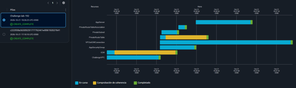

# Lab: Desafío de AWS CloudFormation (Creación de VPC, Subred Privada e Instancia EC2)


## Descripción General

En este laboratorio de desafío se implementó una solución integral de **Infraestructura como Código (IaC)** utilizando una plantilla personalizada de **AWS CloudFormation**. El objetivo principal consistió en automatizar el aprovisionamiento de una arquitectura de red aislada y un recurso de cómputo estructurado. Ante limitaciones operativas con el terminal integrado del navegador (_VocaLab_), el despliegue y la validación se gestionaron directamente a través de la interfaz visual de la Consola de administración de AWS mediante la carga de la plantilla YAML.

---

## Objetivos del Laboratorio

- Diseñar y estructurar una plantilla declarativa en AWS CloudFormation utilizando YAML (`AWSTemplateFormatVersion: "2010-09-09"`).
- Automatizar la creación de una Amazon VPC con soporte de DNS activado.
- Configurar y adjuntar una pasarela de internet (_Internet Gateway_) vinculada a la VPC.
- Definir parámetros dinámicos y subredes privadas aprovechando la recuperación de AMIs mediante el Parameter Store de AWS Systems Manager (SSM).
- Desplegar una instancia de Amazon EC2 de tipo `t3.micro` asociada a grupos de seguridad específicos dentro de la subred privada.

---

## Plantilla de CloudFormation Utilizada

La solución completa implementada para resolver el desafío se estructuró de la siguiente manera:

```yaml
AWSTemplateFormatVersion: "2010-09-09"

Description: Challenge Lab 192 - VPC with private subnet and EC2

Parameters:
  ChallengeVpcCidr:
    Type: String
    Default: 10.0.0.0/20

  PrivateSubnetCidr:
    Type: String
    Default: 10.0.1.0/28

  AmazonLinuxAMIID:
    Type: AWS::SSM::Parameter::Value<AWS::EC2::Image::Id>
    Default: /aws/service/ami-amazon-linux-latest/amzn2-ami-hvm-x86_64-gp2

Resources:
  # VPC
  ChallengeVPC:
    Type: AWS::EC2::VPC
    Properties:
      CidrBlock: !Ref ChallengeVpcCidr
      EnableDnsSupport: true
      EnableDnsHostnames: true
      Tags:
        - Key: Name
          Value: Challenge VPC

  # Internet Gateway attached to the VPC
  IGW:
    Type: AWS::EC2::InternetGateway
    Properties:
      Tags:
        - Key: Name
          Value: Challenge IGW

  VPCtoIGWConnection:
    Type: AWS::EC2::VPCGatewayAttachment
    Properties:
      InternetGatewayId: !Ref IGW
      VpcId: !Ref ChallengeVPC

  # Private subnet
  PrivateSubnet:
    Type: AWS::EC2::Subnet
    Properties:
      VpcId: !Ref ChallengeVPC
      MapPublicIpOnLaunch: false
      CidrBlock: !Ref PrivateSubnetCidr
      AvailabilityZone: !Select
        - 0
        - !GetAZs ""
      Tags:
        - Key: Name
          Value: Private Subnet

  # Route table for the private subnet
  PrivateRouteTable:
    Type: AWS::EC2::RouteTable
    Properties:
      VpcId: !Ref ChallengeVPC
      Tags:
        - Key: Name
          Value: Private Route Table

  PrivateRouteTableAssociation:
    Type: AWS::EC2::SubnetRouteTableAssociation
    Properties:
      RouteTableId: !Ref PrivateRouteTable
      SubnetId: !Ref PrivateSubnet

  # Security group: SSH from anywhere
  AppSecurityGroup:
    Type: AWS::EC2::SecurityGroup
    Properties:
      GroupDescription: Allow SSH access on port 22
      VpcId: !Ref ChallengeVPC
      SecurityGroupIngress:
        - IpProtocol: tcp
          FromPort: 22
          ToPort: 22
          CidrIp: 0.0.0.0/0
      Tags:
        - Key: Name
          Value: App

  # EC2 instance in the private subnet
  AppServer:
    Type: AWS::EC2::Instance
    Properties:
      ImageId: !Ref AmazonLinuxAMIID
      InstanceType: t3.micro
      SecurityGroupIds:
        - !Ref AppSecurityGroup
      SubnetId: !Ref PrivateSubnet
      Tags:
        - Key: Name
          Value: Challenge Server

Outputs:
  VPCId:
    Description: ID of the created VPC
    Value: !Ref ChallengeVPC

  PrivateSubnetId:
    Description: ID of the private subnet
    Value: !Ref PrivateSubnet

  SecurityGroupId:
    Description: ID of the SSH security group
    Value: !Ref AppSecurityGroup

  InstanceId:
    Description: ID of the EC2 instance
    Value: !Ref AppServer
```

## 1. Preparación y Acceso al Entorno

- Iniciar sesión en la consola de AWS a través del panel principal del laboratorio (`Start Lab`).
- Debido a incidencias técnicas e incompatibilidades con el terminal interactivo integrado (_VocaLab_), se optó por una estrategia directa utilizando la interfaz nativa del servicio **AWS CloudFormation**.

## 2. Creación de la Pila mediante la Consola

- Navegar al servicio **CloudFormation** en la consola de AWS y seleccionar **Create stack** (Crear pila) con recursos nuevos (_With new resources_).
- En la sección de especificación de plantillas, cargar el código YAML provisto anteriormente (`Challenge Lab 192`).
- Configurar los parámetros iniciales (bloques CIDR para la VPC y subred, manteniendo los valores por defecto recomendados).
- Avanzar a través de las opciones de configuración de etiquetas y permisos, y finalmente confirmar la creación de la pila (_Create stack_).

### 3. Monitoreo y Validación de Recursos

- Observar en tiempo real el panel de eventos (_Events_) y recursos (_Resources_) de CloudFormation para verificar el despliegue ordenado y secuencial:
  1. Creación de la VPC (`ChallengeVPC`) y habilitación de atributos DNS.
  2. Aprovisionamiento del _Internet Gateway_ (`IGW`) y su respectivo acoplamiento mediante `VPCtoIGWConnection`.
  3. Generación de la subred privada (`PrivateSubnet`) seleccionando de manera automatizada la primera Zona de Disponibilidad disponible mediante la función intrínseca `!Select`.
  4. Creación de la tabla de rutas privada (`PrivateRouteTable`) y su asociación formal con la subred.
  5. Despliegue del grupo de seguridad (`AppSecurityGroup`) configurado para el puerto SSH.
  6. Lanzamiento de la instancia de cómputo `AppServer` (`t3.micro`) utilizando el AMI dinámico gestionado por SSM Parameter Store.
- Comprobar en la sección de salidas (_Outputs_) los identificadores únicos generados automáticamente para la VPC, la subred privada, el grupo de seguridad y la instancia EC2.

   \
  _Figura 1: Captura con el estado de la pila con el estado `CREATE_FAILED`_

## Resumen de Recursos y Componentes

| Servicio / Recurso              | Nombre del Componente            | Descripción y Función Técnica                                                            |
| :------------------------------ | :------------------------------- | :--------------------------------------------------------------------------------------- |
| **AWS CloudFormation**          | Pila de Desafío                  | Orquestador de infraestructura encargado del despliegue declarativo de la arquitectura.  |
| **Amazon VPC**                  | `Challenge VPC` (`10.0.0.0/20`)  | Red virtual aislada con soporte para resolución y nombres de host DNS habilitados.       |
| **Amazon EC2 (IGW)**            | `Challenge IGW`                  | Puerta de enlace de internet adjunta para permitir conectividad perimetral.              |
| **Amazon EC2 (Subnet)**         | `Private Subnet` (`10.0.1.0/28`) | Subred interna mapeada sin asignación automática de direcciones IP públicas.             |
| **Amazon EC2 (Security Group)** | `App`                            | Grupo de seguridad perimetral configurado para control de tráfico en el puerto SSH (22). |
| **Amazon EC2 (Instance)**       | `Challenge Server` (`t3.micro`)  | Servidor virtual desplegado dentro de la subred privada utilizando imágenes de SSM.      |

## Conclusiones del Laboratorio

- **Resiliencia Operativa ante Fallos de Terminal:** La versatilidad de AWS CloudFormation permite alternar sin inconvenientes entre la CLI/terminal integrada y la consola gráfica web mediante el uso de plantillas YAML estructuradas.
- **Automatización Basada en Parámetros:** El uso de funciones intrínsecas como `!Select` y referencias a parámetros de SSM Parameter Store (`/aws/service/ami-amazon-linux-latest/...`) garantiza la portabilidad y actualización automática de las versiones de sistemas operativos sin dependencia estática de IDs de AMIs regionales.
- **Eficacia de la Infraestructura como Código:** Definir arquitecturas de red y cómputo de manera declarativa reduce drásticamente el margen de error humano frente a configuraciones manuales paso a paso en consola.
