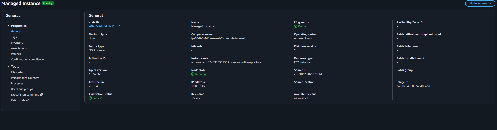
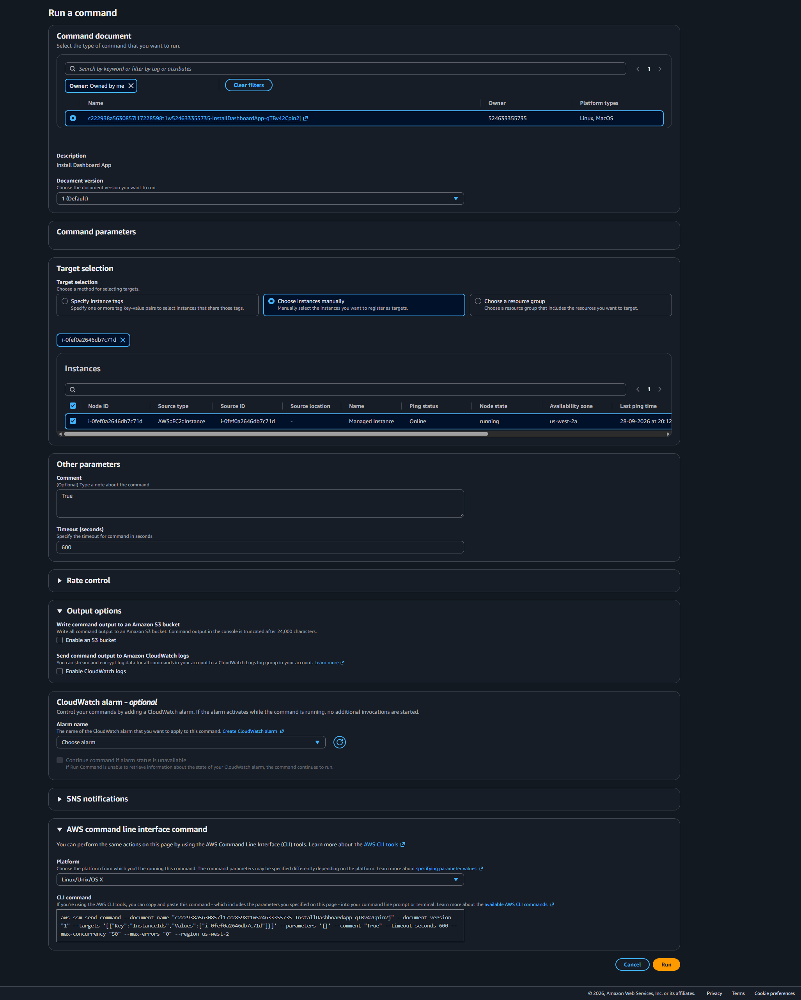
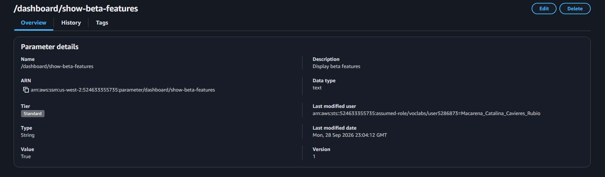
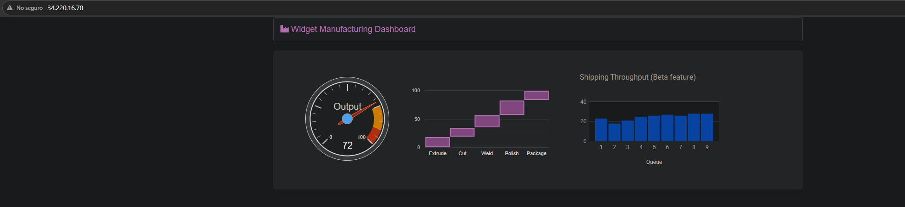
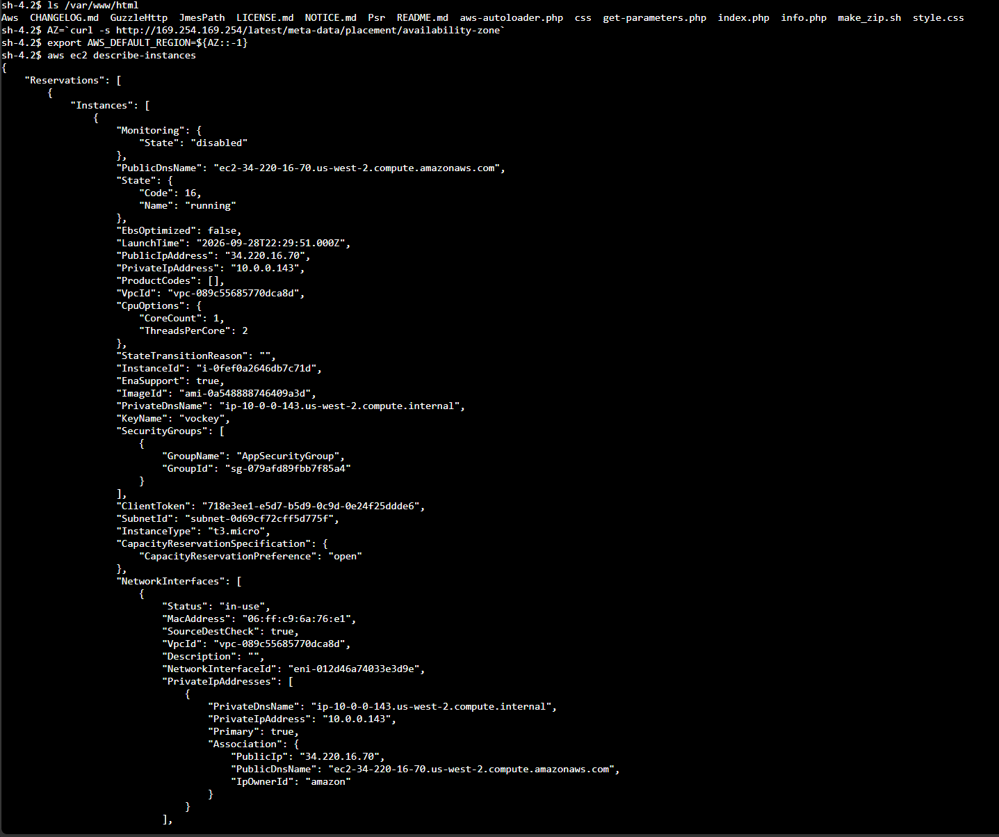

# Lab 169 Gestión Centralizada y Automatización de Instancias con AWS Systems Manager


## Descripción General

En este laboratorio práctico se utilizaron las capacidades operativas de **AWS Systems Manager (SSM)** para centralizar el monitoreo, la configuración y el acceso a instancias **Amazon EC2**. Se recopiló un inventario detallado del sistema operativo con **Fleet Manager**, se automatizó la instalación y despliegue de una aplicación web completa mediante **Run Command**, se activaron características en tiempo de ejecución gestionando estados en **Parameter Store** y se accedió a la línea de comandos de la instancia de forma segura sin puertos SSH expuestos mediante **Session Manager**.

## Arquitectura del Laboratorio

```text
┌─────────────────────────────────────────────────────────────────┐
│ AWS Systems Manager (SSM)                                       │
│  ├── Fleet Manager / Inventory ──► [Recolección de Metadatos]   │
│  ├── Run Command ────────────────► [Ejecución de Scripts]       │
│  ├── Parameter Store ────────────► [/dashboard/show-beta]       │
│  └── Session Manager ────────────► [Acceso Shell Vía Browser]   │
└────────────────────────────────┬────────────────────────────────┘
                                 │
                                 ▼ (SSM Agent)
┌─────────────────────────────────────────────────────────────────┐
│ AWS Cloud (LabVPC)                                              │
│  ┌───────────────────────────────────────────────────────────┐  │
│  │ Amazon EC2 (Instancia Administrada)                       │  │
│  │  ├── Apache Web Server + PHP                              │  │
│  │  └── Dashboard Application                                │  │
│  └───────────────────────────────────────────────────────────┘  │
└─────────────────────────────────────────────────────────────────┘
```

## Objetivos del Laboratorio

- Configurar una asociación de inventario con **Fleet Manager** para auditar aplicaciones instaladas y metadatos del SO.
- Desplegar una aplicación web completa mediante automatización en **Run Command** sin conectar por SSH.
- Crear y consumir un parámetro dinámico en **Parameter Store** (`/dashboard/show-beta-features`) para controlar características de la aplicación en tiempo de ejecución.
- Acceder a la consola interactiva shell de una instancia EC2 mediante **Session Manager** cumpliendo con políticas de seguridad e auditoría.

## Tarea 1: Generar Listas de Inventario para Instancias Administradas

1. En la consola de **AWS Systems Manager**, navegar a **Node Management** > **Fleet Manager**.
2. Seleccionar **Account management** > **Configure inventory**.
3. Definir la asociación de inventario:
   - **Name:** `Inventory-Association`
   - **Targets:** Manually selecting instances -> Seleccionar la `Instancia Administrada`.
4. Confirmar la creación mediante **Configure inventory**.
5. Inspeccionar la pestaña **Inventory** en los detalles del nodo para auditar los paquetes de software y versiones instaladas.


_Figura 1: Lista de las políticas por el cliente_

## Tarea 2: Instalar una Aplicación Personalizada con Run Command

1. En el panel lateral de Systems Manager, navegar a **Node Management** > **Run Command**.
2. Seleccionar **Run command** y filtrar documentos seleccionando **Owner** > **Owned by me**.
3. Seleccionar el documento `Install Dashboard App`.
4. En **Target selection**, elegir **Choose instances manually** y marcar la `Instancia Administrada`.
5. En **Output options**, desmarcar la casilla **Enable an S3 bucket**.
6. Seleccionar **Run** y esperar a que el estado cambie a **Success**.
7. Obtener la IP pública (`ServerIP`) y acceder desde un navegador web para verificar la carga del **Widget Manufacturing Dashboard**.


_Figura 2: Captura de la tareaa 2_

## Tarea 3: Utilizar Parameter Store para Administrar la Configuración de la Aplicación

1. En el panel lateral, navegar a **Application Management** > **Parameter Store**.
2. Seleccionar **Create parameter** y configurar:
   - **Name:** `/dashboard/show-beta-features`

   
   _Figura 3: Captura de `/dashboard/show-beta-features`_
   - **Description:** `Display beta features`
   - **Type:** `String`
   - **Value:** `True`

3. Seleccionar **Create parameter**.
4. Recargar la pestaña de la aplicación web en el navegador.
5. Verificar la aparición de la tercera tabla en la interfaz (módulo beta habilitado dinámicamente).


_Figura 4: Verificación de la tercera tabla en la interfaz_

## Tarea 4: Utilizar Session Manager para Acceder a Instancias

1. En el panel lateral de Systems Manager, navegar a **Node Management** > **Session Manager**.
2. Seleccionar **Start session**, marcar la `Instancia Administrada` y confirmar con **Start session**.
3. En la terminal abierta en el navegador, listar los archivos de la aplicación instalada:

   ```bash
   ls /var/www/html
   ```

4. Consultar los metadatos de la instancia y la AWS CLI desde la sesión interactiva:

   ```bash
   AZ=`curl -s [http://169.254.169.254/latest/meta-data/placement/availability-zone](http://169.254.169.254/latest/meta-data/placement/availability-zone)`
   export AWS_DEFAULT_REGION=${AZ::-1}
   aws ec2 describe-instances
   ```


_Figura 5: Comandos ejecutados en la CLI de la tarrea 4_

## Resumen de Recursos y Componentes

| Servicio / Recurso      | Nombre del Componente           | Descripción y Función Técnica                                                                                         |
| :---------------------- | :------------------------------ | :-------------------------------------------------------------------------------------------------------------------- |
| **AWS Systems Manager** | `SSM Agent`                     | Agente instalado en la instancia EC2 que permite la comunicación bidireccional segura con el plano de control de SSM. |
| **Fleet Manager**       | `Inventory-Association`         | Automatización encargada de escanear y recopilar el inventario de software y configuraciones del sistema operativo.   |
| **Run Command**         | `Install Dashboard App`         | Documento de automatización para la instalación desatendida del servidor Apache, PHP y la aplicación web.             |
| **Parameter Store**     | `/dashboard/show-beta-features` | Parámetro clave-valor utilizado para activar banderas de características (_feature flags_) en la aplicación.          |
| **Session Manager**     | `Session Manager Shell`         | Entorno de consola SSH-like seguro que opera mediante túneles cifrados sin abrir el puerto `22`.                      |

## Conclusiones del Laboratorio

- **Eliminación del Acceso SSH Tradicional:** **Session Manager** ofrece acceso shell auditado mediante AWS Identity and Access Management (IAM) e integrado con AWS CloudTrail, reduciendo la superficie de ataque al no requerir puertos de entrada abiertos (`22`).
- **Gestión de Configuración Desacoplada:** **Parameter Store** permite alterar el comportamiento o habilitar características en aplicaciones sin necesidad de desplegar nuevo código o reiniciar servidores.
- **Automatización a Escala:** **Run Command** y **Fleet Manager** permiten auditar y ejecutar operaciones de mantenimiento de forma consistente en flotas masivas de instancias EC2 con una sola llamada a la API.
